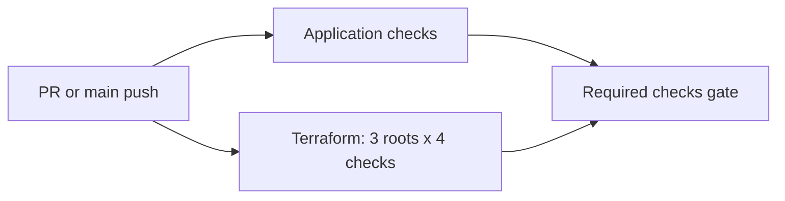
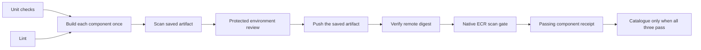

# CanopyOps

A local cloud/DevOps learning project using persisted synthetic monitoring readings. No physical sensors, uploads, production users or production availability claims. The current code still defines four woodland stations; greenhouse naming is a recorded application gap.

## Cost?availability decision: portfolio demo (27 November 2026)

**Decision:** defer further paid AWS deployment and retain the verified local
application as the working baseline. The full cloud design was implemented in
Terraform, but completing its paid rehearsal was not justified for the current
portfolio budget and scope. This is a documented cost?availability trade-off,
not a completed AWS deployment or demonstrated cost saving.

The 24 November apply reached AWS and partially created resources before AWS
returned `FreeTierRestrictionError` for RDS creation and an ALB attribute change.
That was an account-plan feature restriction, not a repository policy, a budget
limit being reached, or proof that the architecture could not work. The exact
rejected ALB attribute was not established. End-to-end cloud operation cannot be
claimed without a successful deployment and runtime verification.

| Evidence level | What this project demonstrates |
| --- | --- |
| Verified in the recorded exercises | Local application/container behaviour, persisted-reading migration rehearsals, CI checks, GitHub OIDC image publishing/ECR scans, and the earlier network-only deploy/destroy workflow rehearsal. Refer to the dated evidence below for each result. |
| Implemented and checked in source | Modular Terraform, scoped IAM, private networking/endpoints, HTTPS routing, PostgreSQL/Redis/SQS integration design and protected plan/deploy/destroy controls. Static/mock checks do not prove live authorization or service behaviour. |
| Still unverified | Complete ECS application operation, local-to-RDS cutover, full live rollback activation, RDS Multi-AZ failover and measured zero-downtime releases. |

### Alternatives and availability limits

A future lower-cost baseline would use private **Single-AZ RDS PostgreSQL**, while
retaining the two-AZ VPC/subnet layout and ALB. This alternative is proposed, not
implemented or measured. An ALB requires subnets in at least two AZs, and the RDS
subnet group spans at least two AZs even for a Single-AZ database. Encryption,
TLS, backups, least-privilege access and durable reading preservation would remain
requirements. Single-AZ RDS has no cross-AZ standby failover, so it would not
support a database high-availability claim. Multi-AZ could be enabled later for a
separately budgeted, time-boxed failover exercise with recorded outcomes.

The existing London model, priced on 20 November, estimates approximately
**$0.21/hour with tasks stopped and Redis deferred**, or $0.43 over two hours,
before tax, variable usage and retained-resource charges. Running three services
and Redis increases the model to approximately $0.32/hour. Continuous operation
is materially more expensive than a short rehearsal. The main baseline drivers
are private interface endpoints, ALB/WAF and RDS; changing only RDS to Single-AZ
would make a modest difference to a two-hour run. No cheaper cloud deployment was
measured, so no savings percentage or actual optimisation result is claimed.

The last account-wide usage check on 24 November was approximately **$2 before
credits**, with a net total near zero. This is neither the final CanopyOps cost nor
proof of zero usage. Credits offset eligible charges; they do not remove resource
cost or justify leaving unused infrastructure running.

**Cleanup remains unconfirmed.** Earlier successful network teardown does not
prove cleanup after the later partial application applies. The 24 November
23:00 UTC rehearsal deadline has passed; there is no evidence here that it was
met. Inventory remaining resources, complete reviewed cleanup while preserving
readings/recovery data, and reconcile actual billing before calling the rehearsal
closed. Retained state, ECR, DNS, keys, secrets and backups need their own ongoing
cost/retention review. This documentation change does not destroy resources or
change Terraform inputs.

References: [AWS account plans](https://docs.aws.amazon.com/awsaccountbilling/latest/aboutv2/free-tier-plans.html),
[ALB subnet requirements](https://docs.aws.amazon.com/elasticloadbalancing/latest/application/application-load-balancers.html),
[RDS VPC requirements](https://docs.aws.amazon.com/AmazonRDS/latest/UserGuide/USER_VPC.WorkingWithRDSInstanceinaVPC.html).

## Current implemented system

- FastAPI dashboard/API: `python -m canopy.api`, laptop http://127.0.0.1:8001.
- PostgreSQL is now the active local database on this checkout. All existing SQLite readings were migrated; they were not regenerated.
- SQLite remains supported with `BACKEND=local` and `DATABASE_PATH`. `BACKEND=postgres` uses the PostgreSQL adapter.
- A separate `docker/cloud-api/Dockerfile` builds a PostgreSQL-only API serving image. The root Dockerfile retains SQLite and migration/recovery tooling for local use; the running local stack is unchanged.
- The local generator writes directly to the configured store. Prometheus scrapes private API metrics and Grafana presents a loopback-only, read-only viewer at http://127.0.0.1:3000.
- A separate PostgreSQL/SQS ingestion image now includes hash-locked Boto3 and a verified local queue adapter. The API image remains free of Boto3. Local emulator evidence is documented below; end-to-end AWS ingestion remains unverified, and partial cloud resources require inventory.
- GitHub OIDC image publishing, native ECR scan gating and separate Terraform plan, approved deploy and manual destroy workflows are implemented and verified below. AWS retains protected state storage, scoped CI roles and three encrypted immutable ECR repositories. An earlier network-only deploy/destroy rehearsal passed. Later application applies were partial; current cleanup is unconfirmed and no complete ECS/RDS application operation is claimed. RDS PostgreSQL replaces the earlier DynamoDB plan; Multi-AZ failover remains untested.

## Repository layout

Application packages and dependency inputs/locks now live under `app/`. Python module names and container startup commands remain unchanged; `app/` is a source directory, not an additional import prefix.

```text
app/
  canopy/                 # API, domain, storage, static assets and migrations
  ingestion/              # Queue worker and finite producer
  analytics/              # Historical analytics and optional cache
  requirements*.in        # Dependency inputs and shared constraints
  requirements*.txt       # Hash-locked runtime/development dependencies
docker/
  compose/                # postgres, analytics, cache, queue and alerts overlays
  ingestion/Dockerfile
  analytics/Dockerfile
  cloud-api/Dockerfile     # PostgreSQL-only API serving image
  cloud-api/storage.py     # Cloud-only storage selector; shared PostgreSQL implementation
Dockerfile                # Local API and SQLite migration/recovery image
compose.yaml              # Root orchestration entry point
postgres/                 # Database role bootstrap
monitoring/               # Prometheus, Grafana and local alert routing
scripts/                  # Operator commands and verification tools
tests/                    # Application/guard regression tests
security/                 # Explicit risk controls and review proposals
infra/                    # Demo backend, rehearsed network module and future scaffolds
  bootstrap/              # Applied state protections and scoped operator/OIDC roles
  registry/               # Applied encrypted immutable ECR repositories and retention
```

Build contexts remain the repository root, with an explicit `.dockerignore` allowlist. Dockerfiles copy selected `app/` sources into the same in-container package paths, so the API still starts with `python -m canopy.api`. Compose commands and ports are unchanged. Database files/volumes, external password files, `.env`, virtual environments and retained backup evidence were not moved into the source tree. Terraform bootstrap source is under infra/bootstrap. The parent infra configuration calls a network module whose creation and teardown were exercised in AWS using the demo role. That earlier network-only teardown is recorded below; later partial application applies require a fresh resource inventory. ECR has a separate registry root, and the supporting application modules are implemented and checked in source. A complete working AWS application has not been verified.

## PostgreSQL-only API image and resource comparison

`docker/cloud-api/Dockerfile` is a separate serving recipe, not a replacement for the local recovery image. Both use the same digest-pinned Python 3.12 base, hash-locked `app/requirements.txt`, shared API/PostgreSQL/domain code, static assets and health-check schedule. The cloud recipe copies a small PostgreSQL-only storage selector over the local selector, avoiding an upfront SQLite import without changing the existing local application's approved risk scope. It rejects other backends. SQLite's Python package, extension and native library are removed from the cloud runtime; transfer/audit/migration utilities are excluded. The original root image remains available for SQLite export, backup and recovery. This is packaging separation, not a change to existing persisted records or migration evidence.

Dependencies are installed before source in a builder virtual environment, then copied to the compatible runtime stage. Locked binary wheels mean no compiler is needed; multi-stage separation controls what is copied, rather than implying large savings from removing nonexistent build tools. UID/GID 10001 runs `python -m canopy.api`. Application files remain root-owned and non-writable by that user. The API listens on port 8000; metrics listen on port 9100 without a host publication. The cloud API has no `/data` directory or local database volume. Verification runs with a read-only root filesystem, dropped capabilities and a 16 MiB `/tmp` tmpfs. PostgreSQL owns persistent data outside the API container. No secret is supplied through a build ARG, COPY or image ENV.

```bash
# WSL, repository root. These checks create their own disposable database:
python3 scripts/verify_cloud_runtime.py --smoke
# Or test the exact already-built artifact (also used by CI):
python3 scripts/verify_cloud_runtime.py --smoke --image canopyops-api:postgres
# Full comparison: three repetitions per image/allocation, strict scans and public prices:
python3 scripts/verify_cloud_runtime.py
# Build only; no existing database or running service is changed:
docker build -f docker/cloud-api/Dockerfile -t canopyops-api:postgres .
```

The verifier copies tracked application sources and explicit build inputs into a temporary context. It does not use Compose, actual `.tfvars`, host `.env`, secret files, AWS profiles or existing Docker credential configuration. Child commands receive a literal environment and empty temporary HOME/Docker config. Fixture PostgreSQL uses trust authentication only on a new internal Docker network, with no database host port; the API additionally joins a separate network for random loopback-only HTTP publication. This credential-free fixture is never a deployment configuration. Only labelled, uniquely named fixture resources are removed; original volumes are never mounted. Raw results/build logs/scans remain ignored under `backups/cloud-runtime-*/`.

The cloud smoke check covers imports without SQLite/Boto3/development tools, non-writable application files, Docker health, dashboard JS/CSS, both health endpoints, private metrics, duplicate suppression, late observations, incidents, identical measurements at different times, denied reader DELETE, readiness failure while liveness stays healthy, data preservation across API replacement and graceful shutdown. The full comparison additionally exercises the existing local tooling through PostgreSQL export -> SQLite backup -> import into a separate fresh PostgreSQL database, comparing complete manifests. This synthetic fixture round trip does not repeat or replace the original real-data migration, its 28.14-second timing bound, or its separate rollback evidence.

CI source now wires cloud Dockerfile lint/build, Python checks, the disposable PostgreSQL smoke test and a separate strict HIGH/CRITICAL scan into the existing `checks` job. The cloud image receives no SQLite exception. The unchanged local image still has the three explicitly accepted, local-only SQLite advisories until 23 November 2026 00:00 UTC; raw scanner success does not override that gate. Python 3.12 is the supported container version; no unsupported-version matrix is introduced.

The local workload offers 10 HTTP requests/second for 15 seconds, with four client threads and at most eight outstanding requests. Its mix is 60% overview, 20% history and 10% each readiness/liveness. A separate fixture actor commits two readings/second directly through the transactional PostgreSQL store. Each trial starts from 40 events/four states, verifies all 30 additional readings and the latest state, and samples API CPU/memory every 0.5 seconds. Three shuffled repetitions compare both images at 0.5 vCPU/1024 MiB and 0.25 vCPU/512 MiB. Predeclared local acceptance requires no failed/dropped requests, p95 <= 500 ms, sampled memory <= 75% and CPU p95 <= 80% of allocation. A completed comparison can contain rejected allocations; `local_acceptance_passed` and the capacity decision must be checked separately from script completion.

These short shared-host Docker trials are screening evidence, not a production capacity forecast. They use small synthetic tables, not the existing full dataset, and do not exercise SQS, the worker, analytics, Redis, TLS or ECS. Startup measures Docker create/start through HTTP health with the image already local, not an ECS image-pull or release duration. Instruction-cold builds use `--no-cache` but can reuse base/download caches. Docker image size and gzip-compressed Docker exports are recorded separately; gzip exports are not ECR compressed-size measurements. Deleting inherited files does not remove their bytes from lower image layers ([Docker layers](https://docs.docker.com/get-started/docker-concepts/building-images/understanding-image-layers/)).

Before deployment, repeat the chosen workload on ECS with the migrated database and real worker path, then measure request errors/latency, durable processing, reading freshness and queue recovery during both a healthy release and an intentionally failed release. Rolling overlap, ALB health/routing, draining, SIGTERM and tested rollback determine release availability; image size cannot establish zero downtime. Compare any smaller allocation against both image variants before attributing savings. Fargate charges for allocated CPU/memory and time starting with image download ([AWS pricing](https://aws.amazon.com/fargate/pricing/)). Actual AWS spend and ECS availability remain unmeasured.

Keep Fargate as the initial deployment choice. A cheaper EC2 option is a later comparison of total host capacity, all three services, idle time, patching and operational work; no EC2 saving is claimed or EC2 infrastructure added here. Before provisioning paid services, estimate the complete London stack, including endpoints, ALB/WAF, Redis and RDS, against the $20–30 rehearsal budget. Limit paid sessions and tear down application infrastructure afterward. Secure RDS connectivity still requires private networking, verified TLS/CA trust, scoped runtime roles and runtime secrets; this fixture does not verify those controls. At this packaging checkpoint, ECR publishing and Terraform workflows were subsequent stages; their later verified results appear below. ECS deployment and Terraform ownership of its image digests remain future work.

Existing application gaps remain visible: four woodland station IDs, no event sequence/restart strategy, and the direct `PostgresStore` duplicate path does not compare conflicting payloads for an existing ID. The separately implemented queue repository's conflict handling is not evidence that every direct-write path does so. No domain/schema behavior is changed in this packaging stage.

Packaging-stage roadmap (retained as historical context): publishing and network-only Terraform workflows below are now verified; the ECS/RDS/HTTPS and release-recovery work remains future scope.

1. Terraform format/validation, lint and security checks are implemented in the credential-free matrix described below. Authenticated deployment plans remain separate; this matrix does not add supported Python versions.
2. Add encrypted, immutable ECR repositories and scoped GitHub OIDC roles. Review the Terraform plan and costs before applying. No static AWS keys or cloud SQLite waiver.
3. Application publishing workflow: parallel unit/lint checks, then parallel build/scan jobs for the cloud API, worker and analytics. Publish the exact scanned artifacts only after required checks pass, retaining immutable digests. Pull requests receive no publishing credentials.
4. Terraform infrastructure workflow: checks -> plan -> reviewed apply -> deployed-version/end-to-end checks. Terraform remains the owner of desired ECS image digests. Automatically request and DNS-validate ACM certificates before configuring HTTPS. Private RDS/Redis, endpoint networking and all paid services require a complete cost review first.
5. Separate manual Terraform destroy workflow with a protected environment, explicit demo confirmation and serialization against deployment. Keep bootstrap/state storage outside application teardown; use the existing native S3 lock.
6. Rehearse a successful rolling release and an unhealthy release with rollback while measuring HTTP traffic and durable processing. Compare the locally qualified Fargate allocation with an ECS baseline; record actual spend and teardown. Evaluate EC2 only if its total capacity and operational trade-offs justify changing the baseline. Do not label the deployment zero downtime before these measurements pass.

### Results from 18 November 2026

The controlled comparison passed build/cache, functional, recovery-tooling and strict scan checks in `backups/cloud-runtime-305481f159b64e19a6098900aeed3e08/`. Python was **3.12.16, x86_64**. Both raw Trivy scans reported zero HIGH/CRITICAL findings against the same advisory database snapshot; the known local SQLite exceptions were separately checked and remain unchanged. No cloud exception was used. All **1,800 offered HTTP requests** completed successfully, and all **360 newly submitted fixture readings** were durably verified. Every API trial shut down with exit0 and no OOM kill. The smaller allocations nevertheless failed the declared CPU-headroom threshold.

| Build observation | Existing local image | PostgreSQL-only cloud image |
| --- | ---: | ---: |
| Docker-reported `.Size`, bytes | 33,199,181 | 33,230,207 |
| Gzip Docker export, bytes; not registry size | 33,044,115 | 33,073,525 |
| Instruction-cold build, seconds | 16.690 | 16.368 |
| Cached build, seconds | 1.081 | 1.524 |
| Source-only rebuild, seconds | 1.146 | 2.036 |
| Dependency installation remained cached after source change | Yes | Yes |

The cloud image was **31,026 bytes larger**, not smaller. These are Docker's reported size values, not independently measured unpacked filesystems. The useful outcome is an unavailable SQLite runtime and a narrower serving package; no image-size saving, speed improvement or cloud-cost reduction is claimed.

| Image / allocation | Local acceptance | Ready time range, seconds | Worst trial p95 HTTP, ms | Maximum idle / load memory sample, MiB | CPU p95 range, % of allocation |
| --- | --- | ---: | ---: | ---: | ---: |
| Local, 0.5 vCPU / 1024 MiB | 3/3 passed | 3.77–4.07 | 23.28 | 48.84 / 55.41 | 16.61–19.97 |
| Cloud, 0.5 vCPU / 1024 MiB | 3/3 passed | 3.85–4.03 | 22.66 | 49.27 / 53.82 | 18.61–19.98 |
| Local, 0.25 vCPU / 512 MiB | 0/3 passed | 12.10–13.11 | 200.04 | 43.21 / 58.83 | 99.15–109.72 |
| Cloud, 0.25 vCPU / 512 MiB | 0/3 passed | 12.10–13.45 | 120.54 | 42.44 / 54.68 | 97.57–101.30 |

CPU is calculated from cgroup CPU-time deltas between samples, normalized to allocation; short quota windows can yield samples above100%. Memory numbers are sampled container usage, not a guarantee of the true lifetime peak. The justified next candidate is **0.5 vCPU / 1 GiB for an ECS rehearsal**, not an approved production size. The 0.25-vCPU result does not prove that allocation can never work; it did not meet this test's headroom criterion.

The public [AWS London price catalog](https://pricing.us-east-1.amazonaws.com/offers/v1.0/aws/AmazonECS/current/eu-west-2/index.json), retrieved at23:25UTC, gave Linux x86 on-demand rates of **$0.04656/vCPU-hour** and **$0.00511/GB-hour**. The candidate's API compute is therefore **$0.02839/hour**, approximately **$0.2271 for eight hours**. The rejected smaller allocation would be$0.014195/hour; that is not an accepted saving. These estimates exclude every other task/service, storage/networking, public IP and tax. No AWS task was deployed and no actual bill was measured.

Troubleshooting evidence is retained separately: an initial fixture import needed an explicit `/app` Python path, an internal-only Docker network could not publish the API port, and reusing a fixed source-change marker falsely reused an earlier cache probe. Unique markers now prove that the source layer rebuilds while dependencies stay cached. An exploratory comparison had unequal10/30-second health schedules, so its capacity results were discarded and all12 controlled trials above were repeated with identical30-second schedules. The public pricing parser was corrected to accept the catalog's `hours` unit and has a regression fixture. The current verifier labels Docker's size field without assuming it is an independently measured uncompressed size. These corrections do not change migration records or the original cutover evidence.

Final checks passed Python 3.12.16 syntax, Ruff lint/format, dependency consistency, Hadolint and **84 unit tests**; one existing Starlette/httpx deprecation warning remains. The exact scanned and benchmarked artifact is tagged `canopyops-api:postgres`, image ID `sha256:2e4857b52d45adcccc82586db0aa08add35372c906c59c3d368211cf6042edb3`. Final `--smoke --image canopyops-api:postgres` run `305727f58e6d4b86b9b02088be35b233` passed against that artifact, including source-identical dashboard assets, Docker health and metrics scraped from a separate private container. CI uses this prebuilt-image option to test the same artifact it subsequently scans. Existing localhost ports 8001 and 8002 still returned 200 for both health endpoints. Final artifact/HTTP results are retained in `backups/cloud-runtime-final-artifact-checks.json`.

The comparison report's ambiguous size-field name was corrected to describe Docker's reported `.Size` without changing any measurements. Its original is retained alongside the corrected report. No existing database, migration evidence or risk acceptance was changed.

The fixture now waits for PostgreSQL over loopback TCP: the image's temporary initialization server accepts Unix sockets before initialization finishes, so socket-only readiness could race role/schema creation. Exact-artifact smoke run `0b2b649a0f9b407493a8d8efdd3a09dc` passed after this test-only hardening. The initial [PR CI run](https://github.com/23faraaz/CanopyOps/actions/runs/44424868596) passed Python, configuration, container and strict scan checks; current-head checks and review are available in [PR #15](https://github.com/23faraaz/CanopyOps/pull/15).

## Python development

For Python-only development from the checkout root, use the existing virtual environment and the source path explicitly:

```bash
python -m pip install --require-hashes -r app/requirements.txt
BACKEND=local DATABASE_PATH="$PWD/data/sqlite/canopy.db" PYTHONPATH=app python -m canopy.api
# Development dependencies and tests:
python -m pip install --require-hashes -r app/requirements-dev.txt
python -m pytest
```

Keep the intended backend/database configuration explicit when running Python directly; do not substitute a fresh SQLite file for the active PostgreSQL dataset. Docker Compose remains the recommended route to the existing local database. Pytest uses `pythonpath = ["app"]`; CI syntax/lint checks target `app`, `scripts` and `tests`. Dependency regeneration can run from `app/` so relative constraints and filenames remain meaningful. Older dated evidence below retains its historical paths; current source paths include the `app/` prefix.

## Compose layout verification (17 November 2026)

The five optional overlays live in `docker/compose/`. Keep `compose.yaml` first in explicit `-f` commands: Docker resolves relative paths against the first file, so build contexts and mounts still resolve from the repository root ([Docker documentation](https://docs.docker.com/compose/how-tos/multiple-compose-files/merge/)). The ignored local `compose.override.yaml` stays at the root; ordinary `bash scripts/run.sh` commands still work.

```bash
docker compose -f compose.yaml \
  -f docker/compose/postgres.yaml \
  -f docker/compose/analytics.yaml \
  -f docker/compose/cache.yaml \
  --profile analytics ps
```

The base and all five overlay contents are unchanged. Seven effective configuration comparisons passed: SQLite, PostgreSQL, database tools, analytics/cache, ingestion, alerts and the combined profiles. Comparisons used an empty temporary environment input; no project `.env` or password files were inspected. Existing security fingerprints still match; the local-only SQLite acceptance and its expiry are unchanged.

Validation passed: 75 Python tests, syntax/Ruff checks, Dockerfile/workflow lint, Compose configuration, alert fixtures and image builds. A fresh isolated `python3 scripts/verify_analytics.py --cache` run verified calculations, expiry, fallback, database interruption and graceful shutdown; its resources were removed afterward. The live read-only `python3 scripts/verify_local_endpoints.py` check passed for dashboard assets, both APIs, health, metrics, Grafana and Redis. Four stations were fresh and persisted events advanced from 36,440 to 36,444. Original container IDs and volume bindings were unchanged.

Raw local evidence remains ignored under `backups/compose-layout-52562ddbfe7747e1acfcc1a414ee2d3b/`, `backups/analytics-c53fbe88843a4981a9041469464d3ff5/` and the endpoint verifier's timestamped directory. These checks establish local behaviour, not AWS deployment or availability.

## ECR and OIDC provisioning source: review before applying

The ECR module defines three private repositories, `canopyops-demo/api`, `canopyops-demo/worker` and `canopyops-demo/analytics`, using provider ownership tags plus per-service Name/Service tags. Each explicitly uses AES256 encryption, immutable tags without exclusions, scan-on-push and `force_delete=false`. No repository was created by the agent. Encryption is a creation-time decision: changing to KMS later requires a replacement/migration review, not a silent setting toggle. [AWS encryption guidance](https://docs.aws.amazon.com/AmazonECR/latest/userguide/encryption-at-rest.html)

`infra/registry/` calls the module independently of `infra/` so creating a registry does not also recreate the torn-down VPC. Its planned state key is `canopyops/registry/terraform.tfstate`, with native S3 locking. Its workspace-list prefix stays under `canopyops/registry/`; only the default workspace's exact state/lock objects receive read/write permissions. This is a third lifecycle root for the same London demo, not a staging/production expansion. Existing bootstrap/demo keys are unchanged. The new provider lock is a copy of the public AWS 6.73.0 lock, not a copy of any state.

Lifecycle rules expire untagged remnants after one day and retain 20 images per repository by count. Processing is asynchronous (up to 24 hours), so this is not a hard storage or spending cap. The count rule can expire a digest still used by ECS: **before deploying ECS, replace/review retention to protect active and rollback digests and test the policy preview**. This publishing-only baseline has no cloud tasks relying on images. Nonempty repository deletion is refused by Terraform; that setting is not an IAM prohibition on an administrator forcing deletion. [AWS lifecycle evaluation](https://docs.aws.amazon.com/AmazonECR/latest/userguide/LifecyclePolicies.html)

Bootstrap source adds a registry state policy and a separate managed ECR-management policy attached to the existing Terraform demo role. The managed policy avoids exceeding the role's combined inline-policy quota, which remains tested. Creation is limited to the three exact ARNs, London and required ownership tags; repository management/preview is limited to those owned repositories. State DeleteObject is allowed only for the registry lock, not state. The image-publishing role receives none of these Terraform, state or deletion permissions.

GitHub federation remains **disabled by default** through `enable_github_publishing=false`. When deliberately enabled, bootstrap can either reuse an inventoried GitHub provider ARN or create the account-wide provider. Inventory must happen first; do not blindly create a duplicate. No obsolete certificate thumbprint is hardcoded: the pinned provider supports AWS's trusted-CA handling for GitHub. Trust matches audience `sts.amazonaws.com` and exact subject `repo:23faraaz/CanopyOps:environment:ecr-publish`. Because an environment subject does not carry the branch in that field, branch restrictions are enforced by GitHub's environment deployment policy, not an invented AWS claim condition. [GitHub OIDC guidance](https://docs.github.com/en/actions/how-tos/secure-your-work/security-harden-deployments/oidc-in-aws)

The protected GitHub `ecr-publish` environment is configured for the **main branch only**, with owner review required and no tag rule. Self-review is allowed for this single-operator demonstration; it is not independent approval/separation of duties. No secret/variable values were inspected. No publishing job has been approved or run against AWS. The intended publisher can obtain ECR login tokens (the required wildcard resource) and push/read back images only in the three repositories. It cannot change repository policy/encryption/mutability, delete images, read Terraform state or deploy ECS. The workflow will further restrict each temporary session to its one component. [AWS push permissions](https://docs.aws.amazon.com/AmazonECR/latest/userguide/image-push-iam.html)

Mock tests cover repository names, explicit encryption, immutable tags, scan-on-push, refusal of forced Terraform deletion, retention defaults/invalid values, provider reuse/creation, disabled federation, exact trust, publisher action/ARN boundaries and policy-size limits. These are source contracts, not proof that AWS STS or ECR has enforced them. Before live use, inspect existing OIDC/ECR/scanning configuration, review actual bootstrap/registry plans and costs, apply only approved changes, then verify real authorization and tag immutability. The agent has not used AWS credentials, initialized these real backends, read actual input/state files, or applied resources.

**Cost proposal, 19 November 2026:** the public [London ECR price catalog](https://pricing.us-east-1.amazonaws.com/offers/v1.0/aws/AmazonECR/current/eu-west-2/index.json) lists standard private image storage at **$0.10/GB-month**. Assuming 0.2 GB per image, three repositories and 20 retained images each gives 12 GB, approximately **$1.20/month or $0.28 for seven days**. Image size is an explicit conservative assumption, not measured ECR usage, a maximum bill or a saving. This excludes transfer, enhanced scanning, tax, S3 state operations and GitHub artifact charges/quotas. Do not assume free-tier credits. Basic scan-on-push is configured; inspect the account's registry-level settings before relying on basic-scanning costs. The full ECS/RDS/Redis/ALB/endpoints stack still needs its own estimate against the $20–30 budget. Registry storage persists after application teardown until deliberately cleaned up.

The offline ECR scan has no unwaived HIGH/CRITICAL findings; its three LOW AWS-0033 recommendations for KMS remain visible because AES256 was explicitly selected. No new security ignore was added. The existing state-bucket KMS exception and local-only SQLite deadline are unchanged. Raw review metadata and price data remain ignored under `backups/ecr-publishing-discovery/`. This extends the earlier two-root CI baseline below; its recorded historical results remain intact.

## Terraform checks without AWS credentials (19 November 2026)

The CI workflow now runs **twelve independent Terraform jobs**: formatting, validation, TFLint and security for each of `infra/`, `infra/bootstrap/` and `infra/registry/`. They run alongside the existing application job, with `fail-fast: false` so one failure does not hide the other results. The existing branch-protection context **`checks`** is now an always-running aggregate that succeeds only if the application job and the complete Terraform matrix succeed. No additional branch-protection bypass or AWS identity was added. The workflow still has only `contents: read`, with no OIDC token permission, AWS secrets or deployment commands.



`scripts/terraform_checks.py` provides the same commands locally in WSL/Linux with Docker. It copies only tracked Terraform source, public examples and provider locks into a temporary directory. Demo checks exclude the separate bootstrap root; bootstrap checks include only bootstrap sources. Actual `.tfvars`, state, plans, local `.terraform` contents, `.env`, credential directories and source symlinks are excluded. Public examples are not automatically loaded as real inputs. Empty temporary HOME/Docker configurations and literal child environments prevent use of existing AWS profiles or Docker logins. The unrelated Grafana edit is outside the copy scope.

```bash
# WSL, repository root; these do not initialize the working checkout:
python3 scripts/terraform_checks.py --root infra
python3 scripts/terraform_checks.py --root infra/bootstrap

# The individual checks used by the CI matrix:
python3 scripts/terraform_checks.py --root infra --only format
python3 scripts/terraform_checks.py --root infra --only validate
python3 scripts/terraform_checks.py --root infra --only lint
python3 scripts/terraform_checks.py --root infra --only security
```

Validation initializes **only the temporary source copy**, using `terraform init -backend=false -input=false -lockfile=readonly`. This downloads the provider selected by the committed lock without configuring S3 or upgrading dependencies. Subsequent validation and mocked tests run in containers with networking disabled and AWS metadata/config/credential discovery disabled or directed to empty inputs. Bootstrap also runs the existing mocked-provider IAM-policy test, including its ten boundary assertions. No real plan, refresh, state migration, apply or destroy is performed. Static validation is not evidence of live IAM authorization, quota availability or absence of infrastructure drift. [HashiCorp validation guidance](https://developer.hashicorp.com/terraform/cli/commands/validate)

Tools use digest-pinned images: Terraform **1.17.2**, TFLint **0.66.0** and Trivy **0.76.2**. Both roots retain the AWS provider **6.73.0** selected by their existing locks. `infra/.tflint.hcl` enables the bundled recommended Terraform rules and AWS ruleset **0.50.0**; plugin initialization downloads the pinned public release, then lint runs without networking. Lint covers each root and non-empty child modules, currently only `network`; empty scaffolds are not presented as implemented infrastructure. The network module now explicitly declares its Terraform/provider compatibility contract. It does not configure another provider instance or change resources.

The Trivy gate uses `--exit-code 1 --severity HIGH,CRITICAL`. Its checks are the pinned tool's bundled policies (`--skip-check-update`), run offline on the isolated source copy. A separate LOW/MEDIUM scan reports advisory findings without blocking that declared severity gate. Its exit1 is recorded as findings rather than falsely described as a clean scan. Scanner errors or malformed reports fail the check. Updating pinned tools/policies remains an explicit maintenance action; this is not a continuously refreshed or exhaustive cloud audit.

| Finding | Decision and remaining limitation |
| --- | --- |
| **AVD-AWS-0132, HIGH:** customer-managed KMS key recommended for state encryption | One resource-specific inline exception on `aws_s3_bucket_server_side_encryption_configuration.terraform_state`, expiring **19 December 2026**. The selected single-demo baseline remains AES256/SSE-S3 with IAM restrictions, HTTPS-only access, public-access blocking and versioning. This is encrypted storage, but lacks a separate customer-managed key-policy control. It is not a production approval; reassess before extending scope. No new KMS resources, key policy or AWS permissions are introduced merely to silence a scanner. |
| **AVD-AWS-0178, MEDIUM:** VPC flow logs missing | Remains visible and unsuppressed. Review reject-flow logging, permissions, retention and cost before deploying application infrastructure; the rehearsed VPC is currently torn down. |
| **AVD-AWS-0089, LOW:** state bucket access logs missing | Remains visible and unsuppressed. Review an audit/log destination, access controls, retention and cost before extending the deployment. Existing bucket protections do not substitute for access auditing. |

SSE-S3 and SSE-KMS are distinct encryption/key-control choices, not encryption versus plaintext. Terraform state can contain sensitive data; keep it private and do not commit or upload it as CI evidence. [AWS encryption options](https://docs.aws.amazon.com/AmazonS3/latest/userguide/UsingEncryption.html)

The exception uses Trivy's native resource-scoped expiring comment, not a global ignore or disabled check. Each bootstrap security job also performs three static negative controls in its temporary copy: remove the exception, expire it, and add a different SSE-S3 encryption resource. All three must produce exit1 and the expected customer-key finding on the unexempted resource. This proves the exception expires and cannot silently exempt a second resource. The canary resource is never planned or deployed. [Trivy inline exceptions](https://trivy.dev/docs/latest/scanner/misconfiguration/config/config/)

Local verification passed both roots' format/init/validate/lint/security gates, the existing mock-policy run and all three exception controls. Source-only Python checks passed **104 tests**, syntax/Ruff and workflow actionlint; one existing Starlette/httpx deprecation warning remains. Tests also check rejection of private input/state paths, root isolation and symlink refusal before copying. Safe raw results remain ignored under `backups/terraform-checks-8a80f9e13c174607b54780f25e131842/` (demo), `backups/terraform-checks-f786f0f5b0e5441cb2fb835c1d6c8b33/` (bootstrap) and `backups/terraform-python-checks.log`. Passing gates include the documented exception and remaining advisories; they do not mean zero security issues.

No AWS resources, live state, application readings, container configuration or SQLite exception changed in this stage. ECR/OIDC publishing, authenticated Terraform plan/deploy and a separate manual destroy workflow remain next. Before those apply operations, review actual permission requirements, private connectivity, certificate validation and the complete London cost estimate.

## Terraform authentication and remote-state baseline (18 November 2026)

One demo environment in `eu-west-2`. Terraform CLI is constrained to `~> 1.17.2`; both root configurations lock AWS provider 6.73.0. AWS CLI 2.50.4 was reported working in WSL. This stage creates no application infrastructure and changes no readings, database volumes, application code or image-risk acceptance.

### Local authentication and permission boundaries

| Local profile | Purpose |
| --- | --- |
| `23faraaz` | Browser-based `aws login` session; temporary credentials |
| `canopy-terraform` | `credential_process` bridge to that login; bootstrap administrator |
| `canopy-demo` | Assumes `canopyops-demo-terraform-role` through the bridge |

Profile configuration and login caches live outside Terraform source. No keys, tokens or actual operator ARN are committed. Renew an expired browser session using `/usr/local/bin/aws login --profile 23faraaz`. Do not invoke `export-credentials` interactively or paste its output: the bridge consumes it internally. GitHub OIDC is a later, separate automation identity; IAM Identity Center/Organizations was not enabled for this work.

The owner reports MFA enabled for the IAM user on 18 November. The current role trust policy does **not** enforce an MFA condition; browser MFA does not automatically restrict pre-existing access keys. Original access-key retirement has not been verified. The source administrator identity retains broad permissions and can bypass the demo role's restrictions; temporary credentials do not reduce those permissions.

Bootstrap manages the role and policy, so the demo role cannot edit its own permissions. Its trust policy names the operator supplied privately through `terraform_operator_arn`. Its inline policy permits prefix-scoped bucket listing, GetObject/PutObject on the exact demo state key, and GetObject/PutObject/DeleteObject on its exact `.tflock`. It grants no DeleteObject on state, no bootstrap-prefix access and no infrastructure provisioning permissions. This is one demo role with a separate state policy; add scoped deployment policies incrementally rather than creating an unnecessary backend-only role.

### Separate state roots

Both use bucket `canopyops-demo-tfstate-23faraaz`, SSE-S3 (`AES256`), and `use_lockfile = true`:

| Root | State key | Local execution profile |
| --- | --- | --- |
| `infra/bootstrap/` | `canopyops/bootstrap/terraform.tfstate` | `canopy-terraform` |
| `infra/` | `canopyops/demo/terraform.tfstate` | `canopy-demo` |

The parent configuration does not inherit bootstrap variables or provider configuration. At this bootstrap-only checkpoint, root main/provider/variable/output files and future modules were empty; the network stage below records their later implementation. Backend authentication is separate from AWS provider authentication; command-scoped `AWS_PROFILE` currently selects the intended identity for both. Backend settings contain no credentials.

### Commands, results and limits

The following evidence was reported during the interactive WSL walkthrough, not collected by CI or rerun against AWS for this commit:

- Browser login, process bridge and role assumption succeeded. Bootstrap plans using the bridge and a demo plan using the restricted role reported no changes.
- The demo role listed `canopyops/demo/` successfully (initially empty); listing `canopyops/bootstrap/` returned AccessDenied. This verifies listing restrictions only, not all negative object-permission cases.
- Before migration, local state was copied into a timestamped `$HOME/canopyops-state-backups/` directory outside Git (directory mode 0700, backup mode 0600) and compared successfully with `cmp`. This backup uses filesystem permissions, not encryption. A resource-address inventory contained seven resources: five S3 resources, one role and one inline policy.
- The destination bootstrap prefix was empty. After writing its backend, `AWS_PROFILE=canopy-terraform terraform init -migrate-state` migrated the existing state. The subsequent plan reported no changes. The walkthrough prescribed an inventory comparison, but its no-diff output was not independently supplied; repeat that comparison before claiming complete content equivalence.
- `head-object` on bootstrap state confirmed nonzero size, AES256 and a version ID. Only metadata was requested; state contents were not printed.
- The console-based lock probe was inconclusive. A later plan received S3 HTTP 412 and reported an existing plan lock. No jobs or Terraform processes were found in the tested WSL distribution; after the operator checked for other owners, force-unlock cleared the stale lock. A subsequent no-change plan succeeded and `head-object` on the lock returned 404 afterward. Lock rejection, stale-lock recovery and absence of a lock after a completed plan were observed. A controlled two-process contention test with the original holder releasing normally remains unverified; do not repeat suspension on the real bootstrap state to finish documentation.
- The demo root initialised using `canopy-demo`, validated and produced a no-change plan. The root is empty; this is not evidence of deployed services or complete deployment permissions.

Repeat safe checks from the checkout root:

```bash
terraform fmt -check -recursive infra
terraform -chdir=infra/bootstrap validate
terraform -chdir=infra validate
AWS_PROFILE=canopy-terraform terraform -chdir=infra/bootstrap plan -lock-timeout=5s
AWS_PROFILE=canopy-demo terraform -chdir=infra plan -lock-timeout=5s
```

Run plans deliberately in the intended account; no apply is needed to record this stage. Preserve local backups and remote version history. Do not commit state, `.terraform/`, saved plans, actual `.tfvars`, AWS configuration or login caches. Commit both provider lock files and only non-secret example inputs. Bootstrap and demo `terraform validate` both passed locally for this commit. Existing PR checks cover the application/container milestone; Terraform format/validation are local checks for this stage, not a claimed Terraform CI pipeline.

`prevent_destroy` is a Terraform planning safeguard while the resource remains configured. It does not prevent direct AWS deletion, and removing the resource from configuration removes that safeguard. Ordinary application teardown must leave the bootstrap bucket and its state intact. S3 bucket management, object access and lock deletion permissions are distinct. See [HashiCorp backend permissions](https://developer.hashicorp.com/terraform/language/backend/s3#permissions-required) and [AWS browser-login guidance](https://docs.aws.amazon.com/cli/latest/userguide/cli-configure-sign-in.html).

The subsequent network lifecycle stage is recorded below. ECS, ECR, ALB/WAF/ACM, RDS, Redis, SQS and GitHub OIDC deployment are not provisioned. Estimate the complete short rehearsal against the $20-30 budget before applying paid infrastructure; no current estimate or savings claim is supplied here.

### Network-permission draft: local verification (18 November 2026)

`infra/bootstrap/network_permissions.tf` now describes lifecycle access for the current 18-resource network plan only: VPC/DNS, six subnets, internet gateway, tier route tables, public default route and subnet associations. The existing demo-state policy is unchanged. Four resource-type entries generate explicit creation, creation-tagging, existing-resource and name-update statements; shared conditions avoid duplicated ownership rules. Region/account ARNs and ownership tags constrain writes. Subnet and route-table creation require a valid Tier tag. Individual route writes require the public tier. Existing-resource tag updates permit only Name, so the demo role cannot relabel ownership or Tier using this policy. Terraform changes to those protected tags require a deliberate bootstrap-administrator review.

This is tag-based scope, not an exact list of future resource IDs. Multiple resources with matching ownership tags qualify. Read-only discovery remains region-wide. Association operations can change relationships among owned resources, so IAM alone does not establish the intended private-subnet routing; review plans and inspect actual associations after deployment. No NAT, instances, endpoints, security groups, ECR, ECS, RDS, IAM management or S3 access is added by this network policy.

Local `terraform validate` and formatting passed. A provider-mocked, plan-only test ran in a temporary source-only clone with fictional inputs, no backend, no local variable files and no real state. Nine boundary assertions passed; the fixture rendered 18 IAM statements (7,620 characters), or 8,201 characters combined with its state policy, below the 10,240-character role inline-policy quota. All action/resource/condition combinations were checked against the public AWS EC2 service-authorization reference. A local evaluator passed 115 representative allow/deny cases (wrong account/region/ownership, creation tags, ownership-tag mutation, multi-resource operations, public-only route writes and unrelated service actions). That evaluator is not AWS IAM simulation and does not establish live authorization or account-level policy effects. Safe raw results remain ignored at `backups/network-policy-322a8a86924e405991addc6a55b310cb/`.

Repeat the mocked regression test without creating resources:

```bash
terraform -chdir=infra/bootstrap fmt -check
terraform -chdir=infra/bootstrap validate
terraform -chdir=infra/bootstrap test -filter=tests/network_permissions.tftest.hcl
```

The tests use a mocked AWS provider and explicit fictional values. The owner subsequently applied the role-tag and network-policy updates and created all 18 network resources using the demo role. Pasted AWS inspection results showed the expected subnet CIDRs/AZs/tags and public-only internet default route. VPC creation dry runs accepted the expected tags and rejected a wrong environment and missing ManagedBy tag. The reviewed destroy plan contained only the 18 network resources. Its execution removed the gateway, route, route tables and associations, then failed before deleting six subnets because the provider requires ec2:DescribeNetworkInterfaces during its ENI dependency check. At that point teardown was incomplete, with six subnets and the VPC expected to remain. The completed recovery and final teardown are recorded below.

The source repair adds only ec2:DescribeNetworkInterfaces to the existing region-limited discovery statement, with no ENI deletion/detachment grants. An added regression assertion checks that distinction. Formatting, isolated source-only validation and all 10 mock boundary assertions passed with a fixed non-secret child environment and temporary empty HOME; no real local inputs, state, credential files, login caches or inherited environment values were inspected. Safe results are ignored at backups/network-eni-read-fix-b3d8c2c3549f45fdb5569e9915d031aa/. The agent did not apply the repair or inspect credentials; the owner ran the authenticated operations. A later bootstrap no-change plan and successful final subnet deletion confirmed the repaired configuration was effective. The owner requires explicit permission before agent tools access credentials. Preserve state after partial failures and regenerate destroy plans; old saved plans can be stale, and normal network applies recreate deleted resources. Do not use administrator credentials to bypass demo-role teardown failures. Paid-service estimation remains a separate prerequisite for later services.

### Network lifecycle: completed AWS rehearsal

The owner supplied terminal evidence for creation, inspection and teardown using `canopy-demo` temporary assumed-role credentials. The root configuration implements a VPC, six subnets, internet gateway, three tier route tables, public default route and six associations: **18 Terraform-managed resources**. Root inputs feed the network module; a tier map and nested for expressions generate stable subnet keys, `for_each` creates subnets/tables/associations, and module outputs expose IDs as maps. Common Project/Environment/ManagedBy provider tags are consistent across demo and bootstrap; Name and Tier remain resource-specific. `infra/terraform.tfvars.example` contains non-secret example values; actual inputs remain ignored.

Observed evidence:

- The reviewed network plan and apply reported 18 additions, no changes or deletions. AWS inspection showed six non-overlapping /24 subnet ranges within 10.42.0.0/16 across eu-west-2a/eu-west-2b; automatic public IP assignment was false on all six and the intended tags were present.
- Each public/app/data table had its two intended subnet associations. Only the public table had an active 0.0.0.0/0 route to the internet gateway. App/data and the untagged AWS-created main table had local routing only. The later destroy-plan refresh showed both VPC DNS support and hostnames true. These observations establish network configuration, not application reachability or availability.
- VPC-creation dry runs returned DryRunOperation for correct ownership tags and UnauthorizedOperation for a wrong environment and missing ManagedBy. These are specific positive/negative checks, not proof of all IAM boundaries.
- Initial teardown removed 11 resources before the provider's ENI discovery call failed. A later AWS inspection showed replacement route-table IDs: removed components had been recreated while the original VPC/subnets remained. A normal creation plan saved under a repair filename and a concatenated shell command caused troubleshooting confusion; a later repair-plan apply was rejected as stale. We do not have a complete command history proving precisely when recreation occurred. Explicit `terraform -chdir=...` paths and fresh scoped plans were used to separate bootstrap IAM work from network teardown.
- After the region-scoped DescribeNetworkInterfaces repair was effective, a fresh reviewed destroy plan and apply reported **0 added, 0 changed, 18 destroyed**. The supplied log showed every subnet and the VPC deleted, no addresses printed between `terraform state list` and the next command, AWS InvalidVpcID.NotFound for the original VPC, and a subsequent bootstrap plan reporting **No changes**. Bootstrap state/bucket/IAM resources were outside the network destroy plan.

The final plan/apply/verification attachment was reviewed for Terraform result lines only; credentials, login caches, real variable files, environment values and raw state were not inspected by the agent. Raw attachment paths are local evidence rather than committed logs. Final source checks for this commit passed in temporary clones with no real backends or local inputs, empty HOME directories and fixed non-secret child environments: bootstrap and demo formatting/validation, plus all 10 mock policy assertions. Safe local results are ignored under backups/network-stage-final-a41dced3c950406da162d42e716fe428/. The network has not been recreated after this successful teardown. A normal root plan should propose the network again; that is expected while its configuration remains. No create/destroy pipeline exists yet.

The network-only resource list contained no NAT gateway, interface endpoints, public IP allocations, compute, load balancer or database. VPC/subnet/routing resources and the internet gateway add no hourly network-service component; state S3 storage, versions and requests remain metered. No account-wide zero-cost, measured savings or actual-spend claim is made. See [VPC pricing FAQ](https://aws.amazon.com/vpc/faqs/) and [internet gateway guidance](https://docs.aws.amazon.com/vpc/latest/userguide/VPC_Internet_Gateway.html). Price later paid services against the $20-30 rehearsal budget before applying them.

Next verified stages: add Terraform formatting/validation/lint/security automation; then ECR/OIDC image publishing and reviewed plan/deploy/manual-destroy workflows against the small stack. Later ingress must include Terraform-requested ACM certificates, managed DNS validation, HTTPS and WAF. Keep application publishing, Terraform release ownership and bootstrap teardown protection separate. RDS migration must preserve existing PostgreSQL records. Controlled lock contention, comprehensive IAM negative tests, paid-service estimates, application migration, availability/recovery measurements and cloud Multi-AZ exercises remain outstanding.

## Supported Python runtime

CanopyOps supports **Python 3.12 only**, currently verified as **3.12.16** in the digest-pinned Dockerfile image. Other minor versions are not promised or tested; there is no Python-version matrix. Host Python launches the check controller and is not evidence of application compatibility. `scripts/verify_docker.py` reads the pinned image reference directly from the Dockerfile; CI installs the hash-locked dependencies and runs syntax, Ruff, `pip check` and pytest in that exact image. Container verification compares the built runtime's full Python version with the test image and records both. The repository Dockerfile uses the same pinned Alpine image in both build stages; prior Debian image measurements and CVE assessments below are historical evidence. The running local services have not been replaced by this image change.

When updating the base digest or dependencies, rerun the same checks before claiming support for the resulting interpreter. Testing on this local container image does not establish an AWS deployment result. Adding another supported minor version later requires maintained locks/tests and an explicit README support promise before adding a matrix.

## Run

In WSL, from the project checkout:

```bash
bash scripts/run.sh
bash scripts/run.sh status
bash scripts/run.sh logs
```

The migration creates an ignored `compose.override.yaml` to activate PostgreSQL for ordinary Compose commands. The tracked `compose.yaml` remains the SQLite baseline; `docker/compose/postgres.yaml` is the explicit PostgreSQL overlay. Do not simply remove the override to roll back: the retained SQLite file does not contain new PostgreSQL writes.

`bash scripts/run.sh stop` preserves all named volumes. `docker compose down` also retains volumes. Never use `down --volumes` or a volume prune on the real environment if data must survive.

A fresh checkout defaults to SQLite. To migrate an existing source volume, follow the procedure below. Do not run an empty PostgreSQL instance and substitute newly generated data for the source records.

## Host SQLite data location

The optional host-development database is `data/sqlite/canopy.db`, with its `-wal` and `-shm` sidecars in the same directory. This is an older host dataset, not the active PostgreSQL dataset or the container's `/data/canopy.db` named volume. Do not use it as a substitute for exporting current PostgreSQL writes during rollback.

For an explicit host SQLite session from the checkout root:

```bash
mkdir -p data/sqlite
BACKEND=local DATABASE_PATH="$PWD/data/sqlite/canopy.db" PYTHONPATH=app python -m canopy.api
```

Keep `DATABASE_PATH` explicit: the unchanged application's fallback is `canopy.db` relative to its working directory, so omitting it can recreate a root database. Do not run this host API on a port already used by another service. Normal Docker Compose operation remains the recommended route to the active PostgreSQL data, and its database paths are unchanged.

On 17 November 2026, no owner was found for the root host SQLite files using WSL `lsof`, and Windows exclusive-open checks passed. A consistent SQLite backup was made and verified before moving all three files together. Source, backup and relocated database each passed integrity checks and matched complete-row hashes: **128 events and 4 states**. An initial pre-move guard stopped because backup connections remained open; after explicitly closing them, the guard passed and relocation completed. No live service or Docker volume was changed. The verified backup and safe summary are retained locally under `backups/host-sqlite-layout-252e253a8dda4cdeab3baa2ab1233e8c/`.

The whole `data/` directory is ignored by Git and excluded by the Docker context allowlist. Database records and backups are local artifacts, not files to commit.

## Storage inspection and schema

The actual source is `/data/canopy.db` in the API's SQLite named volume. It contains:

```sql
CREATE TABLE events (id TEXT PRIMARY KEY, station TEXT, observed TEXT, payload TEXT);
CREATE INDEX event_station ON events(station, observed);
CREATE TABLE states (id TEXT PRIMARY KEY, payload TEXT);
```

The API reads all state rows and the newest 60 event payloads per station. Processing checks the global event ID, inserts history and updates latest state/incident JSON in one transaction. No foreign-key constraints existed in SQLite; relationships are validated explicitly during transfer.

PostgreSQL schema version `001_initial.sql` preserves these IDs, station references, original timestamp strings and complete payload text. A separate `observed_at timestamptz` column provides native history ordering. Event IDs remain a primary key. Source states are copied exactly, not rebuilt from history. New writes atomically insert an event and update state, with per-station transaction advisory locking and the global primary key protecting concurrent deliveries.

Timestamp comparisons in application state now use parsed datetimes instead of serialized-string ordering. A regression test covers whole-second versus fractional-second observations. Equal timestamps still retain the previous state; no sequence strategy was added.

## Credentials and database permissions

Existing local password files live outside the checkout in the sibling `../CanopyOps-secrets` directory. `python3 scripts/init_secrets.py` checks filenames/existence only; it never reads or generates passwords. Set `CANOPY_SECRETS_DIR` to an absolute external directory to override the default in both Compose and helper tooling. `.secrets/`, backups and the backend-activation override are ignored by Git and excluded from the image context. No passwords are baked into image layers, build arguments, tracked Compose configuration or logs.

On native Linux, the host secret directory is mode 0700. Individual file-based Compose secrets are readable by the container user; only each service's required files are mounted. Protect the Windows host directory using your user-account ACLs. This is a local Compose mechanism, not AWS Secrets Manager.

| Role | Purpose and grants |
| --- | --- |
| `postgres` | Local bootstrap administrator; never used by the API or generator |
| `canopy_migrator` | Schema owner, versioned migrations and data transfer |
| `canopy_reader` | API: schema usage and SELECT on events/states only |
| `canopy_writer` | Generator/future worker: SELECT, INSERT events, INSERT/UPDATE states; no event UPDATE, DELETE or schema DDL |

All three application/migration roles are non-superusers with no role/database creation. Migrations are checksum-checked, ordered SQL files in `app/canopy/migrations/`; they are run explicitly with the migration role, not by API startup. Connection settings are `PGHOST`, `PGPORT`, `PGDATABASE`, `PGUSER`, `PGPASSWORD_FILE`, and optional `PGSSLMODE`. RDS will require runtime secrets and an explicit TLS configuration later.

## Repeatable migration procedure

Prerequisites: the actual SQLite volume, Docker/Compose, Python 3, a clean local PostgreSQL target, and no external writers. The scripts manage this dedicated local stack's API and generator. Stop any additional/manual writer before proceeding. The target database is not published to a host port.

```bash
python3 scripts/init_secrets.py
mkdir -p backups
docker compose -f compose.yaml -f docker/compose/postgres.yaml up -d --wait postgres
docker build -t canopyops:local .
python3 scripts/migrate_local.py rehearse
```

Rehearsal uses Python's SQLite online-backup API to take a consistent snapshot of the real source while it remains online. It imports into a separately named disposable PostgreSQL project, applies versioned migrations, verifies repeat import is a no-op, exercises duplicate/late/concurrent delivery, checks forbidden actions, runs the PostgreSQL API on an isolated port, and reverse-exports all rows to SQLite. Only that rehearsal project's volumes are removed; source data and backup files remain.

Final cutover, after a successful rehearsal:

```bash
python3 scripts/migrate_local.py cutover
```

The command:

1. Applies migrations and refuses a non-empty final target before stopping writes.
2. Stops the generator and API. The API is also stopped because SQLite readiness/metrics initialization can issue schema statements. Refuses a source volume still held by another running container.
3. Uses SQLite's backup API, then integrity-checks the final backup. Original source volume remains intact.
4. Imports all events and states in one PostgreSQL transaction. Any failure rolls back that import. An already identical import is a no-op; a differing target is never silently overwritten.
5. Verifies row counts, unique IDs, station coverage, timestamp agreement, state/event/incident references, latest observation times and a checksum over every original event field and state payload. It also verifies native PostgreSQL timestamps.
6. Replays an existing event using the writer role and proves the complete dataset is unchanged. Tests denied schema/data actions with runtime credentials.
7. Starts and smoke-checks the read-only PostgreSQL API before resuming the generator. Writes the local backend override and checks for a new durable PostgreSQL event after resuming.

Evidence/checkpoints are stored under `backups/`, not committed with raw data. On failure, inspect the last checkpoint, active backend and service status. Do not rerun an import against a changing target, resume two writers, or restore the old backup over newer accepted data. Before resume, failed checks should leave writers paused for investigation. After resume, do not automatically revert: new target writes must be preserved.

## Actual migration evidence, 16 November 2026

| Check | Observed result |
| --- | --- |
| Final SQLite source | 4,500 unique events, four states, 1,125 events per station |
| Source backup/volume checksum | `deeb2c22fc2effd15c1f9347293c0062588f9b4c74ad62b9fda806d658b3b1f1` |
| Final import before writes resumed | Matching exact-row validation for all events and states |
| Post-resume audit | Every one of the 4,500 source events still present with exactly the same fields; new PostgreSQL events present |
| Rehearsal | 4,396 source events/four states, exact import and idempotent repeat import |
| Rehearsal concurrency | Eight deliveries of one new ID produced one accepted event |
| Rehearsal reverse transfer | 4,400 events: all 4,396 source events plus all four rehearsal writes |
| Permission checks | Five forbidden runtime database/schema actions denied |
| API checks | Dashboard, JS/CSS, liveness, readiness and PostgreSQL-backed metrics passed |
| Automated tests | Nine passed; one existing Starlette/httpx deprecation warning |
| PostgreSQL persistence | 4,656 events/four states with identical checksum before and after database-container replacement |

The live cutover completed the data checks and resumed PostgreSQL writes, but the final progress-reporting command failed because a nested Windows command string was quoted incorrectly. The app was not reverted. The reporting command was moved into a Python module, and the read-only audit proved source preservation and ongoing processing.

The source's last observation was 09:20:31.995426 UTC and the first new PostgreSQL observation was 09:20:53.141128 UTC: a 21.15-second reading gap. From the cutover command's timestamp to that first new observation was a conservative 28.14-second wall-clock bound, within the agreed five-minute budget. The original stopwatch result was lost with the reporting error; this bound is not an exact HTTP-outage measurement. Database persistence was checked in a later, separate brief generator pause.

A Windows CRLF secret-file issue was also found and corrected during rehearsal. Secret generation now uses LF; bootstrap trims CR/LF. Existing mounted secret files may require container recreation after an intentional file change. No source records were discarded to troubleshoot either issue.

## Rollback without losing accepted PostgreSQL writes

Dependencies: PostgreSQL must still be readable, both sets of runtime writers must be stopped, and the SQLite-compatible schema/payload format must remain unchanged. If PostgreSQL is unavailable, recover it first; reverting to the old SQLite snapshot cannot guarantee zero data loss.

```bash
python3 scripts/migrate_local.py rollback
```

This stops the managed generator/API, takes a consistent repeatable-read view of **all current PostgreSQL events and states**, exports a new SQLite file, validates its counts and complete-row checksum, archives the previous SQLite file/journals, installs the verified export, removes the activation override and starts SQLite API/generator. The PostgreSQL volume is preserved and PostgreSQL is stopped after the SQLite service restarts. Do not delete either volume during the rollback decision window.

The reverse export, including four post-import writes, was rehearsed. The complete live rollback activation has not been exercised on the real environment; doing so would be a separate controlled drill. Checkpoints and source backups are recovery evidence, not a substitute for that drill. If future schema changes are incompatible with SQLite, the reverse exporter must be changed and rehearsed before using this rollback path.

Acceptable data loss for this local cutover was zero accepted source events; no readings were regenerated as a replacement. Writes paused for transfer, so missing observations during the pause are downtime, not discarded accepted events. The new PostgreSQL dataset is authoritative after resume.

## Container and monitoring baseline

The startup command remains `python -m canopy.api`. Builder/runtime use the same digest-pinned Python 3.12 slim base. Locked runtime dependencies are installed before `COPY canopy/`; psycopg adds the database driver and bundled client libraries. No compiler or development-test dependencies are installed in runtime. The source and dependencies are root-owned; the API/generator run as UID/GID 10001 with a read-only root, private metrics and temporary /tmp mounts. SQLite development uses a named /data volume. The official PostgreSQL image initializes its named data volume and runs the server as the postgres OS user.

```bash
python -m pytest -q
python3 scripts/verify_docker.py
python3 scripts/verify_monitoring.py
```

The first Docker script explicitly tests SQLite in an isolated project, ignoring the active PostgreSQL override. Its source-change fixture restores the original CSS bytes; do not edit that file concurrently. It validates non-root startup, assets, health, private metrics, SQLite persistence, shutdown and dependency reuse. Its no-cache timing is layer-cold, not an empty-cache download benchmark. The post-driver regression measured 13.66 seconds without layer cache, 1.74 seconds cached, 1.74 seconds for a source-only change, and a Docker-reported image size of 57,544,279 bytes. The latest local JSON report is ignored by Git. A fully cold benchmark and an explicit uncached source-COPY assertion remain unfinished evidence tasks.

The existing four-service monitoring verifier exercises the SQLite baseline; the PostgreSQL API/storage metric was checked separately after cutover. A healthy website/stopped-processing and missing-metrics failure exercise remains to be implemented. Vulnerability scanning, CI and production resilience have not been claimed as completed.

## Recovery contract: next-phase stage 1

Defined on 16 November 2026 against `b5baee3`. This section specifies acceptance criteria, not successful interruption, rollback or AWS test results. No application behavior, database permissions or live service state was changed to create it.

### Evidence baseline and authority

| Claim | Status to preserve |
| --- | --- |
| SQLite to local PostgreSQL | Completed and validated: 4,500 source events/four states at cutover |
| Earlier cutover timing | Conservative 28.14-second bound; never label as an exact measured duration |
| Reverse export with PostgreSQL writes | Rehearsed |
| Complete rollback activation | Untested, including isolated-clone activation |
| AWS deployment | Not implemented |
| RDS Multi-AZ failover | Not tested |

The current PostgreSQL database, including subsequent accepted writes, is authoritative. The retained original SQLite database is historical. Do not overwrite either baseline to execute a drill. Initial interruption and rollback tests must use separately named disposable projects/volumes populated from a consistent copy of current PostgreSQL data. Do not regenerate readings to stand in for that dataset. Record and verify that the live environment was not modified.

### Recovery objectives and clocks

These are targets for the upcoming controlled local drills, not achieved service guarantees. Carry forward the agreed five-minute budget; do not generalize it into a production SLA.

| Objective | Acceptance definition |
| --- | --- |
| Acknowledged-write RPO | Zero missing or altered events whose successful durable processing was acknowledged; verify IDs and payloads, not just counts |
| Uncertain outcomes | Zero unresolved submissions at completion; reconcile each against durable state, retrying only the identical event ID/content when appropriate |
| Planned write pause | Goal <=300 seconds from pause request through first confirmed durable write on the selected backend; includes stopping/draining writers and validation |
| Interruption recovery | Goal <=300 seconds from first detected failed operation through both API readiness and confirmed processing progress; include injected fault duration and all operator intervention |
| API recovery | Record first failed readiness probe and subsequent successful readiness probe separately; a successful liveness check is insufficient |
| Processing recovery | Record first acknowledged new event and database read-back after the fault; neither a running process nor a healthy website proves progress |
| Freshness | Record latest observed_at and its age; the current application marks readings stale after 120 seconds. This is distinct from commit/acknowledgement time |

Use a persisted monotonic timeline for durations and UTC timestamps for correlation. Record fault injection, detection, fault removal, API readiness, writer restart, durable write confirmation and validation completion. Report probe intervals, process/host identity and any clock assumptions. If timing evidence is lost, mark the duration unavailable or report a justified bound; do not reconstruct an exact stopwatch result from observation timestamps.

The generator currently exits on a database exception. The first drill must record that behavior. Manual restart and automatic recovery are different outcomes: identify every operator action, include its delay, and never label operator-assisted recovery as automatic. A narrow retry/reconnection change requires its own explanation and tests; do not silently add a queue or change application event semantics.

### Per-event evidence ledger

At contract definition the ledger did not exist. The stage-2 test-only implementation is now documented below; this does not add a production ingestion ledger. Write an append-only, flushed durable record before attempting a test event, retaining the complete original reading locally so retries cannot invent a new ID, timestamp or measurement. Each record will include run_id, event_id, station_id, canonical payload SHA-256, attempt number, UTC/monotonic times, transition and any sanitized error classification.

Transitions must distinguish `created`, `attempted`, `acknowledged_insert`, `acknowledged_duplicate`, `uncertain`, and `verified_present`/`verified_absent`. A disconnect after submission is uncertain, not proof that a transaction failed. An acknowledgement follows transaction completion; a duplicate acknowledgement is valid only when stored content matches the attempted content. Flag conflicting content in the verifier even though the existing application currently ignores duplicate-ID content differences.

At the end, reconcile every attempted ID against database content. Every acknowledged ID must be present once with matching content. All uncertain attempts must be resolved. Created-but-unsubmitted events are not acknowledged writes; report them separately. Identical measurements at different observation times remain valid distinct events. Preserve the actual source events, state payloads, incidents and relationships with the existing whole-dataset manifests while all writers are paused.

Record run scope, Git commit, image ID/digest, schema migration versions/checksums, backend identities, commands, exit codes, before/after manifests, probe results, operator actions and pass/fail/inconclusive status. Never include credentials or connection strings containing passwords. Keep raw data and ledgers under ignored backups; commit only sanitized evidence summaries in the README. No test passes solely because its command exited zero.

### Writer inventory and controls

Read-only inspection at 10:47:16 UTC on 16 November 2026 confirmed the three application roles are non-superusers without database/role creation. The reader has event SELECT but not event INSERT or state UPDATE; writer and migrator have the latter privileges. The bootstrap postgres role is a superuser. The session query saw the inspection's migrator session only; this is a transient observation, not a pause test.

| Writer path or identity | Required treatment during a drill |
| --- | --- |
| Local generator / canopy_writer | Stop managed process; prevent new connections; account for in-flight transactions and verify database quiescence |
| Future worker / canopy_writer | Not running locally; include it before any future queued-processing test |
| Migration tools / canopy_migrator | Can write despite being outside the generator service; allow only the identified controller and planned transfer operations |
| Bootstrap administrator / postgres | Can bypass runtime grants; exclude concurrent administration and record the controller's privileged actions |
| Manual docker exec, SQL clients and extra containers | Inventory explicitly; an unknown writer/session fails preflight |
| API / canopy_reader | Read-only on PostgreSQL; stop for backend activation as needed. SQLite mode can issue schema initialization, so it is not treated as a harmless reader during SQLite transfer |

Existing implementation: `freeze()` stops the named Compose generator/API and checks for running containers holding the SQLite volume. It does NOT implement a PostgreSQL connection fence, account for all privileged writers, or prove that in-flight PostgreSQL transactions are drained. Those are open implementation requirements, not completed controls.

The forthcoming clone-only controller must capture original role/connectivity settings, prevent new runtime writer connections, drain or terminate identified clone writer sessions, verify no writable in-flight work remains, and test that a fresh writer cannot write while fenced. Stopping containers or seeing zero sessions once is insufficient. Do not change the migration owner's ability to perform the planned transfer, and do not apply a blanket fence to the live environment.

Use this order: preflight inventory -> checkpoint -> fence/drain -> consistent source snapshot -> transfer -> full manifest validation -> backend activation with writers still fenced -> readiness and application verification -> enable only the selected backend's writer -> verify new acknowledged write. Never run source and target writers together. If any gate fails, preserve both datasets and checkpoints, keep writers paused, and report the failed gate; do not automatically restore an old database or blindly resume.

For rollback, export all CURRENT PostgreSQL events/states, including writes accepted after the old SQLite backup. Validate a new SQLite file, activate it in the isolated clone, and verify states, incidents, history, duplicate handling and the deliberately added PostgreSQL event IDs before enabling SQLite writes. Then verify a new SQLite write. If PostgreSQL cannot be read, zero-loss reverse transfer cannot be promised; recover PostgreSQL first. A successful clone activation must be labeled as such and does not establish live-environment rollback activation.

### Stage gates

1. Define evidence, recovery objectives and writer controls: this contract, grounded by repository inspection and a read-only permission/session check.
2. Test local database interruption and uncertain writes: implement the durable event ledger and clone-only writer controls; capture actual failure/recovery behavior before deciding on retries.
3. Test complete rollback activation in an isolated clone: exercise the full switch and verify PostgreSQL-created writes survive. Preserve the live PostgreSQL environment.
4. Add repeatable syntax, lint, test and container checks: run each check successfully before claiming it exists; keep development tools outside runtime images.
5. Specify RDS restore, TLS and role handling: exact compatible dump/restore commands, ownership/grants, private connectivity, runtime secrets and certificate/hostname verification. No cloud apply in this stage.

Each verified stage gets a focused commit and push before the next begins. A missed objective, missing ledger outcome or incomplete fence is reported as failure/inconclusive, not converted into a portfolio success claim. No new AWS resources, Multi-AZ test, CI/CD or full rollback success is implied by this contract.

## Stage 2: local interruption and uncertain-write evidence

Completed on 16 November 2026 using an isolated clone of the CURRENT PostgreSQL dataset. The original SQLite-to-PostgreSQL migration evidence above is unchanged. This stage does not perform rollback activation, provision AWS, test RDS failover or add CI.

```bash
# Requires the existing local PostgreSQL stack and its external secret files.
python3 scripts/verify_recovery.py
# Unit tests require requirements-dev.txt in the selected environment.
python -m pytest -q
```

The controller builds a uniquely tagged test image and refuses to proceed unless its application files match those in the live API container. The old running image ID was not available as a taggable local image, so this is a separate build, not a claim that the image binaries are identical. Image IDs and normalized source-code hashes are recorded. Recovery code stays under scripts and is mounted read-only into test tooling; the application code, Dockerfile, dependency locks and live generator were not changed by this stage.

A consistent read-only PostgreSQL export produces a SQLite transport snapshot under ignored backups. This is a copy of current PostgreSQL data, not a reuse of the historical SQLite database or replacement by regenerated readings. The clone imports all snapshot events/states, matches its full manifest, and uses a different PostgreSQL volume, Compose project and network. Its API receives an ephemeral loopback port; no clone database port is published.

### What the drill actually runs

| Case | Fault and required result |
| --- | --- |
| Before commit | Terminate the real writer backend before the transaction commits; verify the whole dataset is unchanged, then replay the original reading once |
| Lost commit acknowledgement | A test TCP proxy observes PostgreSQL's successful COMMIT response, suppresses it and disconnects the client; fresh-primary reconciliation finds the matching event without reinsertion |
| Process restart | Exit the writer with code 73 after storage returns but before acknowledgement logging; a new process reconstructs the original reading from the ledger and verifies it without reinsertion |
| Concurrent replay | Eight attempts of the same ID/content produce one insert and seven matching duplicates |
| Conflicting content | Record the negative input before submission; the existing application ignores its duplicate ID, while the verifier rejects the content mismatch and issues no success acknowledgement |
| Writer fence | Capture original login settings, apply NOLOGIN to the clone's writer/migrator roles, terminate the held writer transaction, verify rollback and refusal of a fresh writer connection, then restore the original settings |
| Database interruption | Stop only the clone PostgreSQL container; observe readiness failure and generator exit, restart PostgreSQL, reconcile the pending fixture and explicitly restart the generator |

The proxy parses only the backend message frames needed to suppress CommandComplete for COMMIT and the subsequent response. It is a plaintext, one-connection LOCAL test fixture, following the [PostgreSQL protocol message formats](https://www.postgresql.org/docs/17/protocol-message-formats.html). It is not a TLS proxy, a replacement for RDS testing or a production networking component. The lost-ack case is a real socket disconnect, not merely an exception raised after a successful function call.

Fencing is guarded by the clone's random database marker, primary check, expected Compose labels and a volume distinct from the live database. The test administrator is the exclusive privileged controller; this does not fence a malicious superuser. Fresh writer credentials are proven to work before fencing; role metadata, a working reader/admin connection and rejected writer login prove the applied fence. The observed connection error had no SQLSTATE, so a SQLSTATE whitelist would have misclassified the test. The existing live migration script's freeze function has NOT been upgraded by this test-only controller.

### Durable evidence and interpretation

`events.jsonl` is append-only and records complete original readings before submission, attempts, acknowledgements, uncertain outcomes and fresh read-back verification. Writes and new-file directory entries request fsync. Threaded readers/writers use the same process lock; the controller serializes actor processes that write the same ledger. Multi-process concurrent appending is not supported. Partial trailing records and mismatched run IDs fail closed. A forced-short-write regression verifies that readers cannot see an incomplete threaded append.

`negative-content.jsonl` separately records the deliberately conflicting submission and its known rejection. It is not silently counted as a successful write. A historical `uncertain` transition remains in the append-only ledger after resolution; final unresolved logical event IDs, rather than the count of historical uncertainty records, determine completion.

`timeline.jsonl` records controller commands/exit codes, checkpoints, fault operations, operator-assisted restart and HTTP probes with UTC and monotonic timestamps. Container actors and the host controller have distinct clock-domain labels; durations below use only controller observations. Probe rounds wait 0.5 seconds and individual HTTP requests time out after 1 second; request latency and command overhead are included, so these are not exact server-outage measurements. Pre-fault summaries are persisted and a cleanup failure cannot be reported as overall success.

The ledger's fsync mechanism and process-restart recovery were tested. Host power loss, filesystem hardware durability, full application high availability and universal exactly-once delivery were not tested or established.

### Final verification run

Run ID: `512f859396d1430f8baf2bcef36c5e76`. Evidence remains locally under `backups/recovery-512f859396d1430f8baf2bcef36c5e76/` and is not committed with raw data or credentials.

| Observation | Result |
| --- | --- |
| Source clone snapshot | 10,316 existing events and four states; exact import manifest matched |
| Main fixture reconciliation | Six event IDs verified, zero unresolved outcomes |
| Acknowledgements | 13 acknowledged attempts covering five unique IDs; the remaining fixture was reconciled after process exit without its original acknowledgement |
| Negative case | One conflicting submission recorded and rejected by the verifier |
| API recovery | 14.666 seconds from first observed failure to successful readiness |
| Processing recovery | 24.854 seconds from first observed failure to confirmed generator progress; operator-assisted |
| Generator behavior | Exited with code 1 on database interruption; did not restart automatically |
| Liveness versus processing | API liveness remained healthy and dashboard HTML returned HTTP 200 while storage readiness failed; database recovery alone did not restart the generator |
| Writer control | One held backend terminated, no writer sessions remained, fresh writer login denied; original login settings restored |
| Automated tests | 14 passed; one existing Starlette/httpx deprecation warning |
| Live preservation | Same live API/generator/database container IDs; every snapshot event unchanged in live PostgreSQL; snapshot file unchanged |
| Cleanup | Successful clone containers, volumes and test image tag removed; local ledgers/snapshot retained |

The five-minute recovery target was met for this controlled operator-assisted exercise. RPO evidence is scoped to the ledgered fixture events. The unmodified generator has no durable per-event acknowledgement ledger, so this does not establish zero loss for every possible generator crash. The existing application's conflicting-ID-content behavior remains a recorded gap; verifier detection is not an application fix. Freshness exceeding the application's 120-second threshold was not exercised by this short interruption.

During harness development, an image-ID pull/tagging problem and Docker Desktop's internal-network port behavior prevented initial setup. A misplaced assertion also wrongly expected an unchanged dataset after an intentional successful replay. These were corrected before the successful runs; diagnosed clone resources were removed while local failure reports remained. The writer-fence SQLSTATE assumption was corrected using independent database evidence. No live database faults or role changes were issued to troubleshoot them.

On success the controller removes only its own uniquely named resources. On a failed drill it stops clone application writers, retains the database/role checkpoint and records failure for investigation. Inspect the retained project before any manual resume or cleanup; do not apply a blanket volume prune.

Stage 3 remains the complete rollback activation drill in an isolated clone, including validation before enabling SQLite writes. Live rollback activation and RDS Multi-AZ failover remain untested. The earlier migration's 28.14-second conservative bound remains a separate result and is not replaced by these interruption timings.

## Remaining scope

- Greenhouse naming/site count, sequence-number scope and restart behavior, and conflicting content for one event ID still require application decisions. Duplicate IDs retain the existing ignore behavior.
- Add data retention deliberately; neither backend currently expires raw readings or deduplication records automatically.
- Revalidate monitoring and processing-progress failure tests on PostgreSQL before CI/cloud work.
- Future stages: one Terraform-managed AWS environment with private RDS PostgreSQL and scoped IAM/secrets, then a rehearsed simulated local-to-AWS dump/restore migration. This completed stage is SQLite-to-local-PostgreSQL, not an AWS migration.
- Keep one environment. Multi-AZ and extra tasks are for justified time-boxed experiments later; there is no Multi-AZ environment to destroy now.

## Complete rollback activation: isolated clone

Verified 16 November 2026 with `python scripts/verify_rollback.py` (run `0732c6d6d37147498270d729eeb478af`). This completes the isolated activation drill described above; live-environment rollback activation remains untested.

The controller requires the running PostgreSQL API/generator/database, confirms `/version` reports PostgreSQL, records original container IDs and volume bindings, and creates a consistent read-only logical export through the reader role. It never mounts either original database volume into a test tool. Unique `canopyfaultrollback...` projects use new PostgreSQL and SQLite volumes; volume-name guards run before writes and cleanup. PostgreSQL remains the authoritative source of the copied records.

Procedure: import the current snapshot into the clone; retain an older SQLite copy; add four identifiable PostgreSQL events (normal, incident opening, resolution and late arrival); fence clone writer/migrator logins and drain their sessions; export CURRENT clone PostgreSQL into a fresh SQLite file; activate the API against that file with the generator stopped. Before enabling writes, compare full row/state manifests, IDs, timestamps, station coverage, latest state, incidents, duplicate replay, dashboard assets, both health endpoints and API history. Only after this gate passes, verify a new SQLite write and incident, then start the generator and confirm progress. PostgreSQL stays fenced throughout SQLite activation. On failure, stop clone application writers and retain the clone for investigation; never resume automatically or switch to an old backup.

| Check | Observed result |
| --- | --- |
| Source snapshot | 13,050 events, four states, four stations |
| Fresh reverse export | 13,054 events and four states, exact-row hash `5c7d51c03a637e632358f859cc0b6c442b3f4761f3eeff5d9b8fbdd1fe0efc12` |
| Older recovery copy | Missing all four deliberately added PostgreSQL event IDs |
| Verification gate | All rows/states matched; latest/incident behavior, duplicate replay, assets, health and API checks passed before writers resumed |
| New SQLite write | Event count 13,055; duplicate unchanged; new incident visible |
| Generator after gate | Four additional readings observed |
| Observed drill interval | 36.693 seconds, covering fresh export, activation, gate, new-write and generator checks; includes command overhead and is not a measured live outage |
| Original resources | Same API/generator/PostgreSQL container IDs and volume bindings; original volumes never mounted by test tools |
| Cleanup | Only isolated containers/volumes and test image tag removed |

Safe command/exit-code evidence and summaries remain in ignored `backups/rollback-0732c6d6d37147498270d729eeb478af/`. Snapshots and full reading ledgers stay local and outside Git. No original database files were inspected or modified by the drill; the original generator continued its normal writes. Password files were used only by runtime authentication and were not opened, printed or hashed by the controller.

The earlier SQLite-to-PostgreSQL cutover retains its separate **28.14-second conservative bound**, not an exact stopwatch measurement. Reverse-export rehearsal, complete clone activation and live rollback are separate claims. To return from PostgreSQL without omitting accepted writes, stop/fence every writer, export current PostgreSQL, validate the new SQLite database and application before resuming the selected writer. If PostgreSQL is unavailable, recover it first; switching straight to the old SQLite file loses newer writes. Once SQLite accepts new writes, switching back to the fenced PostgreSQL copy also requires a fresh transfer and validation. This drill does not establish automatic failover, high availability, AWS deployment or RDS Multi-AZ behavior.

## External local password files

Stage verified on 16 November 2026. The four existing `pg_admin`, `pg_migrator`, `pg_reader` and `pg_writer` files were moved as unopened filesystem objects to `C:\Users\faraa\projects\CanopyOps-secrets`, outside the checkout and OneDrive. No password was read, hashed or regenerated. Directory and individual file ACLs have inheritance disabled and permit only the current Windows account and SYSTEM. Docker Desktop runtime secret mounts successfully authenticated reader, writer and migrator roles after service recreation; administrator authentication is exercised by the isolated rollback tool. The same original PostgreSQL and SQLite named-volume bindings remain attached; no volume was deleted, replaced or restored. Generator record counts increased after reconnection, and API/dashboard/live/ready checks passed.

Compose defaults to sibling `../CanopyOps-secrets`. WSL can use this default from `/mnt/c/Users/faraa/projects/CanopyOps`; an alternate directory requires exporting `CANOPY_SECRETS_DIR` before running Compose/helpers. Keep `.env` optional and limited to nonsecret port defaults. On native Linux, protect the directory with mode 0700 and arrange narrowly scoped read access for the mounted container UID 10001; Compose bind-backed secrets do not remap host ownership. Windows ACL instructions here are specifically verified with Docker Desktop, not a claim of native Linux permission compatibility.

```bash
python3 scripts/init_secrets.py  # Metadata/presence check only; no generation
# Existing PostgreSQL activation override uses the same external paths.
docker compose config --quiet
bash scripts/run.sh
```

If a file is missing, stop and recover that existing password file from your private backup. Do not generate replacements for an initialized database: changing a file does not change a database role password. Restore filenames and restrictive host permissions, then recreate only the affected services against their existing named volumes. Never use `down --volumes`. Keep the private directory backed up securely outside Git/cloud sync; file loss is a recovery dependency, not something this repository can repair automatically.

Troubleshooting: PowerShell ACL construction initially failed on SID translation and privileged security-descriptor updates before any files moved. Access-only `icacls` rules were then applied successfully and verified. Neither failure caused password replacement. `.gitignore` and the Docker build allowlist exclude secret files, optional environment files, SQLite databases, dumps and backups. No secret scanner was run against password files.

## Repeatable checks and CI

Run `python3 scripts/checks.py` from the checkout with Docker/Compose available. Host Python runs the controller; pinned Python 3.12 runs application checks in a disposable container. It installs the hash-locked `requirements-dev.txt`, compiles only `canopy`, `scripts`, and `tests`, checks Ruff lint/formatting, and runs pytest against temporary data. Ruff formatting and unused-import cleanup preserve application statements/logic; an AST comparison confirmed this separately. Runtime requirements remain unchanged and development tools are excluded from the application image.

The same controller runs pinned Hadolint and actionlint containers, quiet base/PostgreSQL Compose validation, `scripts/verify_docker.py`, image artifact/development-package exclusion checks, and a local Trivy image-archive scan. The Docker harness uses its explicitly named SQLite-only Compose project, ephemeral loopback API port and new named volume; it ignores the live PostgreSQL activation override. It verifies UID 10001, dashboard/static assets, both health endpoints, private metrics, persistence after replacement, graceful shutdown and dependency-layer reuse after a source-only change. Build times are layer-cold versus cached, not fresh-host download benchmarks.

Trivy scans vulnerabilities only, fails on every HIGH or CRITICAL finding (including unfixed findings), and fails closed if its database cannot be obtained or scanning fails. It downloads public vulnerability metadata, receives only an application image archive, and uploads no image. It has no Docker socket or host secret-directory mount. Results cover this image/platform and the database at scan time, not unknown vulnerabilities, application authorization or every Compose service image. Safe counts/exit status are retained in ignored `backups/checks-summary.json`; temporary image archives and scan databases are removed. CVE/package/fixed-version metadata is printed for actionable failures; no environment or password values are printed.

`.github/workflows/ci.yml` runs this command on pull requests and pushes to main with `contents: read`, a 25-minute timeout, concurrency cancellation and immutable checkout/tool-image references. Checkout does not persist Git credentials. CI uses disposable synthetic SQLite records, no real database volumes/passwords, no AWS/OIDC or deployment steps, and no `pull_request_target`. Container tools are development infrastructure, not runtime dependencies. PostgreSQL interruption and rollback drills remain operator-run local tests; CI does not exercise the real dataset.

Merge enforcement is a separate repository setting: the public branch API reported `main` unprotected during this work. After a successful workflow run, a repository administrator must enable a main-branch rule requiring the `checks` status, require pull requests/up-to-date checks as appropriate, and restrict bypasses. The workflow failing is not proof that GitHub rejects a merge. No authenticated GitHub administration tool is available in this session; merge blocking is therefore an explicit outstanding requirement.

Existing recovery verifier limitation: `scripts/verify_recovery.py` deliberately rejects byte-different application sources between live and test images. The current live containers were not upgraded to the formatted application image. Until a planned local rebuild/recreation, that older verifier will refuse the source comparison; its historical result is unchanged. The new complete rollback drill was rerun successfully after formatting and external-password relocation: run `e8c11a2f56e844fd812315e1af40b9dc`, 13,756 exported events/four states, all gates passed, 22.213-second observed drill interval (not live downtime), isolated resources removed. No live database fault or role change was used.

### Validation and vulnerability triage

The initial local checks passed syntax, Ruff lint/format, all 14 pytest tests (one existing Starlette/httpx deprecation warning), Hadolint, actionlint, both quiet Compose validations, container functional checks and artifact exclusions. An application AST comparison also passed apart from unused-import cleanup. The first strict Trivy result was **49 HIGH package findings and zero CRITICAL**, so the overall check failed as designed; this was not a successful security gate.

Two findings named zlib fixes (`CVE-2026-76844` and `CVE-2026-85091`). The official Python tag still resolved to the already pinned digest, while Debian's security repository offered `zlib1g=1:1.3.dfsg+really1.3.1-1+deb13u1`. The Dockerfile now applies that exact package update in a shared base stage used by builder and runtime, preserving compatible libraries and dependency-before-source caching. See the [Debian fixed-version record](https://security-tracker.debian.org/tracker/CVE-2026-85091). Package availability and the base digest were checked, rather than assuming an image rebuild applied updates.

The other initial findings had no fixed version listed: util-linux-related packages, ACL, ncurses, SQLite, systemd/udev and Perl. These are package findings, with multiple packages sharing a CVE; they are not 47 distinct vulnerabilities. No application-runtime Python package HIGH/CRITICAL findings were reported in that scan. Lack of a vendor fix does not establish harmlessness. Next security work requires package-specific applicability review and vendor/base updates, or an explicitly reviewed, bounded exception with rationale and expiry. This work adds no allowlist and does not enable `--ignore-unfixed`.

The complete check exits nonzero on these findings. CI must be observed through GitHub after the commit is pushed; a local result alone is not a GitHub Actions result. Successful unit/container checks do not override a failed vulnerability gate. Main-branch protection remains a separate administrator requirement described above.

One revised-container functional run: image size **57,682,345 bytes**, layer-cold build **16.70 s**, cached build **1.34 s**, source-only rebuild **1.49 s**. Dependency installation was cached while the changed application COPY layer rebuilt. UID 10001, read-only source/root filesystem, writable isolated SQLite directory, dashboard assets, both health endpoints, private metrics, storage after replacement and shutdown exit code 0 all passed. The harness now finds BuildKit stage counters dynamically; introducing the shared security-update stage initially exposed its old hardcoded counters and that verifier was corrected before this passing functional run. These timings include local command overhead and warm base/download caches.

Post-fix local scan: **47 HIGH package findings across 11 distinct CVEs, zero CRITICAL**, all remaining entries list no fixed version. Both zlib findings disappeared; the built image reports the intended patched zlib package version. The strict scan still exits 1. All nonsecurity checks passed locally; stage completion is blocked on the remaining vulnerability assessment/remediation and administrator-enabled merge enforcement. No security exception was introduced. The CI workflow exposes Python, configuration, container and scan as separate steps, using `--only` selections of the same local controller so their results can be distinguished.

CI execution uses the same four commands as the independently selectable local phases:

```bash
python3 scripts/checks.py --only python
python3 scripts/checks.py --only configuration
python3 scripts/checks.py --only container
python3 scripts/checks.py --only scan
```

The first three phases passed locally; scan failed with the findings above. See [CI runs for this workflow](https://github.com/23faraaz/CanopyOps/actions/workflows/ci.yml) for the actual result attached to the published commit, rather than interpreting workflow creation as a passing run. No production CD or NL2SQL/Olist import workflow was copied into this project.

Final repeatability run after making the source marker unique: **30.00 s layer-cold / 2.16 s cached / 2.19 s source-only**, image **57,682,512 bytes**. All container checks passed again, including an explicitly rebuilt source COPY and cached dependency installation. The previous fixed comment had allowed reuse of a prior test's source layer; the stronger assertion caught it, and the unique marker corrects that test-fixture problem. Build timings vary with local/network load; neither run is a cold-download benchmark. The security scan applies to the same runtime sources/dependencies/OS package versions, independently of image metadata differences between builds.

External directory placement and ACLs reduce accidental source/build inclusion; they do not isolate passwords from every process running as the same Windows account. No password files or optional environment-file contents were read during this work.


## Secret storage and encryption boundaries

Local PostgreSQL continues to use the four external password files with restricted Windows ACLs, mounted only into the services granted each Compose secret. Passwords are not ordinary environment variables, `.env` entries, build arguments or image contents. Nonsecret connection settings and file paths can remain in Compose. File-based [Compose secrets](https://docs.docker.com/compose/how-tos/use-secrets/) are bind mounts: naming something a secret does not encrypt its host file. Host disk encryption and encrypted private backups must be verified separately. The BitLocker status query was denied by Windows on this machine, so encryption at rest is **unverified**; no encryption settings, keys or passwords were changed. An administrator can check drive protection through Windows BitLocker settings without displaying recovery keys in project logs/chat.

Current CI needs no database passwords or API keys and receives no local secret files. If a later workflow genuinely needs a sensitive value, use [GitHub Actions Secrets](https://docs.github.com/en/actions/concepts/security/secrets), with environment protection and scoped access where appropriate. GitHub encrypts submitted secrets and decrypts them for authorized runtime use; runtime access still needs careful workflow review. Ordinary GitHub configuration variables (`vars`) and environment variables are not encrypted secret stores and may appear unmasked in output. Keep nonsecret settings in variables and credentials in Secrets; never print or dump either a credential environment or a secret file. Future AWS access will use scoped OIDC instead of stored AWS access keys; AWS runtime-secret integration remains unimplemented.

Python-policy verification (16 November 2026): test interpreter and built runtime both reported **3.12.16**; hash-locked dependency installation, `pip check`, syntax, Ruff lint/format and all **14 tests** passed (the existing Starlette/httpx deprecation warning remains). Isolated dashboard, health, private metrics, persistence, non-root, artifact exclusions, shutdown and dependency-cache checks also passed. External directory/four-file ACL metadata was rechecked: inheritance disabled, only the current account and SYSTEM allowed. No secret contents were accessed. The existing vulnerability-gate and branch-protection limitations above remain separate from these passing compatibility checks.


## Linux Trivy cleanup correction

The supplied CI log for job `133340892451` shows a completed scan and **47 HIGH findings**, followed by `CalledProcessError` for the configured vulnerability gate. A second exception occurred while Python removed the temporary directory: Trivy's default root user had created cache directories that the non-root runner could not remove. The cleanup exception obscured the vulnerability failure; the scan had already produced its report.

`scripts/checks.py --only scan` now precreates the private cache directory and, on POSIX hosts, passes the caller's UID/GID to the Trivy container with `--user`. `HOME=/tmp` avoids relying on a root-only home directory. Windows Docker Desktop continues to use its Windows ACL behavior. No chmod 777, sudo cleanup, ignored cleanup errors or vulnerability exclusions were added. The strict HIGH/CRITICAL gate remains unchanged. An always-run CI step checks only scan-temp directory names and verifies none remain, even when the security gate fails.

Verified with the actual scan under WSL as UID/GID **1000:1000**: 47 HIGH findings, scan exit 1 preserved, no newly retained scan temporary directory and no cleanup PermissionError. Safe evidence is in ignored `backups/scan-cleanup-linux.json`. The controller's original failure remained `CalledProcessError`; the regression wrapper confirmed that expected failure and successful cleanup. Syntax, Ruff lint/format, dependency consistency and all 14 pytest tests passed afterward (one existing deprecation warning). No credentials, original database volumes or application runtime dependencies changed.

## CVE applicability review: 16 November 2026

Historical assessment of the Debian image, before the Alpine runtime change and the separately approved local-only acceptance below.

Scope: the existing Linux/amd64 API image (`canopyops:local`), Python 3.12.16, SQLite/local and PostgreSQL application paths. The last actual scan reported **47 HIGH binary-package findings across 11 distinct CVEs**. Debian often tracks vulnerabilities at source-package level: four util-linux CVEs each appear against nine installed binary packages, which accounts for 36 findings. A source-package match does not prove every binary contains the affected component. Conversely, an unused feature is not a patched library.

This review does **not** add an exception, change the severity gate, claim exploit resistance, or authorize a production release. `--scanners vuln --severity HIGH,CRITICAL --exit-code 1` and `scan.check_returncode()` remain enabled. The findings remain blocking. No destructive proof-of-concept was run.

### Stable package and base-image checks

Checked the configured Trixie and Trixie-security repositories using a disposable container with `apt-get update` and `apt-cache policy`. Candidate versions for the remaining source families match the installed vulnerable versions:

| Binary package checked | Installed/candidate in Trixie |
| --- | --- |
| util-linux | 2.41.5-0+deb13u1 |
| libacl1 | 2.3.2-2+b1 |
| ncurses-bin | 6.5+20250216-2 |
| libsqlite3-0 | 3.46.1-7+deb13u2 |
| libsystemd0, libudev1 | 257.13-1~deb13u1 |
| perl-base | 5.40.1-6+deb13u1 |

The image already contains the available zlib security update, `1:1.3.dfsg+really1.3.1-1+deb13u1`; its two previously reported findings were removed in the earlier verified scan. The fresh package-policy probe used the unmodified upstream base, so it correctly showed that update as available there rather than already installed. No newer Trixie fixes for the remaining 11 CVEs were offered by the configured repositories at review time.

Official registry checks resolved both `python:3.12-slim` and `python:3.12-slim-trixie` to the currently pinned `sha256:5e2bdb1b0d542d5039cffb8181c65930093949194a65c365dfb1b0fe13a4fa5b`. Rebuilding that digest alone cannot supply a new base release. `python:3.12-slim-bookworm` resolved to `sha256:935c3c5b12357a7e10caa9c1e6ca5692344d97cf229832ef584be2cec9fc03df`. Debian marks Bookworm not affected by three of these util-linux CVEs, but still vulnerable to the fourth, ACL, ncurses, SQLite, systemd and Perl CVEs. A Bookworm tag is therefore not a complete remediation; that alternative image was not built, tested or scanned in this review. The Dockerfile base remains unchanged.

Debian lists fixes in unstable/testing for the CVEs below. Mixing those packages into this stable image would introduce a different dependency/ABI and maintenance problem, particularly the new ACL ABI. No unstable repository, hand-built system library, package removal or base-family change was introduced. Revisit an official stable update first, and test both build stages, locked dependencies and application behavior before adopting a changed base.

### Runtime and code evidence

Image-only inspection ran as UID/GID 10001 with a read-only root filesystem, all capabilities dropped and no-new-privileges, matching the current Compose API hardening. Observed `CapEff=0` and `NoNewPrivs=1` belong to that hardened invocation; they are not an unconditional property of arbitrary `docker run` commands. The image still has a setuid `mount` binary. The default image `/etc/fstab` contains zero active entries. No database volumes, secrets or original database files were mounted or inspected.

`mount`, `nsenter`, `infocmp` and Perl are installed. `systemd-homed` was absent from PATH and the checked `/usr/lib/systemd/systemd-homed` and `/lib/systemd/systemd-homed` paths. Perl explicitly reported `Can't locate Archive/Tar.pm` when asked to load `Archive::Tar`. SQLite reports version 3.46.1 with **ENABLE_FTS5 and ENABLE_SESSION compiled in**. Those extensions must not be described as absent. SQL feature probes used only an in-memory database.

Source inspection of `canopy/` found no subprocess/shell execution, libacl calls, FTS/MATCH usage, changeset APIs, tar extraction or curses invocation. `canopy/storage.py` creates ordinary events/states tables and uses bound values; the API exposes fixed station/history views rather than arbitrary SQL, database uploads or archive input. Transfer code preserves trusted application records and does not add FTS tables. These are current code-path observations, not a guarantee against every future code-execution or malicious-file scenario. The SQS worker remains an unverified future integration and is not covered by a deployed-cloud applicability claim.

### Individual decisions

Each CVE links directly to its Debian record. Fixed versions below are **Debian unstable source versions**, not available Trixie security candidates. All 11 records still list Trixie as vulnerable at review time.

| CVE | Source family (binary findings) | Debian fix/status | CanopyOps applicability and decision |
| --- | --- | --- | --- |
| [CVE-2026-76642](https://security-tracker.debian.org/tracker/CVE-2026-76642) | util-linux (9) | Fixed in unstable 2.42.3-1; no Trixie candidate fix | Privileged post-mount hooks can run after a helper fails. Mount tooling is present, but the application never runs it; the hardened service has no effective capabilities, no privilege gains and no active image fstab entries. Reduced exposure depends on those controls. Installed affected source version; retain blocking finding. |
| [CVE-2026-78408](https://security-tracker.debian.org/tracker/CVE-2026-78408) | util-linux (9) | Fixed in unstable 2.42.4-1; Trixie no-DSA/minor note | A privileged `nsenter --join-cgroup` invocation can leak a cgroup descriptor across credential changes. `nsenter` exists, but no application or startup path invokes it and no privileged operator action is part of the API flow. Reassess debug/operator tooling changes; retain blocking finding. |
| [CVE-2026-78409](https://security-tracker.debian.org/tracker/CVE-2026-78409) | util-linux (9) | Fixed in unstable 2.42.3-1; no Trixie candidate fix | `X-mount.subdir` resolution can escape through intermediate symlinks on qualifying kernels. No authorized fstab entry or application mount operation exists in the inspected image. Kernel versions and mount policies can change; do not infer universal safety. Retain blocking finding. |
| [CVE-2026-78410](https://security-tracker.debian.org/tracker/CVE-2026-78410) | util-linux (9) | Fixed in unstable 2.42.3-1; Bookworm also vulnerable | Restricted bind-mount sources can be replaced before a privileged mount and ownership/mode hook. Current code does no mounting; the inspected image has no active fstab entry and Compose prevents privilege gains. Setuid mount remains installed, so changing runtime controls invalidates this assessment. Retain blocking finding. |
| [CVE-2026-54369](https://security-tracker.debian.org/tracker/CVE-2026-54369) | acl (1) | Fixed in unstable 2.4.0-1; Debian plans a point-release update rather than individual backports | Path-based ACL operations can follow attacker-controlled symlinks when called with privilege. libacl1 is installed; the app has no ACL-management path and executes as a non-root user. No claim that the installed library is fixed. Track the stable update and retain blocking finding. |
| [CVE-2025-69720](https://security-tracker.debian.org/tracker/CVE-2025-69720) | ncurses (4) | Fixed in unstable 6.6+20251231-1; Trixie no-DSA/minor note | A crafted input to `infocmp` can overflow its analysis buffer. That CLI is installed, but the HTTP API/generator do not execute it or accept terminfo files. Low observed application reachability; no binary removal or exemption. Retain blocking finding. |
| [CVE-2026-119373](https://security-tracker.debian.org/tracker/CVE-2026-119373) | sqlite3 (1) | Fixed in unstable 3.54.1-1; no Trixie candidate fix | FTS5 prefix matching with detail=none and negative rowids can corrupt memory. FTS5 is compiled in, but CanopyOps creates no FTS tables and issues no MATCH queries. Affected library is actively used for supported SQLite operation; absence of this query path reduces current exposure, not patch urgency. Retain blocking finding. |
| [CVE-2026-119374](https://security-tracker.debian.org/tracker/CVE-2026-119374) | sqlite3 (1) | Fixed in unstable 3.54.1-1; no Trixie candidate fix | Deletion from a corrupt FTS5 index can trigger an overflow in its secure-delete path. The app accepts no uploaded databases and has no FTS5 schema. FTS5 and secure-delete support exist in the linked library; do not disable generic secure-delete or call the library unaffected. Retain blocking finding. |
| [CVE-2026-119379](https://security-tracker.debian.org/tracker/CVE-2026-119379) | sqlite3 (1) | Fixed in unstable 3.54.1-1; no Trixie candidate fix | Crafted session changesets can overflow the changeset application path. ENABLE_SESSION is compiled in; application code does not call changeset APIs or accept changesets. Reassess any future sync/import/native-extension work. Retain blocking finding. |
| [CVE-2026-16742](https://security-tracker.debian.org/tracker/CVE-2026-16742) | systemd (2) | Fixed in unstable 261.2-1; Trixie no-DSA/minor note | The described escalation requires systemd-homed managing a logged-in local user. The homed daemon is absent at the checked locations and the service runs Python, with no homed account workflow. This is evidence of an absent affected component for this image, while libsystemd0/libudev1 source-package findings remain. No scanner exception added. |
| [CVE-2026-9538](https://security-tracker.debian.org/tracker/CVE-2026-9538) | perl (1) | Fixed in unstable 5.42.3-1; Trixie postponed/minor note | Archive::Tar can allocate excessive memory from crafted tar headers. Perl is installed, but the affected Archive::Tar module cannot be loaded and the app performs no Perl/archive processing. Affected component absence is supported for this tested image; adding Perl modules or archive features invalidates it. No scanner exception added. |

Debian's minor/no-DSA/postponed notes and Trivy's HIGH severities reflect different assessments. Neither a lower vendor assessment nor unused functionality silently overrides this project's chosen gate. This review contains no exploit attempt or complete dynamic reachability proof. Do not generalize these observations to a privileged container, new uploads, arbitrary SQL, a changed image or the future AWS deployment.

### Recheck commands and evidence

```bash
# Resolve the currently published digest; compare with the Dockerfile pin.
docker buildx imagetools inspect python:3.12-slim
# Inspect stable candidates inside a disposable, unmodified upstream base.
docker run --rm python:3.12-slim@sha256:5e2bdb1b0d542d5039cffb8181c65930093949194a65c365dfb1b0fe13a4fa5b sh -ec \
  'apt-get update >/tmp/apt-review.log 2>&1; apt-cache policy util-linux libacl1 ncurses-bin libsqlite3-0 libsystemd0 libudev1 perl-base zlib1g'
# Current gate: an exit of 1 with the reported findings remains an expected failure.
python3 scripts/checks.py --only scan
```

Safe local evidence: `backups/checks-summary.json`, `backups/runtime-cve-review.json` and `backups/base-digests-review.jsonl`. The runtime inspection collected package/source versions, executable presence, SQLite compile options and hardening metadata only; raw data and secret files were not accessed. The latest package/base checks are dated above; the finding counts refer to the last completed scan, not a claimed new scan during this documentation review. No application code, image dependency, ignore file or CI gate changed, so application tests were not rerun for this documentation-only change.

Disposition owner: CanopyOps maintainer. Recheck by **23 November 2026**, or immediately after a base/package, runtime-permission, SQL, import or operator-tooling change. This is a review deadline, not an exception expiry. Any later proposed exception must identify the exact CVE/package/image digest, supporting applicability evidence, remaining exposure, compensating controls, named reviewer and an absolute expiry, and needs CI enforcement of that expiry before use. No blanket ignore-unfixed setting or unbounded exception is approved by this review. Until fixes or separately reviewed exceptions exist, the strict security gate stays failing and release readiness remains blocked.


## Smaller runtime and bounded local risk acceptance

The candidate Dockerfile uses official `python:3.12-alpine` pinned to `sha256:c5ba3deef00c7758561a0f03c26f44f10589263d40e732b8748e0d1f38f6dd89` (Python 3.12.16, Alpine 3.24.4) in compatible builder/runtime stages. Debian package-removal simulation exposed dependencies of essential utilities, so no force-removal was attempted. Alpine changes glibc to musl and removes the Debian-only utility/component dependency chain; this requires compatibility evidence, not merely a lower finding count. All existing runtime and development dependency hashes installed as binary wheels without changing either lockfile. The Psycopg musllinux binary implementation loaded and was exercised against an isolated PostgreSQL copy.

Stable Alpine package probes confirmed and the shared base installs exact available security updates `zlib=1.4-r0` and `krb5-libs=1.22.3-r0`. The initial Alpine scan reported 16 Kerberos HIGH findings; the patched candidate's subsequent actual Trivy scan reported **zero HIGH/CRITICAL findings**. The raw HIGH/CRITICAL threshold and exit code remain unchanged. This is not a claim of a vulnerability-free image: Alpine's current advisory metadata did not report the three previously established SQLite CVEs, while SQLite 3.53.4 still has FTS5 and session features compiled in.

`scripts/image_policy.py` therefore checks those known SQLite advisories independently of Trivy: CVE-2026-119373, CVE-2026-119374 and CVE-2026-119379 remain relevant below SQLite 3.54.0 when their required feature is compiled in. The probe reads installed package metadata and application Python/SQL hashes from the disposable image and uses an in-memory database; no live database or secrets are inspected. A clean scanner report alone cannot override this additional gate. It is a deliberately bounded advisory check, not a complete replacement vulnerability database or proof that every unknown vulnerability is detected.

`security/sqlite-risk-acceptance.json` was **explicitly accepted by the project owner on 16 November 2026 for the stated local synthetic-data build only**. It names only those three CVEs and expires at **2026-11-23 00:00 UTC**, with no automatic renewal. It is limited to this local synthetic-data project: no arbitrary SQL/database uploads, FTS tables, changesets or untrusted database imports; retain non-root, read-only root, dropped capabilities and no-new-privileges. The affected features remain compiled in and SQLite remains unpatched for these issues. This is temporary risk acceptance, not a declaration of false positives or authorization for an AWS/production deployment.

The acceptance binds the immutable base-image digest and CPU architecture, normalized Dockerfile/runtime-lock/Compose hashes, built application's Python/SQL source hash, SQLite package and SQLite version. It is bound to these build inputs rather than the final image digest, whose metadata differs across builds; the actual test image ID is recorded separately in drill evidence. Changing any bound input requires review. Acceptance requires a named approver and UTC approval/expiry times, is limited to seven days, and fails closed at expiry or on changed inputs. The CI policy itself requires protected review of repository changes; main-branch protection remains an administrator task, not a capability provided by this JSON file. The acceptance does not suppress any Trivy finding: a new scanner HIGH/CRITICAL still fails the raw scan gate.

The policy tests exercise unapproved risks, preserved visibility of accepted risks, exact expiry, future dates, overlong duration, UTC enforcement, missing rationale/controls, unknown CVEs and changed image/package/application scope. The locked Python suite passed **30 tests**, including 16 new policy cases; one existing Starlette/httpx deprecation warning remains. Hadolint, actionlint and quiet Compose checks passed.

An initial isolated Alpine compatibility drill passed: run `2b6cf143295c4a9f90220c7610bd0b34`, preserving 16,464 PostgreSQL events/four states on fresh SQLite activation, all verification gates, a subsequent SQLite write and generator progress. The observed drill interval was 22.703 seconds, not measured live downtime. That drill preceded the final Kerberos package update; application code, Python, SQLite and locked application dependencies were unchanged by that package update. Original live container IDs and original volume bindings stayed unchanged; isolated resources were removed. Historical 28.14-second cutover-bound evidence remains separate.

Before explicit owner acceptance: the actual patched-image scan recorded Trivy exit 0 but the independent advisory gate correctly failed on the three unaccepted SQLite CVEs. This is the reviewable boundary before accepting the remaining risk. Credentials, `.env`, external password files, database volumes and live services are unchanged. Policy/source files stay outside the Docker image's explicit build allowlist.


Final patched candidate container verification passed: **33,199,616 bytes**, compared with the recorded Debian image's 57,682,512 bytes (about **42% smaller by Docker-reported image size**, not a cloud cost or transfer-saving claim). Layer-cold/cached/source-only builds took **14.75 / 1.46 / 1.44 seconds** on this laptop; base/download caches may be warm. Dependency installation stayed cached and the changed source COPY rebuilt. Non-root, read-only application/root filesystem, isolated writable SQLite volume, dashboard assets, both health endpoints, private metrics, persistence after replacement and graceful shutdown exit 0 passed. Runtime Python remained 3.12.16. No runtime lock changed.

The acceptance deadline is checked on every invocation of the advisory gate. Main CI triggers remain pull requests and pushes to main; the separate daily SQLite risk-review workflow described below now tracks expiry. An expired acceptance does not terminate an already running application. The owner subsequently activated only the three scoped local exceptions, as recorded below.


Final-image PostgreSQL/SQLite compatibility was rechecked after the Kerberos patch: isolated run `2131f4cd7b2b4cdcaa98223488af7425` passed with 16,888 exported events/four states, duplicate and incident checks, SQLite activation before writer resume, a new SQLite write and generator progress. Observed drill interval **21.671 seconds**; no live downtime measurement. Original containers/volume bindings stayed unchanged and isolated resources were removed. The actual image's policy scope matches the inactive proposal; a temporary in-memory test approval accepted the three CVEs while the on-disk proposal remained unapproved. The default gate continues to block them.


### Explicit owner acceptance

On 16 November 2026 the project owner explicitly approved the three temporary exceptions for the stated local synthetic-data build, acknowledging that SQLite remains vulnerable and that this does not approve AWS or production use. The policy now records that named approval and its UTC timestamp, with the unchanged expiry **2026-11-23T00:00:00Z** and unchanged build-input/package/architecture scope. This is the sole approval activated; it cannot suppress other CVEs or scanner failures. The three accepted risks remain visible in scan output and local evidence, rather than being removed from the vulnerability inventory. A passing CI run under this policy means the checks passed with these disclosed temporary risk acceptances, not that the image has no known vulnerabilities.


After the explicit approval, the real Linux scan passed locally: raw Trivy HIGH/CRITICAL findings **0**, the three known SQLite CVEs remained visible as **accepted until 2026-11-23T00:00:00Z**, and no blocked advisory remained. The original severity and exit-code behavior were retained. The locked Python check then passed all **30 tests**, dependency consistency, syntax and Ruff checks; Hadolint, actionlint and quiet Compose validation also passed. The GitHub run for the published commit must be consulted for its actual remote result; local success alone is not a CI claim.

## Protected main branch

Configured on 16 November 2026 using the authenticated WSL GitHub CLI; this supersedes the earlier lack-of-administration-access limitation. The reproducible nonsecret settings are in `security/main-branch-protection.json`. GitHub's read-back confirms a pull-request requirement, strict/up-to-date `checks` from GitHub Actions app ID 15368, administrator enforcement, conversation resolution, and disabled force pushes/deletion. The latest observed `checks` job was successful before enabling the rule.

This is a solo-maintainer repository: PRs are required, with **zero mandatory second-person approving reviews**. An author cannot supply independent review of their own changes; no independent-review claim is made. Add another reviewer and increase the count when one is available. Repository administrators can still edit the protection settings; current protections do not prevent a privileged administrator changing policy itself.

Subsequent stages use feature branches and PRs, wait for the required `checks` result, then merge normally without an administrator bypass or force push. Use the feature branch rather than pushing work directly to main. GitHub Actions permissions remain scoped separately from repository administration; no credentials were copied into this policy file.

```bash
# Run from WSL after normal GitHub CLI authentication; no token output required.
gh api repos/23faraaz/CanopyOps/branches/main/protection \
  --jq '{checks: .required_status_checks.checks, strict: .required_status_checks.strict, admins: .enforce_admins.enabled, pr: .required_pull_request_reviews.required_approving_review_count}'
```


## SQLite deadline tracking

The local-only SQLite acceptance still expires **23 November 2026 at 00:00 UTC (London time on that date)**. No approval, scope hash or deadline was changed by this stage. `scripts/review_deadline.py` checks UTC dates and supports a lightweight public vendor-package probe. It warns when 72 hours or less remain and fails on/after expiry. The full CI image gate independently enforces both scope and expiry; the lightweight job does not replace that check.

`.github/workflows/risk-review.yml` runs daily at **08:23 UTC**, on relevant PR/main changes, and through manual dispatch. It uses read-only repository permissions, the pinned checkout action without persisted credentials, a five-minute timeout and concurrency cancellation. It needs no database files, passwords, API keys or AWS access. Scheduled GitHub runs can be delayed and depend on default-branch workflow availability, so this is monitoring rather than a guarantee of an exact-time notification. Failed-run notifications depend on the owner's GitHub notification settings. The existing image gate rejects expired acceptance on every invocation, including before the next daily run.

The vendor probe queries the stable Alpine repositories configured in the pinned Python base, compares available SQLite packages using APK's version comparator, and reports newer candidates for human advisory review/testing. A newer version is not automatically declared fixed, installed or accepted. On 16 November the probe completed and reported only `3.53.4-r0`, no newer candidate, with advisory closure explicitly unverified. The three known SQLite risks therefore remain accepted only within their existing local scope and expiry.

```bash
python3 scripts/review_deadline.py --probe-vendor
# After merging the workflow onto main:
gh workflow run risk-review.yml --repo 23faraaz/CanopyOps --ref main
```

Validation: **37 pytest tests passed**, including seven deadline cases covering the 72-hour boundary, exact UTC expiry, post-expiry failure status, unchanged policy and absent approval. Syntax, Ruff lint/format, Hadolint, both workflow files' actionlint and quiet Compose validation passed. The existing deprecation warning remains. This stage changes no runtime image, application code, dependency lock or bound Compose configuration and does not invalidate or renew the existing acceptance. PR #1 established administrator-enforced PR/required-check protection before this workflow stage.

## PostgreSQL monitoring failure evidence

Completed on 16 November 2026 with `python3 scripts/verify_postgres_monitoring.py`, run `62094c7fd9f745dfbde89d6caa8af0fc`. This is an operator-run, isolated PostgreSQL monitoring drill, not an AWS failover or data-migration claim. It creates a newly named PostgreSQL volume and fresh disposable synthetic readings; it neither copies over nor substitutes for the actual migration-source dataset. The current live API must identify PostgreSQL before the drill starts.

The controller verifies unique project/volume/network names, refuses original volume names and external networks, and initializes a random guarded database marker. It changes only its own labeled generator and telemetry network. All password files are supplied through existing runtime secret mounts; their contents are not opened or printed by the controller. Raw local diagnostic output stays ignored. Original PostgreSQL and SQLite volumes are never mounted into test tools.

| Case | Evidence observed |
| --- | --- |
| Baseline | Four fresh stations, four telemetry series, PostgreSQL storage available and all **11** Grafana panel queries returned data through its datasource proxy |
| Stop processing | Clone generator stopped cleanly with exit 0; persisted events remained **112 -> 112** while waiting for real staleness |
| Stale readings | All four API stations became offline; minimum reading age **121.223 s**; observed paused interval **124.362 s**, including polling/command overhead |
| Healthy website during stalled processing | Dashboard/static assets, liveness and readiness returned HTTP 200; Prometheus `up=1`, storage availability 1 and heartbeat age **4.438 s**, while reporting stations and latest-state changes were both zero |
| Processing recovery | Explicit operator start restored generator progress (140 events observed) and four fresh stations |
| Missing metrics | Disconnecting only the clone API's dedicated telemetry-alias network yielded `up=0`, zero station series and absent storage series in Grafana; API health/assets stayed HTTP 200 and persisted events increased **144 -> 196** |
| Metrics recovery | Reconnecting the original clone telemetry address restored `up=1`, four series and four fresh stations |
| Preservation | Same original API/generator/PostgreSQL container IDs and named-volume bindings before/after; no original-volume mounts in test tools |
| Cleanup | Only the isolated project resources and test-image tag were removed |

The extra telemetry network/alias is test instrumentation: it isolates a scrape-connectivity fault while leaving the clone API's ordinary database network working. It does not change the live networking configuration. The missing-metrics case demonstrates loss of the configured observation route, not a stopped exporter or database outage. No privileged firewall operation, host clock manipulation or timestamp rewriting was used.

Grafana's storage panel is now backend-neutral (`Database readable`). Two additional panels distinguish **latest-state changes over one minute** from **telemetry station-series coverage**. The first counts timestamp changes observed at scrape times; it is not an exact processed-event count and may stay flat for duplicate/late events. The drill separately queries durable PostgreSQL event counts to establish stopped/continuing writes. Missing metrics are distinguished from a reported storage-availability value of zero. Historical nine-panel SQLite evidence above remains historical; the current dashboard has 11 panels.

```bash
# WSL, in the project checkout, using its existing Python environment:
python3 scripts/verify_postgres_monitoring.py
python3 scripts/checks.py --only python
python3 scripts/checks.py --only configuration
```

Safe counts, status, command/exit-code timestamps and limitations are under ignored `backups/monitoring-62094c7fd9f745dfbde89d6caa8af0fc/summary.json` and `commands.json`. This successful drill was run through WSL as the normal local operator. Python syntax, Ruff lint/format and all **37 tests** passed afterward; Hadolint, actionlint for both workflows and quiet Compose validation passed. No application module, runtime dependency lock, Dockerfile, accepted-risk policy or bound Compose file changed. The SQLite acceptance retains its original 23 November 00:00 UTC expiry and local-only scope.

These probes are discrete observations, not a continuous-availability measurement. At that stage, no alert rules, Alertmanager route or notification delivery had been implemented or tested; query/dashboard visibility is the evidence for that earlier drill. Stopped processing required an explicit operator restart, so this is not automatic recovery or high availability. Environmental incident state is not recreated merely because data became stale. Before AWS, remaining preparation includes tested alert delivery, a backup restoration into a separate database, and a costed private-RDS/TLS/IAM/secrets/teardown design. Those remain separate stages; this work creates no AWS resources.

Branch protection stage merged via [PR #1](https://github.com/23faraaz/CanopyOps/pull/1), main commit `375d76f`; deadline tracking merged via [PR #2](https://github.com/23faraaz/CanopyOps/pull/2), main commit `a772463`. Both passed the required `checks` job. The manually dispatched default-branch deadline/vendor review also [passed](https://github.com/23faraaz/CanopyOps/actions/runs/43891150031). Daily scheduling itself has not yet reached its first scheduled execution; it should not be described as an already observed cron run.

## Consistent PostgreSQL backup and separate-database restore

Verified on 16 November 2026 with `python3 scripts/verify_postgres_restore.py`, run `018958ac7b464f28b1d6f8d37993caca`. This uses the **actual current PostgreSQL application dataset**, not regenerated readings. Source transactions are read-only; the original generator/API are not stopped. No original PostgreSQL or SQLite volume is mounted into test tools.

A short-lived source connection holds a repeatable-read, read-only exported snapshot. The source manifest and PostgreSQL 17.12 `pg_dump --format=custom --schema=canopy --snapshot=...` use that same snapshot. The dump is restored by PostgreSQL 17.12 `pg_restore --single-transaction --exit-on-error --no-owner` into a **new database**, `canopy_restore_018958ac7b46`, on a uniquely named separate PostgreSQL server volume. Original source and target database names/endpoints cannot be interchanged silently: target operations require unique project/volume/network labels plus a random database guard outside the restored schema. Existing target database names are refused; no source cleanup or database overwrite is issued.

| Verification | Actual result |
| --- | --- |
| Captured/restored data | **19,784 events, 19,784 unique event IDs, four states and four stations** |
| Data integrity | Exact row/state hash `9602a95952ef6a228b2d027735101ec61a1a45aa74a1980386c923911c67c940`; native timestamps, latest states, incident references and station coverage validated |
| Schema/permissions | Constraint, index, owner and grant metadata hash matched; migration version/checksum/applied timestamp hash matched; schema owner canopy_migrator; migration rerun was a no-op |
| Application behavior | Existing event replay left data unchanged; five forbidden reader/writer actions were denied with SQLSTATE 42501; one new target event succeeded and its duplicate was ignored |
| Restored API | Dashboard/static assets, both health endpoints, four station views and private metrics passed against the restored database |
| Source preservation | Source advanced to **19,824 events**; the new restore-only event was absent there; original container IDs and volume bindings were unchanged |
| Archive | **1,087,376 bytes**, SHA-256 `22d7e0782f4f3d02de58d9930f853a007beb191f2017c276b6e656a4d687f49c`; unchanged after restore |
| Command timing | Dump command **2.719 s**; restore command **1.988 s**, including client/container overhead; not full recovery-time measurements |
| Cleanup | Only test containers, separate target volume and test-image tag removed; source external network preserved and the local backup retained |

The tool connection was interrupted after the rehearsal had progressed. Its saved summary/command exit codes were recovered and validated as passed, including completed cleanup; the backup was not overwritten or blindly rerun. The interrupted session's total wall time is not an RTO/outage measurement. The live source kept its normal writes; this was not a cutover. A restored backup includes its captured snapshot, not later source writes. Source-to-backup write gaps therefore remain a real recovery-point consideration.

The archive covers the application `canopy` schema, including migration history, owners' intended role names/grants and all current application data. Cluster roles/passwords, other databases, tablespaces, physical/WAL backups, PITR and RDS snapshots are **not** included or tested. Required roles are independently bootstrapped on the isolated server from existing runtime secret mounts, then schema objects are restored under the migration owner. Dump files are compressed logical data, not encrypted backups. Disk encryption remains unverified as documented earlier; protect/archive/prune real backups deliberately before cloud or sensitive-data use.

`scripts/pg_client.sh` builds a mode-0600 pgpass file only on container tmpfs; it escapes delimiters, rejects missing/empty password files, never prints password values and does not export PGPASSWORD. Existing host password files are neither changed nor read by the controller. Four fixture-only tests cover mode/escaping, no password environment variable, and missing/empty-file failure. After the wrapper checks were tightened, a read-only source authentication smoke check returned canopy_migrator with default_transaction_read_only=on. It did not dump or modify records again.

```bash
# Requires the current local PostgreSQL stack and external runtime password files.
python3 scripts/verify_postgres_restore.py
python3 scripts/checks.py --only python
python3 scripts/checks.py --only configuration
```

All **41 Python tests** passed, including the four native-client fixture tests; syntax/Ruff, Hadolint, both workflows' actionlint and quiet Compose validation passed. One existing deprecation warning remains. Safe evidence is in ignored `backups/postgres-restore-018958ac7b464f28b1d6f8d37993caca/summary.json` and `commands.json`. The raw `canopy.dump` stays ignored/local and is never printed or committed. This stage changes no application module, runtime lock, Dockerfile, bound Compose configuration or SQLite acceptance. No AWS resources or live rollback activation are implied.

The consistency and archive choices follow the [PostgreSQL pg_dump documentation](https://www.postgresql.org/docs/17/app-pgdump.html); restoration uses the documented [pg_restore behavior](https://www.postgresql.org/docs/17/app-pgrestore.html).

## Private local alert delivery

`docker/compose/alerts.yaml` is an opt-in overlay for the existing PostgreSQL stack. Prometheus evaluates three local-synthetic alerts and sends them to Alertmanager, which delivers JSON to a private webhook receiver. No email, Slack, credentials or real people are involved. The base stack remains unchanged unless this overlay/profile is explicitly selected.

- **Processing stopped:** no latest-state timestamp changes across four stations for a one-minute range, then 30 seconds pending. This is a progress signal, not an exact event count or proof that every possible writer stopped.
- **Stale readings:** each station's observed timestamp exceeds 120 seconds, then 10 seconds pending; only evaluated with a successful API scrape.
- **Missing metrics:** failed/absent API scrape or fewer than four station series, then 10 seconds pending. The four-station expectation is deliberately local and must change if station coverage changes.

Rule fixtures exercise thresholds, pending intervals, recovery, missing targets/series and scrape-failure suppression. `scripts/checks.py --only configuration` runs promtool checks/tests and the rebuilt amtool configuration validator. Real notification/fault tests are operator-run, not claimed as CI coverage.

Both added services run non-root, with read-only root filesystems, dropped capabilities and no published host ports. Alertmanager writes only its named `/alertmanager` volume and tmpfs; the receiver writes `/data/alert-receipts` on a separate named volume and tmpfs. It runs the stdlib-only `scripts/alert_receiver.py` using the existing application image, without changing application dependencies or startup behavior. The scripts mount is read-only. API publication remains localhost-only.

The receiver validates the configured alert names/scope, bounds bodies to 64 KiB and batches to 20 alerts, excludes arbitrary annotations, and appends sanitized notification metadata to an fsynced ledger before returning HTTP 200. A failed durable write returns HTTP 503 so Alertmanager can retry. HTTP acknowledgement loss can create duplicate receipts; notification delivery is not exactly once. Fingerprint plus startsAt pairs firing/recovery notifications. Receiver replacement preserves the named volume. This is container-replacement evidence, not a host power-loss durability test.

Retention keeps the current and previous JSONL segment, rotating after the current segment reaches 5 MiB; total usage is bounded by two thresholds plus bounded-notification overshoot. Older receipts are intentionally discarded. Incomplete/corrupt records fail closed for investigation rather than being silently truncated. Inspect/export required evidence before pruning. Do not use `down --volumes` on the live stack merely to stop alerts.

### Alertmanager dependency fix

The pinned upstream 0.35.0 image scan found **CVE-2026-78661** in `golang.org/x/net` 0.61.0 in both alertmanager and amtool. The [official Go advisory](https://pkg.go.dev/vuln/GO-2026-6860) identifies the HTML parser allocation issue and fixes it in 0.62.0. This finding was not waived or included in the unrelated SQLite acceptance.

`monitoring/alertmanager/Dockerfile` rebuilds the same upstream release with a committed Go module lock selecting 0.62.0. It pins compatible official Go/Alertmanager image digests, checks the upstream source module checksum and official release UI asset checksum, runs selected upstream webhook/configuration tests, and copies only the two static binaries into the runtime. This is a locally patched build, versioned `0.35.0-local-net0.62.0`, not an unchanged official binary. The Go toolchain and test dependencies stay outside the runtime. Review and replace this maintenance patch when an appropriate upstream fixed release is available.

The existing CI configuration step builds this runtime; the scan step scans it separately with the same HIGH/CRITICAL `--exit-code 1` gate. No exception applies to Alertmanager. The three previously approved SQLite exceptions remain unchanged, local-only, expiring 23 November 2026 at 00:00 UTC; a clean package scan does not erase those known risks.

```bash
# Isolated disposable PostgreSQL drill; never faults the current live stack:
python3 scripts/verify_postgres_monitoring.py --alerts

# Repeatable syntax/lint/test, config/build and both-image scan checks:
python3 scripts/checks.py --only python
python3 scripts/checks.py --only configuration
# Build/verify canopyops:local before a standalone scan if not already built:
python3 scripts/checks.py --only container
python3 scripts/checks.py --only scan

# Optional activation on your local PostgreSQL stack, after reviewing the overlay:
docker compose -f compose.yaml -f docker/compose/postgres.yaml -f docker/compose/alerts.yaml --profile alerts up -d --build
# Inspect sanitized receipt metadata from inside the network; no host port needed:
docker compose -f compose.yaml -f docker/compose/postgres.yaml -f docker/compose/alerts.yaml --profile alerts exec -T alert-receiver python -c "import json,urllib.request; print(json.load(urllib.request.urlopen('http://127.0.0.1:9080/receipts')))"
```

The overlay is not automatically activated against the current live project by the drill. Its unique test project uses disposable readings, guarded fresh volumes and a dedicated telemetry fault network, preserves original container IDs/volume bindings, and removes only its own resources after successful evidence capture. Failed drills retain diagnostics and stop their own generator. This local receiver proves neither delivery to a person nor resilience when the host/Prometheus/Alertmanager itself is unavailable; external monitoring and human escalation remain future work. No AWS availability or failover claim is made.

### Verified delivery evidence, 17 November 2026

Final patched-image run **`ac23d813d9ba465ea6753d317ab6907b`** passed with cleanup completed. Safe summary/command evidence and the sanitized receipt archive remain ignored under `backups/monitoring-ac23d813d9ba465ea6753d317ab6907b/`.

| Case | Observed result |
| --- | --- |
| Healthy baseline | Four fresh stations, 11 Grafana panel queries with data; private database/metrics/receiver ports and non-root added services verified |
| Receiver unavailable | One failed webhook attempt observed; firing notification arrived after receiver restart |
| Processing stopped | Durable events **172 -> 172**; all four stations stale, minimum age **120.895 s**, observed pause **126.750 s**; dashboard/assets/health still HTTP 200, scrape/storage available |
| Firing and recovery | **1 processing alert + 1 matching resolution; 4 stale station alerts + 4 matching resolutions** |
| Metrics disconnected | Scrape down and station/storage series missing, while API stayed HTTP 200 and events advanced **244 -> 296** |
| Metrics firing and recovery | **1 missing-metrics alert + 1 matching resolution** after reconnect |
| Receipt persistence | Receiver container replaced on the same named volume; **7 -> 7** batches, all earlier receipts preserved; archive hash `d28fa9ad7784c8eb0b70588d1d43a594adac234ad6e705f747ab05b3778550e2` |
| Isolation | Original API/generator/PostgreSQL IDs and volume bindings unchanged; no original-volume mounts in test tools; only successful test resources removed |

The actual patched Alertmanager image tested was `sha256:2862af0a1a34c58a434e38e0727d4aec25ac3d4649f07cd5ca9863d6a0777e21`, reporting Go 1.27.4 and version 0.35.0-local-net0.62.0. Both-image Trivy scans returned **zero reported HIGH/CRITICAL findings**, with the separate known-SQLite advisory gate still enforcing its existing scoped acceptance. This does not mean the known SQLite vulnerabilities disappeared. All **49 Python tests**, syntax/Ruff, both Dockerfiles' Hadolint, both workflows' actionlint, quiet Compose validation, promtool fixtures and patched amtool checks passed. One existing deprecation warning remains. Selected upstream webhook/configuration tests passed during the Alertmanager build; the entire upstream suite was not run.

An earlier final-drill attempt (`9ee6fb523aea4a07a136cbd3a168f168`) failed before creating test services because Docker reported `getwd: no such file or directory` while validating Compose. The same inputs then validated and the fresh run above passed; that failed attempt is retained locally as troubleshooting evidence. The earlier unpatched-image functional run is not used as proof for the patched image. No raw database dump, receipt archive or diagnostics are committed.

## Local SQS-compatible ingestion milestone

Implemented locally: **finite generator task -> private SQS-compatible emulator -> worker -> PostgreSQL**, with the existing API/dashboard reading PostgreSQL. The planned third application service, analytics, Redis caching, AWS infrastructure and deployment automation are not implemented by this stage. The future ECS layout is API/dashboard, worker and analytics services, with the synthetic generator as a separate finite task. No dashboard split is needed.

`ingestion.worker` is the new queue-runtime entrypoint. It reuses the existing `canopy.domain.Reading` and transactional `PostgresStore`; it does not introduce another event/state database schema. The older `canopy.worker` and `canopy.simulator` entrypoints remain unchanged and are not claimed as the verified queue deployment. The API still starts with `python -m canopy.api`, serves its existing assets and uses localhost port 8001. Existing persisted PostgreSQL and retained SQLite records are not replaced or regenerated.

The worker runs with only the existing writer database secret. The producer has no database secret or database connection: it persists a reading and original event ID in its named outbox volume before send, then uses the same payload for SDK retries and pending-send replay after restart. A process lock prevents concurrent producers sharing an outbox. Finite cycles default to one in the CLI; the demonstration Compose command uses three cycles. Published ledger entries mean queue acknowledgement, not PostgreSQL processing acknowledgement. Keep the outbox outside disposable container storage and archive only after verifying processing; automatic ledger pruning is not implemented.

For a received message, the worker validates the reading, commits event/state changes through PostgreSQL, then deletes the message. Failed processing, uncertain commit acknowledgement and failed deletion leave it available for redelivery. A duplicate ID is acknowledged only after the authoritative writer database returns equivalent validated content on a fresh connection. UTC-equivalent timestamp serializations compare equally; conflicting measurements are flagged and left for dead-letter handling. Global primary-key uniqueness and the existing transaction/station lock protect concurrent insertions. This is database-backed idempotency, not an in-memory deduplication cache or exactly-once SQS delivery.

The conflict check belongs to this queue adapter; the unchanged direct-write storage method still does not flag content differences itself. Existing late-reading behavior is preserved: late observations enter history but do not replace newer state, and identical measurements at later times remain distinct events. Equal-timestamp sequencing/restart strategy remains unresolved; equal timestamps retain the previous state. The four woodland station IDs/names remain unchanged. These limitations must be addressed explicitly before broader cloud processing claims.

The worker exposes private metrics for accepted/duplicate/failed/conflicting attempts, last processing time and heartbeat. Its HTTP metrics health check demonstrates process responsiveness, not successful queue processing or database availability. The existing dashboard's eleven panels and prior alert-delivery evidence remain separate; worker-specific Prometheus scraping, queue-depth/DLQ alerting and dashboard integration are not claimed by this milestone. During database failure, the worker can remain healthy while readings are not advancing.

### Local emulator, images and writable paths

ElasticMQ provides a credential-free SQS-compatible interface for local tests. It is not AWS SQS and does not prove AWS IAM, service durability, throughput or failover. The emulator is **in-memory** in this configuration: replacing/stopping it loses queued and dead-letter messages. The outbox retains original payloads but does not automatically resend records previously acknowledged by a lost emulator. Do not equate emulator acknowledgement with durable cloud queue storage. Dead-letter routing is tested; automated DLQ redrive is not implemented or tested. See the [upstream configuration documentation](https://github.com/softwaremill/elasticmq).

`docker/compose/queue.yaml` is opt-in. Queue and worker ports are not published. All added runtime processes use UID 10001, read-only root filesystems, tmpfs, dropped capabilities and no-new-privileges. The queue worker needs no persistent local data. Only the producer writes its named `/data/outbox` volume. PostgreSQL continues to use its existing named data volume. No Docker socket, host credential directory or original database volume is supplied to the emulator or test tools. Explicit local endpoint validation prevents the test client silently using a real AWS queue; the SDK uses public dummy local signing values, not real credentials. Future AWS mode must use task roles, not these local settings.

`docker/ingestion/Dockerfile` uses compatible pinned Python 3.12 stages, hash-locked `requirements-queue.txt`, dependency installation before explicit source copies, and no development dependencies. It includes only the domain, PostgreSQL and metrics application modules needed by ingestion. Unused SQLite runtime libraries are removed while preserving the other Python library providers; SQLite mode is deliberately unsupported in this image. No SQLite exception is applied to it. The existing API image, dependency lock, application modules and bound Compose configurations remain unchanged; its separately scoped local SQLite acceptance still expires 23 November 2026 at 00:00 UTC and does not authorize AWS use.

The upstream emulator digest initially reported **20 HIGH/CRITICAL package findings**. Available same-distribution vendor fixes were pinned in `monitoring/queue/Dockerfile`: libcrypto3/libssl3 3.5.9-r0, musl/musl-utils 1.2.5-r13 and zlib 1.4-r0. No finding was ignored or accepted. The CI configuration check builds/lints the new images, and its strict scan checks API, Alertmanager, ingestion and the patched emulator separately. Ruff's explicit include list now includes the new ingestion package. No AWS credentials are needed by CI.

### Repeatable local commands

```bash
# WSL, from /mnt/c/Users/faraa/projects/CanopyOps:
# Builds and exercises a guarded NEW project/database, never faults the live stack.
python3 scripts/verify_queue.py
python3 scripts/checks.py --only python
python3 scripts/checks.py --only configuration
python3 scripts/checks.py --only container
python3 scripts/checks.py --only scan
```

The drill creates fresh disposable fixture readings, not a replacement migration dataset. It validates unique project/volume/network names against original bindings, uses only its own database for interruptions, records safe summaries under ignored `backups/queue-<run_id>/`, and removes only its successful test resources. Source password files are used only through normal runtime authentication; their contents are not opened, printed or hashed by the controller. Failed tests retain diagnostics. The original stack continues its existing direct-writing generator until an explicit local queue cutover.

For a later reviewed local activation, first complete the isolated drill and confirm a current backup. Stop the old direct-writing generator, start the opt-in queue/worker against the same PostgreSQL volume, then run the finite producer. Do not use `down --volumes` or initialize an empty database. Build the separate images before using `--no-build`:

```bash
docker compose -f compose.yaml -f docker/compose/postgres.yaml stop generator
docker compose -f compose.yaml -f docker/compose/postgres.yaml -f docker/compose/queue.yaml --profile ingestion build worker queue
docker compose -f compose.yaml -f docker/compose/postgres.yaml -f docker/compose/queue.yaml --profile ingestion up -d --wait postgres api worker queue
docker compose -f compose.yaml -f docker/compose/postgres.yaml -f docker/compose/queue.yaml --profile ingestion run --rm --no-deps generator
```

These activation commands are documented for review; this stage does not execute them on the live project. Before returning to direct writes, stop producers, let the worker drain the queue and verify durable processing; preserve unresolved/uncertain IDs and the outbox. Then stop the worker and resume the original generator. Do not stop the in-memory emulator with outstanding messages. This is transport selection with the same PostgreSQL database, not database rollback or a migration. Queue visibility is 120 seconds by default, DLQ routing follows three receives, and the isolated failure drill deliberately shortens visibility to three seconds. Retries can repeat work; they must not create extra readings or incidents.

Before AWS, the local producer outbox needs an explicitly durable cloud equivalent; Fargate task-local files are not a replacement for a Docker named volume. Queue-based cutover controls must stop/fence producers **and** drain/fence consumers, because stopping generation alone does not stop queued database writes. Multi-worker concurrency, emulator queue-outage recovery, worker-specific alert routing and automatic DLQ redrive remain separate unverified exercises.

### Verified queue evidence, 17 November 2026

Final run **`541400eab5a441f592cdac86654d5232`** passed on the patched emulator and final ingestion sources. Safe summaries and timestamped command exit codes remain ignored under `backups/queue-541400eab5a441f592cdac86654d5232/`; runtime image IDs are recorded there. Expected asynchronous probe retries are logged separately from an overall failed drill. No raw diagnostic or outbox file is committed.

| Check | Actual result |
| --- | --- |
| Duplicate and ordering fixtures | Three unique events persisted; duplicate ignored; late reading preserved in history; newest state unchanged by late arrival; equal measurements at a later time persisted |
| Incident behavior | Exactly one incident for the first fixture; duplicate/conflicting content did not create another or change current state |
| Poison and conflicting messages | Two messages reached DLQ; conflict counter reported three **attempts**, not three distinct conflicting events |
| Database interruption | Only clone PostgreSQL stopped; message was not acknowledged during failure; one retry event persisted after restart |
| Commit-before-delete crash | Fixture consumer called the worker processing method, committed, then exited 17 immediately before SDK DeleteMessage; subsequent worker redelivery was a duplicate, with one durable event |
| Finite generator | Three cycles produced twelve additional synthetic readings through the queue |
| Final database | **17 events, 17 unique IDs, four station states**, source queue drained |
| Health/shutdown | API assets and both health endpoints passed; worker graceful stop exit code **0** |
| Original data isolation | Original API/generator/PostgreSQL IDs and volume bindings unchanged; no original-volume mounts; live direct-writing generator not stopped |
| Cleanup | Only the successful isolated project resources removed |

Producer pending-send replay after an acknowledgement-loss exception is additionally covered by a fixture test reopening its ledger and checking the unchanged original payload/ID. That is not a claim of a separately injected network acknowledgement loss against AWS SQS. Complete local syntax, Ruff (including ingestion), all **57 pytest tests**, four Dockerfiles' lint, workflow/Compose/rule validation and image checks passed; one existing deprecation warning remains. The real PostgreSQL/SQS failure drill is operator-run, not CI coverage. CI runs fixtures and builds/scans images without real database credentials.

All four local runtime scans returned zero reported HIGH/CRITICAL findings after the emulator patch. The original API's separately tracked known SQLite exceptions remain visible and unchanged. No new exception, expiry extension or cloud acceptance was added. Image sizes measured through Docker inspect were **33,199,145 bytes** (API), **49,300,251 bytes** (ingestion) and **35,576,943 bytes** (patched emulator); these are Docker's reported image sizes, not transfer or billable-storage measurements.

The API container regression check also passed persistence after replacement, dashboard/assets, private metrics, non-root/read-only execution and shutdown. Its layer-cold build was **15.13 s**, cached build **2.54 s**, and source-only build **2.66 s**, with dependency installation reused. Layer-cold means `--no-cache`; base-image and pip download caches could already be warm. The ingestion Dockerfile installs its locked dependencies before source; cached dependency installation was observed during source rebuilds, without treating the API timings as ingestion timings.

Troubleshooting retained an early Docker `getwd: no such file or directory` build failure before test services were created; rerunning from a freshly resolved WSL working directory succeeded. The fixture's explicit PYTHONPATH and polling-status reporting were corrected during development. Earlier runs are retained locally; the final run above is the acceptance evidence. Live transport activation, multi-worker concurrency, analytics, Redis, AWS and zero-downtime release claims remain unfinished.

## Read-only analytics service: verified before caching

A separate analytics service now exposes `/analytics/hourly` and `/analytics/thresholds`, taking explicit timezone-aware `start`, `end` and optional `station_id` query parameters. It reads persisted PostgreSQL `events` through the existing `canopy_reader` role. It does not change schemas, existing records, API startup/assets or station names. Incident duration/history reconstruction is not implemented; current state retains only bounded incident history and should not be presented as a complete historical incident ledger.

Windows use **UTC, inclusive start/exclusive end**, positive duration and a maximum of seven days. Unknown stations, naive timestamps and invalid ranges return 422. Hourly SQL aggregates produce per-station count and minimum/mean/maximum temperature, humidity and soil moisture, rounded to three decimals. Missing hours are omitted rather than filled with zeros. Thresholds match the application: temperature >=35 C, soil moisture <25 percent. An observation exceeding both contributes once to `any_threshold`. Overall percentages pool observations across stations, rather than averaging station percentages. An empty denominator returns JSON null, not a misleading zero percent. Percentages describe observations, not time outside limits; late readings are included in historical analytics even when they do not replace latest state.

The image uses compatible pinned Python 3.12 stages and the existing hash-locked API requirements before explicit source COPY. It includes only required PostgreSQL/domain modules and the new analytics package; unused SQLite libraries are excluded. No SQLite acceptance is extended to analytics. Runtime UID 10001, read-only rootfs, tmpfs and dropped capabilities are preserved. `docker/compose/analytics.yaml` opts in through the analytics profile, publishes HTTP only at localhost:8002 and leaves metrics private at port 9100. Database transactions are read-only, SQL uses bound values and data queries have a five-second statement timeout. `/health/live` reports process responsiveness; `/health/ready` checks the database uncached. Query failures return generic 503 responses without connection details. Private Prometheus counters/histograms expose outcomes and latency; scraping/dashboard wiring is not yet added for this service.

```bash
# Safe, new disposable PostgreSQL project with known-value fixtures:
python3 scripts/verify_analytics.py
python3 scripts/checks.py --only python
python3 scripts/checks.py --only configuration
python3 scripts/checks.py --only scan

# Optional reviewed local activation against your EXISTING PostgreSQL volume:
docker compose -f compose.yaml -f docker/compose/postgres.yaml -f docker/compose/analytics.yaml --profile analytics up -d --build postgres analytics
# Endpoint example (historical fixture window; actual live data can differ):
curl --get http://127.0.0.1:8002/analytics/thresholds --data-urlencode 'start=2026-01-01T00:00:00Z' --data-urlencode 'end=2026-01-01T02:00:00Z'
```

Verified on 17 November 2026, isolated run **`fda42e73282b47289d17ba30e7883e26`**: six fixtures seeded, four included within the window, three hourly buckets, two high-temperature observations, two low-soil observations and three breaching either threshold (**75%** overall). A late fifth in-window observation changed the result to **60%**, increased the first hourly count from two to three and yielded soil mean **26.333**. Timezone-equivalent windows matched; start/end boundaries, station filters, empty results and invalid-input rejection passed. Three forbidden reader write/schema actions returned SQLSTATE42501. During clone database interruption, liveness stayed 200 while readiness/query returned503; restart restored correct results. Metrics were reachable only internally and graceful exit was0. Original container IDs/volume bindings were unchanged; only isolated test resources were removed. Evidence stays ignored under `backups/analytics-fda42e73282b47289d17ba30e7883e26/`.

All **63 Python tests**, syntax/Ruff including analytics, Dockerfile/workflow/Compose checks and existing alert rule fixtures passed. The isolated real-PostgreSQL arithmetic test remains operator-run, distinct from CI unit fixtures. Existing SQLite risk scope/expiry is unchanged. This uncached calculation baseline is committed separately before Redis; no live analytics activation, frontend chart integration, Redis behavior, AWS deployment or cost-saving claim is implied.

## Redis cache: verified after the analytics calculation baseline

The uncached analytics baseline was merged separately through [PR #7](https://github.com/23faraaz/CanopyOps/pull/7), commit `339be27`. Redis is now an **optional historical-query cache**, not an authority for readings, incident state, deduplication, readiness or migration validation. The original current-state dashboard and ingestion write path do not use it. `requirements-analytics.txt` adds hash-locked redis-py **8.1.0** to the existing constrained application dependencies; it changes no API/worker dependency lock. The official Redis **7.2.17** image is pinned by digest and scanned independently in CI.

Cache keys include a schema version, endpoint kind and canonical UTC window/station filter. Bodies are JSON, limited to1MiB; no pickle or arbitrary deserialization is used. A result expires **10 seconds after query start**, including query duration, rather than ten seconds after every cache hit. Hits retain the original `generated_at` and do not write/extend TTL. Redis TTL is shortened by query age, and application-side age checks reject expired/future/schema-mismatched results even if a Redis key survives slightly longer. Late arrivals can therefore remain absent until expiry; they appear after PostgreSQL recalculation. Empty results use the same bounded policy. Responses expose source, generated time, data-through timestamp and rounded cache age, and retain `Cache-Control: no-store` to avoid an additional browser cache.

Redis lookup failure falls back to PostgreSQL and suppresses an extra cache-write attempt for that request. Cache-write failure still returns the successful database result. Socket connect/read timeouts are0.2s, SDK retries are disabled, and an additional **0.3s optional-call waiting budget** covers DNS resolution too. A pool plus nonblocking semaphore allows at most **two outstanding cache operations**, including timed-out background calls; no unbounded queue accumulates. Timed-out socket/DNS operations may finish afterward, so the deadline bounds caller waiting rather than forcibly cancelling system DNS. A cache miss can involve separate lookup/write waits plus PostgreSQL connection/query time;0.3s is not a whole-request SLO or a guaranteed outage recovery time. This baseline is not load-tested and has no single-flight cache-miss suppression.

`docker/compose/cache.yaml` opts in after the analytics overlay. Redis has no published host port, no persistent volume, disabled RDB/AOF persistence,16MiB maxmemory with allkeys-lru eviction, a64MiB container limit, bounded local logs and tmpfs. Both added services run non-root with read-only rootfs and dropped capabilities. The cache deliberately contains disposable aggregate results. This credential-free plaintext Redis configuration is for the trusted local synthetic-data Docker network only; protected mode is explicitly disabled for container-to-container access. AWS requires a separately reviewed private ElastiCache TLS/authentication/security-group configuration. No static AWS credentials or Redis password is baked into an image. Existing PostgreSQL passwords stay in their external runtime files.

```bash
# Full real-Redis/PostgreSQL drill in a NEW guarded disposable project:
python3 scripts/verify_analytics.py --cache
# Baseline remains independently runnable with cache disabled:
python3 scripts/verify_analytics.py
python3 scripts/checks.py --only python
python3 scripts/checks.py --only configuration
python3 scripts/checks.py --only scan

# Build then add ONLY the two new services against the existing local DB:
docker compose -f compose.yaml -f docker/compose/postgres.yaml -f docker/compose/analytics.yaml -f docker/compose/cache.yaml --profile analytics build analytics
docker compose -f compose.yaml -f docker/compose/postgres.yaml -f docker/compose/analytics.yaml -f docker/compose/cache.yaml --profile analytics up -d --no-deps --no-build --wait analytics redis
# Explore endpoints and supply explicit date bounds:
# http://127.0.0.1:8002/docs
```

### Cache acceptance evidence

Final isolated run **`09de489e6c2f4aff87eaa61775a57511`**,17 November2026, passed with successful cleanup. Safe summaries/command exit codes remain ignored in `backups/analytics-09de489e6c2f4aff87eaa61775a57511/`.

| Case | Observed result |
| --- | --- |
| Cold query/repeat | PostgreSQL then Redis, with exactly **one** successful threshold SQL query and unchanged generation time on hits |
| Late arrival | Cached count stayed4 before expiry, refreshed to5 and60% afterward; one additional SQL refresh;9.598s observed wait from the post-insert check, not the full TTL |
| Redis stopped | Correct PostgreSQL response with5 observations; readiness200; one measured request **0.377s** |
| Redis recovery | PostgreSQL then Redis responses, correct data retained |
| Corrupt cached JSON | PostgreSQL fallback, then a valid replacement cache hit |
| Memory pressure | Configured16,777,216-byte limit/allkeys-lru verified; **319 evictions**, with correct analytics results afterward |
| PostgreSQL stopped | Cached response200 at age4.221s while fresh readiness503; query503 after absolute expiry; cold query503 and liveness200 |
| PostgreSQL recovery | Correct5-observation/60% result restored |
| Permissions/shutdown | Three reader write/schema actions denied; graceful analytics exit0 |
| Isolation | Original API/generator/PostgreSQL IDs and volume bindings unchanged; no original-volume mounts; isolated test resources removed |

An earlier cache drill observed **5.105s** fallback despite socket timeouts: Docker DNS resolution was outside their scope. The bounded optional-call fix and a regression test were added, then the final real outage measurement above was taken. These are individual controlled observations, not a latency distribution, benchmark guarantee or cost-saving claim. An initial unquoted tmpfs YAML list failed before Redis creation; quoting was corrected and only that diagnosed disposable project was removed after label/volume guards. Its failure evidence remains local.

All **74 Python tests** and syntax/Ruff/configuration checks passed. The strict HIGH/CRITICAL gate passed for all **six** images, including analytics and Redis; no exception was added. The original API's known SQLite risks remain separately tracked with unchanged23 November2026 00:00UTC local-only expiry. Unit tests cover canonical cache keys, invalid/expired/future results, query-time TTL consumption, failure handling and the bounded-call deadline/capacity. Actual Redis expiry/outage/eviction tests are operator-run, not claimed as CI coverage. Worker/analytics/cache scraping, Grafana panels, cloud TLS/IAM and production load/failover remain later stages.

After those local checks, analytics and its cache were additively activated against the **existing** local PostgreSQL reader role using `--no-deps`: no API/generator/database recreation or source-data replacement. At11:37UTC a fixed one-hour query returned **840 persisted observations**, first from PostgreSQL then Redis. `/docs`, both analytics health endpoints and the original localhost8001 dashboard/health checks returned200. Redis remained unpublished. Original container IDs/volume bindings matched. Safe activation evidence is ignored in `backups/analytics-local-activation.json`. The queue transport remains opt-in; this activation does not switch the original direct-writing generator. The original website has not acquired frontend charts; localhost8002 exposes the analytics API and its interactive documentation.

For migrations, restores or backend switches, verify source/target data directly in PostgreSQL with caching disabled or a fresh namespace. A cache hit is not evidence of a successful restore. Stopping/removing Redis discards only cached aggregates; PostgreSQL remains the source of truth. Redis deployment here is local, not ElastiCache, AWS high availability or zero-downtime deployment evidence.

## Current local layout and endpoint verification

On17 November2026, `python3 scripts/verify_local_endpoints.py` passed against the running `canopyops` project. The current application layout remains `canopy/`, `ingestion/` and `analytics/`, with the API Dockerfile at the root and separate ingestion/analytics Dockerfiles under `docker/`. The proposed `infra/` layout and an `app/` relocation have not been implemented; this evidence does not claim they were tested. The verifier checks required paths and actual startup commands before checking HTTP responses.

| Check | Observed result |
| --- | --- |
| Original API, localhost8001 | Dashboard, JS/CSS, docs/OpenAPI, both health endpoints, PostgreSQL backend identity, four station histories and overview passed |
| Analytics, localhost8002 | Docs/OpenAPI, both health endpoints, hourly and threshold queries, station filtering and invalid-input rejection passed |
| Historical consistency/cache | Stable one-hour window ending10s before the probe: **1,996 observations**, eight hourly buckets; bucket counts matched threshold totals; PostgreSQL then Redis returned identical totals/generation time |
| Processing/data freshness | Durable events **32,480 -> 32,484**, unique IDs, four stations with latest readings <=120s old |
| Private infrastructure | Database, Redis, Prometheus and application metrics ports unpublished; API/analytics/Grafana publication restricted to127.0.0.1 |
| Monitoring/cache | Internal API/analytics metrics readable, Prometheus API scrape up1, Grafana database ok, Redis PONG |
| Preservation | Same container IDs and named-volume bindings before/after; no service lifecycle operations, SQL writes or failure injection issued |

This operator check uses HTTP GET, Docker metadata, normal read-only database authentication and Redis PING. Normal generator writes and cache fills continue. It neither opens `.env`/host secret files nor prints raw histories, password values or connection strings. Summaries stay ignored under `backups/local-endpoints-324b0eed16824d4d996c5f11d9c11a44/`. It targets the current direct-writing-generator local stack; queue-worker activation remains a separate choice. These are discrete HTTP/data checks, not a browser-rendering or continuous-availability measurement.

```bash
# WSL, current checkout:
cd /mnt/c/Users/faraa/projects/CanopyOps
python3 scripts/verify_local_endpoints.py
# Optional if you deliberately use a different Compose project name:
python3 scripts/verify_local_endpoints.py --project canopyops
```

This live-stack check is operator-run; CI has no live database credentials or running project. Existing CI separately builds the repository's Dockerfiles, runs application/unit checks and disposable container verification, and keeps its strict image gate. No runtime application code or accepted-risk scope was changed by adding this verifier.

## App-directory refactor verification and approved build-scope review

Moved **33 tracked application/dependency files** with identical file bytes. Existing Python imports are unchanged. Integration changes are limited to Docker source COPY paths, the Docker allowlist, moved-file references, pytest/Ruff/CI paths and the migration-file Git ignore exception. No dependency version, schema, application implementation, base image or Compose input changed.

Fresh API container verification passed assets/health, non-root/read-only execution, private metrics, SQLite persistence across replacement and graceful exit0. Measured layer-cold build19.13s, cached3.20s and source-only3.66s; dependency installation stayed cached. Layer-cold excludes any guarantee of cold base/download caches. The API image's reported size was33,199,800bytes; differences in image metadata are not application-data changes.

New-layout analytics/cache run **`8e5c6864fec14b0f93b6e8cda02d1a28`** passed: known-value hourly/threshold calculations, late arrival, actual cache expiry, Redis outage fallback0.394s in the observed request, corrupt cache,319 evictions, database outage/readiness behavior, reader permissions and clean shutdown. Queue run **`1a36e2faafc24b888750db934c59b191`** passed with17 unique events/four stations, duplicate/conflict/late handling, database interruption, commit-before-delete crash recovery, DLQ routing and clean shutdown. Only disposable test resources were removed.

Live read-only probe **`1f4e592181454d758573f2d5069e78b8`** reports `app_directory_present=true`, required paths present, both APIs healthy,2,780 observations/eight hourly buckets, PostgreSQL then Redis, four fresh stations and normal generator progress33,700->33,704. Original container IDs/volume bindings were unchanged. The running original services were not recreated; separate fresh-container drills above validate the rebuilt source layout. Evidence and file-byte manifests stay ignored under `backups/`.

The existing SQLite acceptance explicitly invalidates itself when its bound Dockerfile changes. Only **`dockerfile_sha256`** differed from the prior approved build: two COPY source paths now include `app/`. Runtime application hash remains `50765055d732b9f457a6d77f835528e03a551760e57b614385dde62a2fa22937`; base, runtime lock bytes, SQLite package/features and both bound Compose hashes match. After reviewing `security/app-layout-risk-proposal.json`, the owner explicitly approved that Dockerfile-only scope update. The active acceptance was updated only after that approval and a fresh current-scope comparison. The same three known SQLite CVEs remain accepted only for local synthetic-data use, with unchanged **23 November2026 00:00UTC** expiry; no AWS/production authorization or expiry extension was granted. The review record retains its before/after Dockerfile hashes and named approval. Raw scanner success does not override known advisories, expiry or future scope changes.

Refactor checks: **75 Python tests**, syntax/Ruff, all Dockerfile/workflow/Compose/rule checks and six independent raw HIGH/CRITICAL image scans passed. The previously blocked Dockerfile scope was explicitly approved by the owner; a clean raw scanner report is not treated as risk approval. The full gate still enforces the approved scope and expiry.

After the owner-approved Dockerfile-only scope update, `python3 scripts/checks.py --only scan` passed the full local gate: all six raw image scans and the exact known-SQLite scope/expiry policy. This does not mean SQLite was patched or approved for AWS.

## ECR publishing workflow: implementation and remaining activation

The application workflow runs unit checks and lint independently, then builds and scans API, worker and analytics in parallel. Each component is built once within that workflow run. Publishing downloads and loads that saved image rather than rebuilding it. PR validation and the later main-branch release are separate runs, so they deliberately have separate builds.

The `release-artifacts` aggregate requires every component check. Publication additionally requires main, the `ECR_PUBLISH_ENABLED` flag, the protected `ecr-publish` environment and successful main CI for the exact commit. The environment is configured for the main branch and an operator review. Self-review is allowed for this single-maintainer demo; this is not independent approval. Only publishing jobs request OIDC credentials, for 900 seconds, with a session policy restricted to their component repository. No static AWS keys are required.

After reviewed AWS provisioning, configure the public account ID and publisher role ARN as environment variables `AWS_ACCOUNT_ID` and `AWS_PUBLISH_ROLE_ARN`; the optional `ECR_REPOSITORY_PREFIX` defaults to `canopyops-demo`. Enable the repository publishing flag only after verifying these resources and trust restrictions. No credential values belong in these variables. The workflow is disabled by default when the flag is absent; its current remote value has not been inspected.

Artifacts contain the image archive, scan report and identity metadata. Verification checks the workflow run/attempt, commit, checksums, scanner identity, Linux/amd64 platform, non-root user, startup command and a maximum six-hour age before requesting credentials. Image artifacts expire after one day; publication receipts and the complete three-component digest manifest are retained for seven days. Rerun all jobs when an artifact expires or an attempt must be repeated. Checksums detect corruption; they are not signed provenance or an independent attestation.

Publication verifies repository encryption, immutable tags and scan-on-push, then compares the remote manifest's configuration digest with the scanned image configuration. A complete release manifest is emitted only after all three receipts exist. Three repository pushes are not atomic: a partial publication must not be treated as a deployable complete release. No ECS deployment is performed here; a later Terraform deployment will explicitly select immutable image digests.

Local verification on 19 November 2026 built and scanned all three PostgreSQL-only images with the HIGH/CRITICAL gate enabled. API verification also exercised a disposable PostgreSQL database. Saved archives were reloaded and their configuration identities checked. Docker Desktop sometimes reports a manifest digest as image `.Id`; verification therefore hashes the exported configuration when necessary rather than assuming `.Id` is the configuration digest. Evidence remains ignored under `backups/release-api-f25e5a8772434b799f84bbbc6ff58df4`, `backups/release-worker-e2f2dc153f2141aa86b4d0b8f52223ec` and `backups/release-analytics-c74b4c23518043f89060c52b5d4750e2`. Those earlier artifacts are historical evidence, not an authorization to publish expired scans.

The isolated Python suite passed 118 tests, including artifact tampering, stale scans, non-root enforcement and simulated publishing without a rebuild. All three Terraform roots passed formatting, validation, TFLint and security checks; mocked plans verified repository settings, trust and permission boundaries. Mocked authorization checks are not live AWS authorization tests.

At the initial source-only milestone, ECR repositories and the publisher role had not been applied. Subsequent activation evidence is recorded below; OIDC assumption, immutable-tag rejection and actual push results must be distinguished from source and mock checks. Inventory must check for an existing GitHub OIDC provider and registry-level scanning settings before applying. The separate registry state avoids recreating the previously torn-down application network. At that source-only checkpoint, Terraform deploy and manual destroy were subsequent stages; their later network-only verification is recorded below.


## TFLint plugin-download rate limit

An earlier main CI run at `b4b8fc0` failed during `tflint --init`: GitHub returned HTTP403 for the shared runner IP's unauthenticated release-metadata quota. The Docker image downloaded successfully; this was not a Terraform lint finding.

CI now explicitly passes its built-in, read-only job token only to the pinned TFLint plugin installer. Docker receives it by environment-variable name rather than command-line value. Captured installer output is redacted before recording evidence; subsequent lint containers receive no token and run without networking. The helper only reads that named token when `--only lint --github-token-from-env` is explicitly selected. Normal local checks remain token-free. No personal access token, AWS credentials or stored repository secret is needed. Authentication raises the API quota but cannot guarantee GitHub availability; download failure still fails the check. See [TFLint's rate-limit guidance](https://github.com/terraform-linters/tflint/blob/master/docs/user-guide/plugins.md#avoiding-rate-limiting).


## London ECR/OIDC activation

On 19 November 2026, authorized temporary local AWS authentication was used internally for inventory, plans and apply. No credential files, existing private tfvars or application secret files were opened. Inventory found no OIDC providers, all three intended repository names absent, and registry scanning set to BASIC. Before applying, the bootstrap plan was checked for exactly six IAM additions and the registry plan for exactly three repositories plus three lifecycle policies; neither plan changed, replaced or deleted existing resources. The three planned permission policies returned no AWS Access Analyzer findings.

Both applies succeeded with six additions each and no changes/deletions. ECR was applied using the scoped demo Terraform role. Live API checks confirmed AES256, IMMUTABLE tags without exclusions, scan-on-push and the configured 20-image/one-day policies. Both roots subsequently returned Terraform detailed exit code 0 (no changes). Registry state uses `canopyops/registry/terraform.tfstate`, separate from bootstrap and demo infrastructure. No application network, ECS service or database was created or migrated here.

An ignored `infra/bootstrap/publishing.auto.tfvars` was created exclusively with the non-secret activation flag `enable_github_publishing = true`; existing private inputs were not read or edited. Retain that flag for subsequent bootstrap plans. Setting it false intentionally proposes removing the publisher role/provider managed by the toggle; do not apply such a plan accidentally. The registry-management/state permissions have a separate lifecycle from that toggle.

The live publisher trust matches the exact GitHub repository, `ecr-publish` environment and STS audience. The environment allows the main branch and requires the owner's review; self-review remains allowed for this single-maintainer demo. IAM simulation allowed an intended push and denied another repository, repository deletion, Terraform-state read and IAM-role creation. These are policy simulations, not live attempts to perform forbidden actions or proof of every possible trust denial.

Known public publishing parameters were configured and the repository flag enabled; no static AWS keys were configured. [Rehearsal run 44536338507](https://github.com/23faraaz/CanopyOps/actions/runs/44536338507) built and scanned API, worker and analytics for commit `b2af99d15e1b70ee4b672ee807735f6b789671c2`; all release checks passed. At this checkpoint the three publication jobs are waiting for the required user environment review. No actual OIDC assumption, successful ECR push, immutable digest receipt or tag-overwrite rejection is claimed yet.

The London public price list still quotes standard ECR storage at $0.10/GB-month (effective 1 November 2026). The conservative 12 GB assumption is $1.20/month, approximately $0.28 for seven days, excluding transfer, tax, state storage and CI allowances. This is an estimate, not measured billing or a hard cap; lifecycle expiration is asynchronous. AES256 avoids adding a customer-managed KMS key; registry enhanced scanning was not enabled. Before ECS depends on these images, revise/preview retention to protect active and rollback digests.

Safe, credential-free activation summaries are retained locally in ignored `backups/ecr-activation-summary.json`. Actual plans remain private and are not committed. Terraform plan/deploy/manual-destroy verification is recorded below; ECS deployment remains future work. Preserve current local monitoring; provision central logs, bounded retention, service metrics and queue/reading-freshness alerts alongside ECS. Distributed tracing is a later improvement, not an implemented claim.


### OIDC subject mismatch discovered during the first real publish

After the environment review, all three publishing jobs in run44536338507 failed at STS role assumption, before any ECR push. Read-only GitHub metadata from `GET /repos/23faraaz/CanopyOps/actions/oidc/customization/sub` reported `use_default=true`, `use_immutable_subject=true` and an ID-bearing `sub_claim_prefix`. The original IAM policy used the legacy name-only subject, so its exact-match condition rejected the request. The earlier live trust check only compared AWS with our configured expectation; it had not verified that expectation against GitHub's repository subject settings. The provider audience and repository/environment protections were present; the failed publish exposed this missing cross-check.

Terraform now takes an exact `github_oidc_subject_prefix` from public repository metadata and appends the existing environment suffix. Validation rejects wildcards and prefixes for another configured repository; mocked policy tests cover these failures. The immutable setting remains enabled, the audience stays `sts.amazonaws.com`, and no ECR permissions or environment gates are broadened. Inspect this metadata before creating trust for another repository. No JWT, access token or credential file is needed to perform that check. See [GitHub immutable subject claims](https://docs.github.com/en/actions/reference/security/oidc#immutable-subject-claims).

The repair must be planned as one in-place publisher-role trust update, then verified by a fresh protected workflow run. Until that succeeds, OIDC publishing and tag-overwrite rejection remain unverified.


Access Analyzer's repaired trust-policy check returned two advisory findings: `CONFIRM_AUDIENCE_CLAIM_TYPE` (SUGGESTION) and `SPECIFIC_GITHUB_REPO_AND_BRANCH_RECOMMENDED` (WARNING). There were no ERROR or SECURITY_WARNING findings. The audience already uses unqualified, single-valued `StringEquals`. The subject also uses exact `StringEquals`, contains no wildcard, and identifies the immutable repository plus the protected environment; main-only eligibility is enforced by that environment's deployment policy and the workflow condition. These findings remain recorded rather than suppressed. This follows GitHub's environment-based trust guidance; no unsupported custom claim is added merely to silence a warning. Recheck these controls when repository identity, subject format, environment rules or workflow permissions change.


The exact-subject repair applied successfully with0 additions,1 in-place role change and0 deletions; the subsequent bootstrap plan showed no changes. All PR checks passed and [PR19](https://github.com/23faraaz/CanopyOps/pull/19) was merged. Latest-main verification continues in [run44539346474](https://github.com/23faraaz/CanopyOps/actions/runs/44539346474) for commit `35e35adec6aaf26b8db3cb8cc83dfe1d26a0cd2a`. A superseded manual attempt was cancelled before publishing began. The live OIDC/push and immutability checks remain pending that run's required environment review; do not infer their success from the Terraform apply or policy simulation.


### Verified OIDC publication and immutable-tag enforcement

After the owner approved `ecr-publish`, [run44539346474](https://github.com/23faraaz/CanopyOps/actions/runs/44539346474) completed successfully for commit `35e35adec6aaf26b8db3cb8cc83dfe1d26a0cd2a`. All three credential actions succeeded through OIDC, all three saved/scanned artifacts were published, and the complete immutable-release catalogue was uploaded. This is the first successful live publication evidence; the earlier failed run remains part of the troubleshooting record.

| Component | Verified ECR manifest digest | ECR-reported image bytes |
| --- | --- | ---: |
| analytics | `sha256:4371b655bf6cfbc9fc785ad82a094d6404b9ac3661af46bd771adeae4bc91b11` | 34,797,243 |
| api | `sha256:601c04d2e9b7f8384e1de1bf0c186fa381208e16d6acb96c86088bec64e66b57` | 33,226,939 |
| worker | `sha256:1bb2b0a594c46f11cca6831d1b16f2cca4b1388766241cb75f0ecc53e95be040` | 49,295,609 |

Independent verification downloaded the release catalogue, checked each tag/digest against ECR, hashed each returned raw manifest and compared its configuration digest with the scanned-artifact receipt. For each repository, a differently serialized but valid manifest was submitted under the existing immutable release tag. All three attempts returned `ImageTagAlreadyExistsException`; subsequent reads confirmed the original digests were unchanged. The probes rebuilt no images and changed no release tags. This tests replacement by a different manifest digest, rather than treating an identical-image retry as an overwrite attempt.

The initial independent read used the Terraform management role and was denied `ecr:BatchGetImage`, as intended by the role separation. That role was not broadened. Independent manifest reads and overwrite probes then used the authorized temporary operator profile; the actual publishing jobs used their scoped OIDC role/session permissions. The denied management-role read is separate evidence from publisher authorization and tag immutability.

Total reported image bytes across the three repositories were 117,319,791. This is not deduplicated billed storage, an AWS bill, runtime RAM usage or evidence of compute savings. The earlier retention-based storage estimate remains an assumption. Safe receipts and summaries are retained locally in ignored `backups/ecr-release-manifest.json`, `backups/ecr-publishing-verified.json` and `backups/ecr-activation-summary.json`; image artifacts and CI receipts retain their configured expiration limits.

Repeat the read-only catalogue/digest check in WSL using your approved profiles; no credential values should be printed:

```bash
# Download only the public release receipts, not an image archive or credentials.
receipt_directory=$(mktemp -d /tmp/canopy-release-receipts.XXXXXX)
gh run download 44539346474 --repo 23faraaz/CanopyOps \
  --name immutable-release-44539346474-1 --dir "$receipt_directory"

# Example: inspect the recorded API release without changing it.
aws ecr describe-images --region eu-west-2 --profile canopy-terraform \
  --repository-name canopyops-demo/api \
  --image-ids imageDigest=sha256:601c04d2e9b7f8384e1de1bf0c186fa381208e16d6acb96c86088bec64e66b57 \
  --query 'imageDetails[].{Digest:imageDigest,Bytes:imageSizeInBytes}' \
  --output json --no-cli-pager
```

The ECR/OIDC publication rehearsal is verified. No ECS service was deployed by this workflow. Terraform plan/deploy/manual-destroy workflows are the next stage. Add central logging and basic service/processing/freshness monitoring alongside ECS, then consider tracing after the end-to-end application works. Active/rollback image retention must be addressed before ECS relies on these repositories.


### Native ECR scan findings after the first successful publication

The successful OIDC run and Trivy HIGH/CRITICAL gate did not establish a clean native ECR report. ECR BASIC scans completed for all three recorded digests and reported OpenSSL3.5.9-r0 with four HIGH findings (`CVE-2026-107496`, `CVE-2026-95691`, `CVE-2026-88823`, `CVE-2026-95692`) and one MEDIUM (`CVE-2026-88822`). The initial digests above remain historical publishing/immutability evidence; do not approve them for ECS merely because the workflow was green.

[OpenSSL upstream](https://www.openssl-library.org/news/vulnerabilities-3.5/) rates these issues LOW and identifies CMS encryption with attacker-controlled EC recipients, QUIC processing, or unusual AES-GCM-SIV usage as the affected paths. The application has no CMS/QUIC/AES-GCM-SIV feature, but that is not a risk acceptance or sufficient evidence to remove findings. [Alpine3.24 security metadata](https://secdb.alpinelinux.org/v3.24/main.json) lists all five as fixed by the3.5.9-r1 backport. The cloud Dockerfiles now pin `libcrypto3=3.5.9-r1` and `libssl3=3.5.9-r1` in the common builder/runtime base. The upstream3.5.9 version string alone cannot distinguish r0 from this vendor backport.

The root local/SQLite Dockerfile, application code, locks, user, startup commands and writable paths are unchanged. No vulnerability gate, severity threshold or exception was changed. Candidate builds and fresh publication/native scan verification are required before claiming these findings resolved. Native ECR checking is currently an explicit operator verification after publishing; it is not yet a post-push CI gate.


Patched local candidates for all three components built successfully and passed the strict Trivy artifact gate. The API also passed its disposable PostgreSQL smoke test. Offline installed-package metadata confirmed `libcrypto3` and `libssl3` both at3.5.9-r1 in every candidate. The first parallel local scan attempt exhausted the3.8GiB `/tmp` tmpfs while downloading separate vulnerability databases; API/worker had built successfully but their scans had not passed. Their saved archives were rescanned sequentially through one temporary cache, without rebuilding. An APK information probe also attempted an index lookup with networking disabled; direct installed-package metadata was used instead. No backups, recovery evidence, volumes or gates were removed. These candidate checks precede fresh CI publication and native ECR verification of the patched digests.


## Automated native ECR release gate

Publishing now verifies native ECR BASIC scan results after upload and remote-digest validation, before writing a component release receipt. The gate polls the exact digest every5s, tolerating initial scan visibility, and stops after60 unsuccessful checks; API errors, timeout, failed/unsupported/incomplete scans, wrong account/repository/digest, malformed reports and HIGH/CRITICAL counts or entries fail the job. A completed scan must have an aware timestamp within24h (allowing5min clock skew); this permits ECR's cached scan of an identical digest without treating an arbitrarily old report as current. Existing Trivy and artifact-freshness checks remain enabled.



The publisher gains only `ecr:DescribeImageScanFindings` on the existing three repositories. Its workflow session policy restricts that read to one component repository. It still cannot deploy infrastructure, read Terraform state, change repositories or delete images. Raw native reports are uploaded as separate seven-day artifacts on success or failure. If a scan fails, an uploaded image may remain in ECR, but no passing component receipt or complete release catalogue is issued; future deployment automation must use the accepted catalogue rather than any tag found in the registry. This gate is post-push, not a claim that rejected images were never stored.

Validation:141 isolated Python tests passed, including HIGH/CRITICAL denial, failed/incomplete scans, identity mismatch, malformed counts, stale timestamps, waiter failure, retained failure reports and publisher receipt withholding. Workflow/Dockerfile lint and isolated bootstrap Terraform formatting, validation/mock policies, TFLint and security controls passed. Read-only live gate checks passed for all three patched release digests and rejected the earlier API digest with four HIGH findings. Safe reports are ignored under `backups/native-ecr-gate-9f686870636b4bcab61efdb32d949d4e`. These live checks used the authorized temporary operator profile; scoped publisher activation and the protected workflow must also be verified before claiming that full path passed.


### Native scan startup and safe diagnostics

The first protected automated-gate run44558595070 uploaded images but failed before retrieving a native report. The original helper intentionally masked AWS/login error output, so the initial AWS error code was not retained and must not be asserted from that traceback alone. Read-only checks confirmed the live scan-read permission was allowed and the API scan later completed cleanly. The AWS CLI waiter's published model does not retry `ScanNotFoundException`, so initial scan visibility is a possible post-push race, not evidence of a vulnerability.

The gate now polls `DescribeImageScanFindings` directly, at most60 checks five seconds apart. Only `ScanNotFoundException`, `ImageNotFoundException` and PENDING/IN_PROGRESS states are retried; authorization/API errors and failed/unsupported scan states fail closed. Complete reports still undergo the same identity, freshness and HIGH/CRITICAL checks. The publisher exposes only a validated AWS error-code identifier, never raw AWS/login error output. Safe failure reports are retained; no release receipt is issued on failure. Regression tests exercise delayed visibility, bounded timeout, immediate permission denial and error redaction.

Polling/diagnostic repair validation:144 Python tests, Python syntax/Ruff checks and workflow/Dockerfile lint passed. HIGH/CRITICAL rejection and receipt withholding remain covered. The initial failed run is retained; full protected-run success for this repair is still pending.
### Terraform workflow preparation (network-only demo)

The proposed automation separates three GitHub OIDC roles and environments:
`terraform-plan`, `terraform-deploy` and `terraform-destroy`. Plan can describe
network resources, read the demo state, manage its exact lock object and upload
private saved plans. Deploy receives the existing scoped network permissions;
destroy receives only the corresponding read and deletion permissions. Neither
can manage bootstrap or registry state. State-object deletion is not granted;
lock-object deletion is required to release the native S3 lock.

Static formatting, validation, TFLint and security checks run independently in a
reusable matrix. Pull requests receive credential-free checks only. Authenticated
operations require current main, successful CI, the exact repository/environment
OIDC subject, and an explicit activation flag. Deploy and destroy also require a
protected GitHub environment review. Never approve those environments automatically.

Binary Terraform plans can contain sensitive state. They are stored under
`canopyops/demo/plans/` in the existing private, versioned, SSE-S3 bucket, not in
GitHub artifacts. Artifacts contain only bounded network review metadata. Consumers
verify the exact S3 object version, SHA-256, source commit, run/attempt, backend,
provider lock and public-input hashes. Plans expire for execution after two hours;
a changed main commit or stale state requires a new plan and review. S3 lifecycle
rules apply only to the plan prefix: current and noncurrent expiration are each
one day, with asynchronous processing and UTC rounding. This is not a hard two-day
erasure guarantee. State and lock keys are outside the expiry prefix.

The initial rehearsal supported six network resource types. The controller now
also checks application resources through the explicit cloud plan-policy guard;
retained foundation deletion remains forbidden. Apply rejects destructive changes,
imports and moves, with only the reviewed ECS task-definition replacement exception.
Destroy accepts deletion only within its fixed disposable-resource targets. Current
workflow inputs come from the strict public `infra/deployment.json` document
(described below), replacing the original example-input dependency. Local variable
files are never copied. The demo backend retains its existing default state key
and native S3 locking. Bootstrap and registry roots remain separate.

Operation sequence after setup verification:

1. Run Terraform plan on main; inspect its sanitized job summary and metadata.
2. Dispatch Terraform deploy with that successful plan run ID, inspect the review
   job, then approve `terraform-deploy`. It applies that saved binary, without replanning.
3. For teardown, dispatch Terraform destroy with confirmation `canopyops-demo`.
   Inspect its newly generated destroy review before approving `terraform-destroy`.
4. Verify state/resource results and retain the receipt. Bootstrap and ECR are not
   part of either operation.

All three operations share `terraform-demo-state` concurrency; S3 locking also
protects against external Terraform writers. GitHub concurrency is not a FIFO
queue and can replace a pending run. Never work around a lock with `-lock=false`.
The role sessions request 900 seconds; an expired session or plan must fail safely.

Local source verification:

```bash
python3 scripts/checks.py --only python
python3 scripts/terraform_checks.py --root infra --only validate
python3 scripts/terraform_checks.py --root infra/bootstrap --only validate
python3 scripts/terraform_checks.py --root infra/bootstrap --only lint
python3 scripts/terraform_checks.py --root infra/bootstrap --only security
```

The workflow roles and prefix-only lifecycle were applied on 19 November 2026:
13 additions, zero changes/deletions; the follow-up bootstrap plan showed no changes.
The workflow activation flag was enabled after PR #24 merged and its checks passed.
Live Terraform OIDC authentication and private saved-plan upload were subsequently
verified. Saved-plan infrastructure apply and teardown were subsequently approved separately
and verified against AWS resource metadata and retained state-object headers.
No ECS application deployment is claimed. Plan storage adds S3 request/storage
usage; IAM roles add no compute resources. Review the bootstrap plan and current
S3 prices before activation. Lifecycle expiry bounds retention, not aggregate cost.


Workflow preparation evidence (19 November 2026): 181 Python tests passed, including
negative controls for expired/mismatched plans, forbidden actions, unexpected
accounts and private-output redaction. Syntax, Ruff, actionlint, formatting,
backend-disabled Terraform validation, mocked IAM tests, TFLint and security checks
passed. The existing LOW S3 access-logging advisory remains; no new blocking scan
findings were reported. Access Analyzer returned no findings for the nine identity
policies. Each OIDC trust policy returned `CONFIRM_AUDIENCE_CLAIM_TYPE` (suggestion)
and `SPECIFIC_GITHUB_REPO_AND_BRANCH_RECOMMENDED` (warning). Reviewed conditions use
`sts.amazonaws.com` and the exact immutable repository plus environment subject;
main-only GitHub environment branch policies provide the branch restriction.
These advisories are recorded, not described as a clean trust-policy scan.

The corrected native ECR gate was verified through protected main run
[44571146146](https://github.com/23faraaz/CanopyOps/actions/runs/44571146146), commit
`88499528c845c8150820c36a77bd4eeb3e5de1e1`. All three publication receipts record
native status `COMPLETE` and empty finding counts; the complete immutable release
catalogue succeeded. API digest:
`sha256:cf0a48a2047d5c3f8b19022d37afe3d608a7fcbcf3191877446f39781d4270f4`;
worker: `sha256:c71eadb4c348c62f0e157ecc5984cda115e06c7acd7e6d2dd2741b96a1bac5ef`;
analytics: `sha256:b6e37e7835d01d604ef7d13ae3f6788140091cdf66bff0e83c4889806a59877f`.
This verifies publishing and scan gating, not ECS deployment or a perpetual
vulnerability-free status.

References: [S3 backend permissions and locking](https://developer.hashicorp.com/terraform/language/backend/s3),
[saved-plan sensitivity](https://developer.hashicorp.com/terraform/cli/commands/plan),
[GitHub AWS environment trust](https://docs.github.com/en/actions/how-tos/secure-your-work/security-harden-deployments/oidc-in-aws).


Live Terraform setup verification (19 November 2026):

- PR #24 merged after the required CI passed. The local setup activation input is
  ignored; actual `.tfvars`, state, plans and `.terraform/` remain excluded from Git.
- The three environments are main-only. `terraform-deploy` and `terraform-destroy`
  require owner review; self-review is allowed for this single-operator demo.
  The plan environment has no human gate because its infrastructure access is read-only;
  it can still write the exact lock and private plan-prefix objects.
- Nine live IAM simulation assertions passed: expected demo state/lock/versioned-plan
  access was allowed, while state deletion, cross-root state access, plan-role state
  writes and destroy-role creation were denied. Simulation is not a live forbidden-write test.
- [Plan run 44579271303](https://github.com/23faraaz/CanopyOps/actions/runs/44579271303)
  succeeded on `9cdcdb2fa039849dd7ee4411879e8e6ca466c43b`. OIDC, source checks,
  Terraform initialization, native locking, planning and private upload succeeded.
  The filtered plan proposes 18 network creations, zero updates/deletions. Its saved
  binary is 9,288 bytes. An independent S3 HEAD verified its exact object version,
  AES256 encryption, size and checksum metadata without reading the binary or state.
- [Deploy review 44580053724](https://github.com/23faraaz/CanopyOps/actions/runs/44580053724)
  passed its unprivileged source/metadata review, received the owner approval and
  completed the exact saved-plan apply. Independent AWS reads verified the VPC, six
  subnets across two AZs, disabled public-IP auto-assignment and three route tables:
  public has the internet route; app/data have local routes only. The retained receipt
  matches the reviewed plan checksum/version. Bootstrap/registry state headers and
  all three encrypted immutable ECR repositories remained available afterward.
  Full network teardown subsequently passed the separately approved destroy run below.

The proposed network-only apply allocates no billable public IPv4 address or running
application service. An internet gateway itself has no charge; usage and other
services can incur charges ([AWS internet gateway pricing](https://docs.aws.amazon.com/vpc/latest/userguide/VPC_Internet_Gateway.html)).
Private saved-plan/state storage and requests remain subject to S3 pricing. This is
not an estimate for the later ECS/RDS/ALB/WAF/endpoints design and not a cost cap.


Repeatable GitHub workflow entry points (run from the repository checkout):

```bash
gh workflow run terraform-plan.yml --ref main
# Inspect the successful run summary; use its current-main run ID below.
gh workflow run terraform-deploy.yml --ref main -f plan_run_id=PLAN_RUN_ID
# Inspect review, then explicitly approve terraform-deploy in GitHub.
gh workflow run terraform-destroy.yml --ref main -f confirm_environment=canopyops-demo
# Inspect its fresh destroy plan, then separately approve terraform-destroy.
```

A new main commit, expired plan or changed state requires a fresh plan and review.
Do not merge documentation changes between planning and consuming that plan.


The separately approved [manual destroy run 44580919291](https://github.com/23faraaz/CanopyOps/actions/runs/44580919291)
succeeded. Its fresh plan contained exactly 18 network deletions and no creates or
updates; the retained receipt matches that plan checksum and S3 version. Independent
AWS reads then verified zero project VPCs, preservation of the existing default VPC,
unchanged bootstrap and registry state-object versions/headers, all three encrypted
immutable ECR repositories retained, encrypted demo state retained and no live demo
lock object. A 404 for that exact `.tflock` after completion confirms release; it is
not a missing-state result.

Safe summaries, receipts and filtered metadata are retained locally in ignored
`backups/terraform-workflow-setup-3c0b1510bf644d2d9e01104459dcccc8/`. Actual state,
private input files and binary plans are not included in GitHub artifacts or this
repository. Application data and the live local stack were not changed by these
workflow rehearsals. This verifies network lifecycle automation, not ECS deployment,
application release rollback, RDS failover, full database rollback activation or zero
downtime. Re-running the unchanged demo configuration will propose recreating the
network; teardown intentionally does not erase its Terraform source.


### Proposed ECS design and rehearsal budget ? 19 November 2026

This is a design estimate, not an applied deployment or measured bill. At this design checkpoint, network and ECR had implementation while ECS service,
database, cache, queue and ingress were scaffolds. Their subsequent source-only
implementation is documented below; they remain disconnected from the root. The reviewed network was torn down after the workflow
rehearsal. No application AWS resources are created by this documentation change.

```text
Internet -> HTTPS ALB + WAF -> API/dashboard (container 8000)
                           -> analytics (container 8081)
Finite synthetic generator -> SQS -> worker -> private PostgreSQL
Analytics -> private Redis cache -> PostgreSQL fallback
```

Keep one demo environment in eu-west-2. API/dashboard, worker and analytics are the
three ECS services; the generator is a separate finite task. Laptop ports 8001/8002
are Compose mappings, not the container listener ports. Keep metrics private. The
worker has no public listener. Preserve persisted readings during migration and keep
reader, writer and migration database privileges separate. Existing local monitoring
remains available; cloud reading-freshness telemetry and alert delivery need their
own implementation/verification and cost allowance before deployment claims.

The no-NAT design assumes five interface endpoint services in both application AZs:
ECR API, ECR Docker, CloudWatch Logs, Secrets Manager and SQS. Add an S3 gateway
endpoint for ECR layers and associate the necessary route tables. Recheck this list
against actual runtime calls; do not add endpoints simply to fill a diagram. Images
must come from ECR. Private DNS, endpoint policies, scoped execution/task roles and
security-group flows must all be verified. See [AWS ECR endpoint requirements](https://docs.aws.amazon.com/AmazonECR/latest/userguide/vpc-endpoints.html).

Planning assumptions: three Linux x86 tasks, each 0.5 vCPU/1 GiB; one task per service
initially; one ALB with one used LCU allowance and two public IPv4 addresses; five
interface endpoints across two AZs; Multi-AZ RDS PostgreSQL db.t4g.micro with 20 GB
gp3; one Redis cache.t4g.micro; one WAF ACL with two ordinary rules. Instance/engine
compatibility and worker/analytics capacity still require verification. One task per
service and one cache node are baseline availability limitations. Use brief extra-task
or resilience exercises only with separate justification and cost approval.

| Component | Approximate hourly cost | 24-hour estimate |
| --- | ---: | ---: |
| Three Fargate tasks | $0.08517 | $2.04 |
| Ten interface-endpoint AZ placements | $0.11000 | $2.64 |
| ALB, one LCU allowance and two public IPv4 addresses | $0.04486 | $1.08 |
| Multi-AZ PostgreSQL and 20 GB gp3 | $0.04329 | $1.04 |
| One Redis node | $0.01800 | $0.43 |
| WAF ACL and two rules | $0.00959 | $0.23 |
| **Baseline** | **$0.31091** | **$7.46** |

Rates checked in public AWS London price lists: Fargate $0.04656/vCPU-hour and
$0.00511/GiB-hour; interface endpoints $0.011/AZ-hour; ALB $0.02646/hour plus
$0.0084/used LCU-hour; public IPv4 $0.005/address-hour; Multi-AZ db.t4g.micro
$0.036/hour and gp3 $0.266/GB-month; Redis cache.t4g.micro $0.018/hour. WAF assumes
$5/ACL-month plus $1/rule-month. Monthly-to-hourly calculations use a 730-hour
planning convention; actual bills, rounding and usage can differ. No credits,
reserved pricing or measured performance savings are assumed.

Sources: [Fargate](https://pricing.us-east-1.amazonaws.com/offers/v1.0/aws/AmazonECS/current/eu-west-2/index.json),
[ALB](https://pricing.us-east-1.amazonaws.com/offers/v1.0/aws/AWSELB/current/eu-west-2/index.json),
[VPC endpoints](https://pricing.us-east-1.amazonaws.com/offers/v1.0/aws/AmazonVPC/current/eu-west-2/index.json),
[public IPv4](https://aws.amazon.com/vpc/pricing/),
[RDS](https://pricing.us-east-1.amazonaws.com/offers/v1.0/aws/AmazonRDS/current/eu-west-2/index.json),
[Redis](https://pricing.us-east-1.amazonaws.com/offers/v1.0/aws/AmazonElastiCache/current/eu-west-2/index.json),
[WAF](https://aws.amazon.com/waf/pricing/).

The same baseline is approximately $3.73/12 hours or $52.23/week. Prefer two six-hour
rehearsal sessions and reserve headroom within the $20?30 total budget. These figures
exclude domain registration, tax, logs/metrics, secrets, SQS requests, data transfer,
backup/retained ECR/S3 storage, database CPU-credit charges, generator/migration tasks,
provisioning/deletion time and rolling-deployment overlap. They are not a full-stack
quote or cost cap. Budget alerts do not enforce a hard spending stop. Price the
remaining choices and existing retained costs before approving paid resources; start
the clock when resources become billable and verify teardown afterward.

No domain is owned yet. Choose and price registration before counting it inside the
same budget. Terraform can later request and DNS-validate a non-exportable ACM public
certificate for the ALB. [ACM pricing](https://aws.amazon.com/certificate-manager/pricing/)
lists that certificate type at no additional cost; registration and DNS are separate.
[Route 53](https://aws.amazon.com/route53/pricing/) lists $0.50/month for a first-tier
hosted zone, generally not prorated for partial months. Domain/DNS selection remains
open; nothing is purchased here.

Next focused milestone: define the allowed-traffic matrix and implement tagged
security groups first. Then add the justified private endpoints, followed by scoped
ECS task/execution roles. Before a workflow can plan/apply these, deliberately extend
its network-only resource allowlist, sanitized review fields, IAM permissions and
negative tests. Keep the manual review gate and separate bootstrap/registry state.
Later stages add SQS, RDS/Redis, ALB/WAF/ACM, ECS services, migration and release-recovery
measurements. Target zero downtime until measured evidence supports a stronger claim.

### Docker package caches: source inspection

The local API Dockerfile and cloud API Dockerfile use
`RUN --mount=type=cache,target=/root/.cache/pip` for dependency installation. They do
not explicitly pass pip `--no-cache-dir`. That cache mount is a reusable build cache,
not copied runtime content. Disabling pip caching in that command would undermine
its intended download reuse. Adding pip `--no-cache-dir` to the API dependency
installation would disable useful download caching without reducing the final
runtime image size: the BuildKit cache mount is not part of that image. The cache
still occupies disk space on the build machine; builder disk usage and the size
of the image published to ECR are separate concerns. Worker and analytics currently use pip's default cache
in their builder stage without an explicit BuildKit pip cache mount. Their runtime
stages start separately from `base` and copy only `/opt/venv` plus selected source;
the builder's `/root/.cache/pip` is not copied. A future cache-mount change there would
be a build-efficiency experiment, not an established runtime image-size saving.

`apk add --no-cache` controls the Alpine package-manager cache. Docker build
`--no-cache` controls layer reuse. Pip `--no-cache-dir` controls pip's download/wheel
cache. They are different controls. Dependency layers remain before source code.
BuildKit cache persistence across fresh CI runners requires explicit configuration;
its presence in a Dockerfile alone does not prove cross-run cache reuse. This was
source inspection, not a new image build or filesystem-size measurement. No Dockerfile
was changed. References: [Docker cache mounts](https://docs.docker.com/build/cache/optimize/),
[pip caching](https://pip.pypa.io/en/stable/topics/caching/).


### Application Terraform modules ? implemented source, not deployed

The five previously empty modules now contain resources, validated inputs, outputs,
provider contracts and mock tests. `infra/main.tf` still calls only the network
module. No AWS plan/apply, credential/profile use, database write or runtime service
change was performed for this implementation. CI validates modules using fictional
test inputs, without loading local variable files or AWS credentials. Inputs below
are contracts to fill/review later, not evidence that dependency resources already exist.

| Module | Implemented behavior | Required caller dependencies |
| --- | --- | --- |
| `queue` | Standard SSE-SQS reading queue, longer-lived DLQ, source-only redrive permission and HTTPS-only queue policies | Name/tag namespace; later scoped producer/worker IAM |
| `database` | Private encrypted PostgreSQL, Multi-AZ by default, TLS enforcement, AWS-managed admin password, seven-day backups, retained automated backups and required final snapshot | Isolated subnets, scoped SGs, reviewed engine version, unique final snapshot name and a regional log KMS key |
| `cache` | Private Redis OSS replication group with mandatory TLS and one reviewed RBAC group; one node normally, two only when explicitly selected | Private data subnets, SGs, reviewed version and separately provisioned restricted RBAC group |
| `ecs-service` | Reusable Fargate service with digest-only ECR image, non-root/read-only container, private networking, bounded logs, health/draining controls and deployment circuit-breaker rollback | The same shared cluster for all three callers, separate task/execution roles, private app subnets, SGs, log KMS key and verified release digest |
| `ingress` | Terraform-created/DNS-validated ACM certificate, HTTPS ALB, HTTP redirects, API/analytics host routing, IP target groups, WAF and bounded/redacted WAF logs | Owned domain, existing authoritative Route 53 zone, public ALB subnets, scoped SGs, regional log KMS key and retained ALB log bucket |

Module naming uses a lowercase project/environment `name_prefix`. `Name`, `Service`
and `ManagedBy` tags are explicit; provider `default_tags` supplies the existing
`Project` and `Environment` convention, with optional caller tags. `for_each` gives
stable identities to queues' policies, log groups, host routes and certificate DNS
records. A single shared cluster remains a caller dependency, not one new cluster
per module call. No environment-specific CIDRs or actual account inputs are embedded
in these new modules.

The ECS module owns listener settings and preserves each image's existing command:
API `python -m canopy.api` on 8000; analytics on 8081; worker process metrics on 9100.
API/analytics target groups use `/health/ready`; task checks use liveness, and the
worker task check only proves the metrics HTTP server responds. It does not prove
processing progress or fresh readings. Metrics ports are not ALB targets and HTTPS
`/metrics` paths are explicitly denied. API and analytics use separate hostnames,
so the analytics docs do not require an unimplemented URL-prefix rewrite.

Tasks run as UID/GID 10001, drop Linux capabilities and use a read-only root with no
unreviewed writable mounts. New temporary-write requirements must be identified and
verified before connecting these definitions to live tasks. In particular, the
finite generator is not a long-running service: its durable outbox/writable storage
and restart strategy still need an explicit Fargate design, or a reviewed external
producer. No ephemeral task filesystem is presented as persistent application data.

`environment_variables` in the ECS module means non-secret container settings, not
the root's deployment-environment string. Obvious credential-setting names, duplicate
secret/settings names and reserved listener overrides are rejected. That name check
is not general secret detection: callers must still review all settings. `secrets`
contains Secrets Manager/SSM ARN references only; the execution role must be scoped
to those exact runtime secrets. No secret versions are read into Terraform. RDS
manages its admin password in Secrets Manager, and only the secret ARN is exported;
application identities must use separate SQL roles and runtime secrets, never that
administrative identity.

Integration gaps remain explicit:

- Analytics currently creates its Redis client without TLS/user authentication.
  Add and verify TLS/CA/RBAC support and failure fallback before using this cache.
  The module cannot verify that a supplied RBAC group disables unrestricted default
  access or limits commands/keys; review that group separately.
- PostgreSQL supports runtime libpq password injection and SSL mode, but the cloud
  image still needs verified RDS CA distribution and `verify-full` configuration.
  `rds.force_ssl` enforces encryption, not client-side server identity verification.
- SQL reader/writer/migrator permissions, schema migration, existing-data transfer,
  backup restoration and application-level smoke/recovery checks remain separate
  application/database operations. A snapshot input supports a separate PostgreSQL
  restore rehearsal; it does not migrate SQLite records.
- Before wiring these modules, implement/review SGs, no-NAT endpoints, cluster and
  scoped roles, the log bucket's regional ALB-delivery policy/SSE-S3/HTTPS/lifecycle,
  log-key policies and secret/RBAC provisioning. No domain has been purchased.
- Refresh the cost estimate for required log keys, logs, cache snapshots, final RDS
  snapshots/retained backups and extra tasks. RDS and ALB deletion protection defaults
  to enabled. Teardown requires a separately reviewed protection change and fresh
  destroy plan; retained backups/log storage can continue billing afterward.
- The current automation deliberately accepts only the original network resource
  kinds. New resources require reviewed IAM and sanitized plan-review changes before
  root calls are added. Its 900-second session is not assumed sufficient for database
  provisioning or certificate validation; review session/job limits and split stages.
- Terraform keeps ownership of task-definition releases. Circuit-breaker settings
  and rolling overlap target safe release behavior but do not prove zero downtime.
  Rollback requires a previous completed release. Later deployment verification must
  check the actual running digest after a rollback and update the desired Terraform
  release deliberately; a stable service alone is not proof the new image deployed.

The strict scanner's intentional-public-ALB check has one resource-local exception:
`AVD-AWS-0053` on `ingress/aws_lb.this`, expiring **19 December 2026**. The project
requires public HTTPS ingress; task/database/cache networks remain private, and
scoped SGs, HTTPS, WAF and access logging are required before deployment. This is
not a vulnerability waiver. Negative controls remove, expire and move that marker
on temporary source copies and require the public-ALB finding to fail the gate.
The HTTP listener was changed to an HTTPS redirect rather than ignoring its scanner
finding. HIGH/CRITICAL gating remains enabled with no global ignored checks.

Repeatable module-only verification in WSL:

```bash
python3 scripts/module_checks.py
# Optional focused checks:
python3 scripts/module_checks.py --module ecs-service --only validate
python3 scripts/module_checks.py --only lint
python3 scripts/module_checks.py --module ingress --only security
```

The checker copies only `.tf`, `.tftest.hcl`, the public provider lock and lint
configuration into a private temporary workspace. It never opens or copies tfvars,
input examples, environment files, actual state or credentials. Provider/plugin
installation uses public network downloads; validation and all mock plans run with
network disabled, no AWS credential mounts/forwarding, and inline fictional inputs.
On CI only, `--ci-plugin-token` forwards the job's read-only GitHub token exclusively
to TFLint plugin installation to avoid anonymous API rate limits. No AWS permission
is granted. Logs and summaries remain locally under ignored `backups/module-checks-*`.

The new module-contract job runs alongside the existing application and root
Terraform checks and is included in required `checks`. The 28 positive/negative mock
cases cover security/recovery/configuration contracts; they do not verify regional
service availability, DNS ownership, live connection behavior, deployed health,
release rollback or spend. No successful cloud application deployment is claimed.


### GitHub dependency and workflow security hardening

The module stage (PR #27) passed all application, root Terraform and 28 module mock
checks before merging. GitHub hardening is a separate stage; it does not wire modules,
change AWS permissions, apply resources or claim live application security.

- `.github/dependabot.yml` checks SHA-pinned GitHub Actions weekly on Monday at
  08:00 Europe/London. Version updates are grouped, limited to three open PRs and
  have an explicit seven-day release cooldown. GitHub documents that cooldowns do
  not apply to security updates. Updates require the normal checks and review;
  no automatic merge or deployment approval is configured.
- Repository Dependabot security updates were enabled and verified through setting
  metadata on 19 November 2026. This is a feature-setting check, not evidence that
  every dependency has a patch or that an update PR has already been generated.
  Existing lock/hash consistency and vulnerability gates still apply to changes.
- Provider secret scanning and push protection remain enabled. Generic/non-provider
  detection remained disabled in both the update response and follow-up metadata.
  GitHub's current eligibility documentation limits that feature to qualifying
  organization-owned repositories with Secret Protection. This personal repository
  does not satisfy that documented eligibility; the feature is not claimed enabled.
  No paid upgrade, repository transfer or secret-alert inspection was performed.
- The required CI `checks` aggregate now includes an independent `Workflow security`
  job alongside application, Terraform and module checks. It uses Zizmor 1.32.0 from
  the official container pinned by SHA-256, runs offline with network disabled and
  no token/AWS credential forwarding, and audits only selected workflow YAML and
  the Dependabot configuration. No local input files or state are mounted.
- The workflow gate blocks medium-or-higher findings with medium-or-higher confidence.
  Inline ignore directives are disabled. Synthetic command-injection, mutable-action
  and ignore-bypass fixtures must all fail on their expected rule. Baseline audit,
  all three negative controls, Python syntax/Ruff and actionlint passed locally.
  The initial full audit also reported four LOW recommendations for the newer
  self-repository syntax; existing supported relative reusable-workflow references
  remain in place. Offline analysis omits checks requiring GitHub API access and
  does not establish the security of external action implementations or Python code.

Run the repeatable check from WSL:

```bash
python3 scripts/workflow_security.py --self-test
```

Only rule/severity/confidence and file/line metadata are emitted for findings; source
snippets are not printed. Summaries and diagnostics are retained locally in ignored
`backups/workflow-security-*`, not uploaded as public artifacts. The tool image pin
is reviewed separately; the Actions updater does not update Python image constants.
No workflow security ignore rules or vulnerability exceptions were added.

References: [Dependabot cooldown and security-update behavior](https://docs.github.com/en/code-security/reference/supply-chain-security/dependabot-options-reference#cooldown),
[generic-pattern eligibility](https://docs.github.com/en/code-security/how-tos/secure-your-secrets/detect-secret-leaks/enabling-secret-scanning-for-generic-patterns),
[Zizmor offline mode and audit limits](https://docs.zizmor.sh/usage/).

Scheduled infrastructure drift detection, isolated Terraform state-recovery rehearsal
remain separate stages. The application plan-policy source is now covered by the code-only milestone below.
Deployment acceptance later requires live verification of network exposure, TLS,
IAM restrictions and runtime monitoring; those checks cannot be claimed from linting.


### Network security groups: service-connection source milestone

`infra/modules/network-security` now defines eight component groups and a single
`local.connections` map for ten permitted TCP flows. Each stable map key creates
one destination ingress rule and one source egress rule through `for_each`.

| Source group | Destination group | TCP port |
| --- | --- | ---: |
| ALB | API | 8000 |
| ALB | Analytics | 8081 |
| API, worker, analytics | PostgreSQL | 5432 |
| Analytics | Redis | 6379 |
| API, analytics, worker, generator | Interface endpoints | 443 |

These are 20 directional rules using SG references, with no VPC-wide/public CIDR
allowance. Generator-to-database/cache traffic and metrics port 9100 remain closed.
Endpoint network reachability does not grant AWS service permissions; later IAM and
endpoint policies must restrict each role and resource separately. PostgreSQL SG
access does not grant SQL reader/writer/migration privileges.

The original standalone ALB/API pair has module-local `moved` declarations pointing
to its new map-key addresses. This preserves address continuity if a caller already
managed that pair; no actual state was read or migrated to produce this refactor.

The existing source-only module checker now includes network-security. Its five
mock cases verify paired directionality, restricted PostgreSQL/Redis sources,
absence of CIDR/metrics access in service rules, generator isolation, task-only
HTTPS endpoint access and the ALB's two application ports. Formatting, provider
validation, all five cases, TFLint and strict HIGH/CRITICAL scanning passed locally.
They verify Terraform configuration, not live reachability or protection from
out-of-band changes/additional attached security groups.

From the repository root:

```bash
python3 scripts/module_checks.py --module network-security
```

From `infra/modules/network-security`:

```bash
python3 ../../../scripts/module_checks.py --module network-security
```

The root now calls this module only when the opt-in application configuration is supplied. Public ALB ingress is
covered by the following milestone. The private-connectivity source milestone below adds S3-prefix-list HTTPS
egress and endpoint resources/policies. Root integration and optional
collector-only metrics access remain separate work. Keep
those flows explicit; do not introduce allow-all egress to make startup work.
Review the root plan guard and narrowly scoped IAM before connecting/applying new
resource types. No AWS changes or application connectivity claims accompany this
source milestone. Verification uses inline fictional inputs without local variable
files or AWS credentials.


### ALB public ingress source milestone

`network-security/public_ingress.tf` adds two separate `for_each` rules, keyed by
`http` and `https`, targeting only the ALB group on TCP 80 and 443. The input
`alb_ingress_ipv4_cidr` defaults to `0.0.0.0/0` for the intended public website and
can be narrowed for a restricted rehearsal. It validates IPv4 syntax; IPv6 is not
implicitly opened. No public rule targets the API, analytics, worker, database,
cache, endpoints or metrics ports. Existing SG-to-SG connection rules are unchanged.

The security group permits HTTP; it does not implement an HTTP redirect or provide
TLS itself. The existing ingress module configures HTTP-to-HTTPS redirects and an
ACM-backed HTTPS listener. Those modules still need reviewed root wiring and live
verification before public service or secure-connectivity claims.

The network-security checker now passes eight mock cases: the original five plus
ALB-only public web ports, configurable restricted clients and rejection of IPv6
in the IPv4 input. Module formatting, provider validation, TFLint and the strict
HIGH/CRITICAL scan passed locally, with no new scanner exception. Re-run using
`python3 scripts/module_checks.py --module network-security` from the repository
root, or `python3 ../../../scripts/module_checks.py --module network-security`
from the module directory. These are source/mock checks without local variable
files or AWS credentials, not live reachability tests.

No AWS changes were applied. The following milestone adds endpoint source;
retain the separate IAM/plan-guard review before root wiring and deployment.


### Cloud application preparation (not deployed)

The optional `application` input wires the modules in `infra/application.tf`.
Its default is null; `activate_services=false` prepares services with zero tasks.
Existing readings must be migrated before activation. No AWS changes were applied
by this milestone. Route 53 and ACM are the chosen DNS/HTTPS services. The existing Cloudflare domain
`faraazmo.co.uk` supplies the delegated `canopyops` subdomain described below.
Terraform requests the certificate and creates validation records after delegation.
No purchase is automated.

Implemented components:

- Five private-DNS interface endpoints (ECR API/Docker, Logs, Secrets Manager,
  SQS), an S3 gateway endpoint, scoped endpoint policies and S3-prefix-list egress.
- Shared ECS cluster, separate component execution/task roles, encrypted logs,
  empty runtime secret metadata, finite generator task and durable S3 outbox.
- Bootstrap-owned runtime permission boundary and opt-in deployment-access
  policies separating plan reads, deployment and teardown. Runtime `PassRole`
  is restricted to the eight application roles and ECS tasks. Direct secret-value
  reads/updates are denied. Some metadata/log-delivery APIs require wildcard
  resources, constrained where supported; live permission verification is pending.
- Cloud-only PostgreSQL `verify-full` using the public London RDS CA bundle,
  Redis TLS/hostname verification and RBAC authentication. Local storage tooling
  and `python -m canopy.api` startup are preserved.
- Original generator events are conditionally persisted before SQS sends;
  retries retain event IDs and conflicting content is rejected. Published receipts
  prove queue acceptance, not database processing. Consumer deduplication remains
  necessary. Existing sequence/restart and direct-storage conflict gaps remain.

Provision restricted SQL users and Redis users outside Terraform, then populate
matching secret versions without putting passwords in source/state. Empty Redis
user IDs prepare metadata only; supply a restricted analytics user and disabled
`default` user before creating the cache. Application deployers can exercise runtime
permissions through deployed code; direct secret-read denial is not data isolation.

The plan guard allowlists application resources and checks private networking,
immutable image digests, role boundaries, encryption, DNS scope and replacement
behavior. Computed policy/container documents are flagged for pinned-source review.
Task definitions use create-before-destroy and retain previous revisions; ECR must
also retain active/rollback digests. Protected OIDC workflows retain saved-plan
integrity and serialized state operations. Real application input selection and
live IAM verification remain gates; no authenticated application run was performed.

The ALB log bucket has a maintainer-approved, resource-only Trivy AVD-AWS-0132
exception until **19 December 2026**, because ALB logging supports SSE-S3 only.
Removal, expiry and wrong-resource controls fail as intended. Other buckets and
image vulnerability gates are unaffected; SQLite exceptions remain local-only.
[AWS ALB requirements](https://docs.aws.amazon.com/elasticloadbalancing/latest/application/enable-access-logging.html),
[ECR endpoints](https://docs.aws.amazon.com/AmazonECR/latest/userguide/vpc-endpoints.html),
[RDS TLS](https://docs.aws.amazon.com/AmazonRDS/latest/UserGuide/UsingWithRDS.SSL.html).

Verification on 20 November 2026:

| Check | Result |
| --- | --- |
| Plan/controller contracts | 21 passed |
| Teardown fake-AWS and availability fake-HTTP contracts | 7 and 3 passed |
| Queue, deployment-access, foundation and ECS-service mock contracts | 5, 4, 5 and 11 passed |
| Root, foundation, connectivity and runtime-boundary contracts | 15 passed |
| Checked Terraform targets: format, validation, TFLint, HIGH/CRITICAL scanning | Passed |
| Copied bootstrap with backend disabled | Initialized and validated |
| Connection and outbox failure contracts | 12 passed |
| Changed Python format/lint; offline workflow security scan | Passed |
| Three cloud images: builds, non-root/read-only-source probes, CA loading | Passed |
| Trivy image scan | Zero HIGH/CRITICAL findings, no image exceptions |
| Disposable API/PostgreSQL TLS fixture | Assets, health, private metrics, SQL permissions, replacement and graceful shutdown passed |
| TLS negative controls | Wrong CA and hostname rejected |

These are local/mock results, not GitHub CI, RDS or migration evidence. No existing
volume was mounted by the disposable fixture. One parallel provider installation
ran out of temporary space; the sequential retry passed. No user data was deleted.
Image sizes: API 35,819,606; worker 51,892,920; analytics 37,393,553 bytes. Cached
build/probe observations were 4.58, 3.09 and 2.51 seconds; these are not cold-build
or transfer measurements and do not justify smaller Fargate capacity.

Repeat source checks sequentially from the repository root:

```bash
python3 scripts/module_checks.py --module cloud-root
python3 scripts/module_checks.py --module deployment-access
python3 scripts/module_checks.py --module queue
python3 -B scripts/tests/test_cloud_plan_policy.py
python3 -B scripts/tests/test_cloud_teardown.py
python3 -B scripts/tests/test_availability_probe.py
python3 -B scripts/tests/test_cloud_connections.py
python3 -B scripts/tests/test_cloud_outbox.py
```

Module checks use disposable public-source copies, disabled backends and fictional
inputs; they do not initialize the checkout backend or authenticate to AWS.

Before deployment: acquire the domain/zone, review bootstrap boundary/access IAM,
verify engine availability and real deployment inputs, provision secret versions
and SQL/Redis roles, and review the complete plan and cost window. London public
prices checked 19 November estimate approximately **$7.60/day or $53/week** for
three 0.5-vCPU/1-GiB tasks, ten endpoint-AZ attachments, ALB, Multi-AZ 20-GiB RDS,
one Redis node and WAF/KMS/secrets allowances. Domain, tax, requests/transfer,
logs, overlap, CPU credits and retained data/snapshots are additional. Use a
12?24-hour rehearsal with contingency inside the $20?30 budget; refresh before
applying. This is estimated, not observed spend.
[AWS ECS pricing](https://aws.amazon.com/fargate/pricing/),
[VPC](https://aws.amazon.com/privatelink/pricing/),
[RDS](https://aws.amazon.com/rds/postgresql/pricing/),
[ALB](https://aws.amazon.com/elasticloadbalancing/pricing/),
[Redis](https://aws.amazon.com/elasticache/pricing/), [WAF](https://aws.amazon.com/waf/pricing/).

Migration must use the current writer's persisted records, preserving event IDs,
timestamps, stations and incident state. Private migration transport/tooling is
still to be selected and tested. Rehearse dump/restore and validate counts,
uniqueness, station coverage, latest state and duplicate handling. Fence all
writers for final transfer and measure against the five-minute budget. Preserve
SQLite and backups. The historical **28.14-second local cutover bound** is not an
exact duration or AWS result. Reverse-export was rehearsed; full rollback
activation remains untested and must transfer PostgreSQL writes accepted after
cutover before reactivating the previous database.

Later acceptance: verify live network/TLS/IAM restrictions, request and processing
behavior through releases, failed-release rollback, RDS Multi-AZ failover, separate
database restoration and isolated-backend state recovery. Never apply cloned state
against the same resource IDs. Capture Prometheus/Grafana screenshots with test,
query and time window: healthy API with stopped processing, stale readings,
missing metrics and firing/resolved alerts with durable receipts. Keep secrets off
screen. Cloud observability and scheduled drift notification remain unverified.

After an owned HTTPS hostname is live, sample release availability separately
from queue progress and freshness:

```bash
python3 scripts/probe_availability.py --url https://YOUR_OWNED_HOST/api/overview \
  --duration 300 --interval 0.5 > /tmp/canopy-release-observations.jsonl
```

This uses no AWS authentication; finite observations cannot prove zero downtime.

Teardown requires separate approved plans: first `pause_ingestion=true` while
workers drain, stop producers and reconcile outbox IDs against PostgreSQL. Then
set `activate_services=false` and `teardown_prepared=true` to stop services and
remove ALB/RDS deletion protection; a final RDS snapshot remains mandatory. The
controller checks stopped tasks, empty source/DLQ counts and a settled writer
fence again before application. Approximate counts do not replace reconciliation.
Its fixed destroy targets exclude the protected foundation, bootstrap and ECR;
foundation deletion is rejected. Retained outbox/keys, logs, secret metadata,
cluster/roles, revisions and snapshots need a separate cleanup/cost review.
`prevent_destroy` is a Terraform safeguard, not protection against direct AWS
operations. Complete application teardown and live recovery remain untested.

### Delegating the CanopyOps subdomain

The domain `faraazmo.co.uk` is registered at Cloudflare. Bootstrap's opt-in
`dns-zone` module creates only the public `canopyops.faraazmo.co.uk` child zone;
it does not modify the parent domain or deploy the application. Creation defaults
to false, forced record deletion is disabled and Terraform destruction is blocked.
The persistent zone remains outside demo teardown. Review ongoing Route 53 charges
($0.50/zone-month for the first 25 zones, plus applicable queries).

Run in your authenticated WSL session after reviewing the merged source:

```bash
AWS_PROFILE=canopy-terraform terraform -chdir=infra/bootstrap init -input=false
AWS_PROFILE=canopy-terraform terraform -chdir=infra/bootstrap plan \
  -var='create_application_dns_zone=true' -out=application-dns.tfplan
# Only after confirming the plan adds the intended zone and has no unrelated changes:
AWS_PROFILE=canopy-terraform terraform -chdir=infra/bootstrap apply application-dns.tfplan
AWS_PROFILE=canopy-terraform terraform -chdir=infra/bootstrap output -json application_zone_name_servers
AWS_PROFILE=canopy-terraform terraform -chdir=infra/bootstrap output -raw application_zone_id
```

Persist the opt-in in your private bootstrap inputs before later plans; otherwise
Terraform proposes removal, blocked by `prevent_destroy`. These commands were not
run by the agent. Existing role permissions and account-plan eligibility remain
unverified; AccessDenied is not a reason to use root or administrator bypasses.

In Cloudflare DNS, add four NS records named `canopyops`, one per returned AWS
nameserver. Do not enter IPv4 addresses or change the root domain's nameservers.
Check delegation with `dig NS canopyops.faraazmo.co.uk`. Once delegation resolves,
use this zone ID for Terraform-managed ACM validation and later ALB alias records.
No ACM certificate, application record or Cloudflare change is created by this step.

### Certificate-only bootstrap step

After `dig NS canopyops.faraazmo.co.uk +short` returns the delegated AWS
nameservers, enable `create_application_certificate` alongside the existing DNS
zone opt-in. Bootstrap requests one London ACM public certificate covering
`canopyops.faraazmo.co.uk` and `analytics.canopyops.faraazmo.co.uk`, writes two
validation CNAMEs in the child zone and waits up to 15 minutes for issuance. It
creates no ALB, application tasks or application A records. The module relies on
the bootstrap AWS provider region; validation rejects enabling it outside London.

Run in the operator's authenticated WSL session; these commands were not run by
the agent:

```bash
AWS_PROFILE=canopy-terraform terraform -chdir=infra/bootstrap init -input=false
AWS_PROFILE=canopy-terraform terraform -chdir=infra/bootstrap plan \
  -var='create_application_dns_zone=true' \
  -var='create_application_certificate=true' -out=application-certificate.tfplan
```

With the zone already applied, expect four additions: one certificate, two DNS
validation records and Terraform's certificate-validation waiter. There must be
no unrelated changes or deletions. Review the plan before applying it:

```bash
AWS_PROFILE=canopy-terraform terraform -chdir=infra/bootstrap apply application-certificate.tfplan
AWS_PROFILE=canopy-terraform terraform -chdir=infra/bootstrap output -raw application_certificate_arn
```

Keep both opt-ins in private bootstrap inputs for subsequent operations. Leave
validation CNAMEs in place for renewal; renewal eligibility also requires the
certificate to be in use by an integrated service. An issued but unused certificate
does not make the website reachable or prove a functioning HTTPS listener.
If validation times out, check parent delegation, CNAME resolution and inherited
CAA restrictions before retrying; do not disable validation or overwrite records
owned by another stack. AWS authentication, permissions and issuance remain
operator-verified steps.

For the later application plan, set `application.certificate_arn` to the validated
bootstrap output. The ingress module then creates no certificate or validation
records of its own. Null retains its existing managed-certificate behavior, with
address moves preserving the old uncounted resources. Do not switch a previously
deployed managed certificate to external ownership without a separately reviewed
migration plan; this change prepares the not-yet-deployed application.
[AWS DNS validation](https://docs.aws.amazon.com/acm/latest/userguide/dns-validation.html),
[renewal eligibility](https://docs.aws.amazon.com/acm/latest/userguide/check-certificate-renewal-status.html).

Repeat offline contracts with `python3 scripts/module_checks.py --module acm`
and `python3 scripts/module_checks.py --module ingress`. These use fictional DNS
values and mock providers; they do not issue certificates or authenticate to AWS.

Certificate-stage local verification: ACM three, ingress five and root three mock
contracts passed, with formatting, validation, lint and strict security checks.
Copied bootstrap source initialized and validated with its backend disabled.
Live ACM issuance has not been run or claimed.

### Application IAM ownership correction

Application workflow policies now read only the exact retained bootstrap
certificate ARN; they cannot request, delete or retag certificates. Bootstrap
passes its validated certificate output into the access module, so enabling
application access also requires `create_application_certificate=true`.
Deployment DNS changes are limited to the application and analytics A records in
the supplied zone. Destroy permits only DELETE for those records. Neither identity
can change validation CNAMEs, NS delegation or unrelated hostnames.

Both mutation identities exclude cluster, runtime role/policy, runtime secret,
log-key alias and retained generator-log deletion. Destroy still permits the
reviewed disposable application/network/database teardown and final snapshot.
These are checks of the proposed policies, not an inventory of every existing
policy or a live AWS authorization test. Deployers can still exercise application
permissions through code and manage application bucket/key policies; this is not
isolation from all application data.

The previous `application-access.tfplan` contains the superseded permissions and
must not be applied. After merging this correction, generate a fresh plan in your
authenticated session (the agent does not run it):

```bash
AWS_PROFILE=canopy-terraform terraform -chdir=infra/bootstrap plan \
  -var='create_application_dns_zone=true' \
  -var='create_application_certificate=true' \
  -var='enable_application_boundary=true' \
  -var='enable_terraform_workflows=true' \
  -var='enable_application_access=true' \
  -var='application_dns={domain_name="canopyops.faraazmo.co.uk",hosted_zone_id="Z04944632GJ89SE2C3524"}' \
  -out=application-access-tightened.tfplan
```

If the old application-access plan was never applied, expect 43 IAM additions
(20 policies, 20 workflow attachments and three local read attachments), with
no unrelated changes/deletions. This count is a source expectation, not a live
plan result. Review policy contents and attachments again before applying.

Correction verification: eight mocked deployment-access contracts passed,
including deploy/destroy DNS ownership, retained-resource deletion exclusions,
exact certificate reads, wrong-account/region rejection and IAM policy quotas.
Formatting, provider validation, TFLint and strict HIGH/CRITICAL scanning passed;
a copied bootstrap initialized/validated with its backend disabled. No AWS
permission simulation, live plan or apply was performed by the agent.

### PostgreSQL 17.11 candidate restore rehearsal

The existing guarded restore controller accepts `--target-postgres-image` for a
same-major candidate. Its default still uses the current pinned PostgreSQL image.
The override changes only the newly created target server, not the source,
its volume or the 17.12 client used for both dump and restore. Image references
must use the official `postgres:major.minor-bookworm` name and a SHA256 digest;
major changes, unpinned/untrusted references and a wrong actual target version
are rejected. The report records source/client/target versions and the minor lag.

Run yourself from the repository root with the working local PostgreSQL stack
and existing runtime secret mounts available:

```bash
python3 scripts/verify_postgres_restore.py \
  --target-postgres-image postgres:17.11-bookworm@sha256:665dc7b37ac52a17e298511414c21d23ffa4e6a6ef6225b3e5d59c7afb35e994
```

This command authenticates through existing runtime password-file mounts; it
must be operator-run under the current credential restriction. The agent does
not open those files or run this drill. It takes a repeatable-read, read-only
source snapshot and a matching schema dump, then restores a new guarded database
on a separate uniquely named volume. Existing row/state/timestamp/schema hashes,
deduplication, SQL permissions, API assets/health/private metrics and source-volume
preservation checks still apply. Source writes continue; this is not a cutover.
Success cleans up only the drill's isolated resources and retains the sensitive
backup/evidence locally. Failure keeps diagnostics; inspect the specific cause
without deleting original volumes or treating the run as passed.

Share only the resulting `summary.json` verification fields, not the dump,
credentials or whole evidence directory. Before cloud configuration proceeds,
require a passed report showing target `170011` and matching source/restored
manifests. This tests the actual persisted dataset; fresh regenerated readings
are not a substitute. Upstream-container success does not prove RDS TLS, SQL
permissions, extensions or security-patch equivalence; rehearse those on RDS
before cutover and recheck its available patches.
[PostgreSQL version compatibility](https://www.postgresql.org/docs/17/upgrading.html),
[pg_dump guidance](https://www.postgresql.org/docs/17/app-pgdump.html).

Offline guard tests: `python3 -B tests/test_postgres_rehearsal.py`. All fifteen
passed under Python 3.12, with changed-source formatting and lint checks. The
controller explicitly includes the tools profile during configuration validation
and separates stdout from stderr so warnings cannot corrupt numeric/JSON results.
Target-stage checkpoints identify preparation, version, restore and verification
failures. The candidate binary was also probed without host data mounts or network.

#### Verified local PostgreSQL 17.12 to 17.11 restore

The operator-run rehearsal passed on **20 November 2026**, run
`0a9ae0ddba884cde8c9fab375dcc3e9a`, using source commit `c65182e`.
The source and dump/restore clients were PostgreSQL **17.12**; the separate target
reported PostgreSQL **17.11**, server version number **170011**. This used the
actual persisted application dataset, not regenerated replacement readings.

| Verification | Recorded result |
| --- | --- |
| Consistent snapshot and restore | 142,648 events, 142,648 unique event IDs, four states and four stations |
| Station coverage | 35,662 observations per station: cedar-valley, coastal-grove, oak-meadow and north-ridge |
| Data and state integrity | Source/restored exact-row, native-timestamp, migration and schema-metadata hashes matched; latest observed timestamps matched for all four stations |
| Schema | `001_initial.sql`, schema owner `canopy_migrator`; migration rerun was a no-op |
| Duplicate handling | Existing-event replay left the restored dataset unchanged; a new target event was accepted once and its duplicate ignored, leaving 142,649 target events |
| SQL permissions | All five forbidden reader/writer actions were denied |
| Application | Dashboard/static assets, both health endpoints, station queries and private metrics passed |
| Source isolation | Source transactions were read-only; the target test event was absent from the source; original container IDs and volume bindings were unchanged |
| Backup and cleanup | Backup checksum remained unchanged; only isolated test resources were removed, with the backup retained locally |

The matching exact-row/state SHA256 was
`f983d0bdd08c3a38fd605bfac28eb1a790bf9dd86e996b7b51e6abb4e341c646`.
The retained dump was 7,662,595 bytes. Its measured dump-command duration was
**7.296 seconds** and restore-command duration **4.124 seconds**. These are
individual operation timings, **not end-to-end migration time or cutover downtime**.
Source writes continued: the later source check counted 142,712 events. Those
post-snapshot writes were not part of this point-in-time backup; final cloud
cutover still requires writer fencing and a consistent final transfer.

Local evidence: `backups/postgres-restore-0a9ae0ddba884cde8c9fab375dcc3e9a/summary.json`.
The dump and full evidence directory remain private/ignored and are not committed.
Preserve original volumes and earlier recovery evidence.

This confirms the tested dataset's local upstream PostgreSQL 17.12-to-17.11
compatibility. It does **not** establish RDS behavior, TLS/role correctness,
security-patch equivalence, AWS failover, complete rollback activation or zero
downtime. It does not replace the separate historical 28.14-second local cutover
bound. Recheck RDS patch availability and rehearse against RDS before cutover.

The local restore gate is now met for this run. Next prepare reviewed application
inputs with PostgreSQL `17.11` as the candidate, Redis `7.1`, `redis_user_ids=[]`
and `activate_services=false`, then connect those inputs to the guarded workflow
and review the infrastructure plan before any application deployment.


### Reviewed cloud deployment inputs (application tasks stopped)

`infra/deployment.json` is public deployment metadata, not a credential file. It
selects the operator-confirmed London certificate, delegated hosted zone, runtime
boundary and all three image digests from publishing run `44744564031`, attempt 1,
source commit `74155727c75bbfb05d65d8b9e6b7035db120c2d9`. It contains no password,
secret value or database connection string. Local variable files are not loaded by
the workflow. CI validates a strict field allowlist and rejects unknown fields.

The initial configuration selects PostgreSQL `17.11` and Redis `7.1`, with
`activate_services=false`, `pause_ingestion=true` and `redis_user_ids=[]`. Services
remain at zero desired tasks, ingestion is fenced and the Redis cache is deferred.
This does not migrate data, provision secret values or start a synthetic producer.
The final-snapshot name is a candidate; check its uniqueness before teardown.

Before AWS authentication, the controller checks that the selected publishing run
is a successful main-branch application workflow in this repository. It verifies
the three artifact receipts against the selected commit, run, attempt, digests and
recorded native ECR scan results. Missing/expired release artifacts fail closed;
publish a new verified release and review the updated metadata rather than bypass
this check. Recorded scans describe publication time, not today's vulnerability
status: recheck live ECR findings before approving deployment.

Planning writes only the validated `inputs` object to a disposable runner file.
Saved-plan metadata schema 2 binds the full document, its SHA256, source commit,
provider lock and backend to the encrypted versioned S3 plan. Apply compares the
saved plan's input values with that document and consumes the exact reviewed
binary/version/checksum; it does not re-plan. Old schema-1 metadata is rejected,
so generate a fresh plan after this change. The teardown-preflight producer and
reader now share a tested contract.

After merging this stage, the operator can open **Actions ? Terraform plan ? Run
workflow ? main**, review the `terraform-plan` environment request, then inspect
the resulting allowlisted plan summary. Do not approve `terraform-deploy` until
the scope, live scan findings and refreshed 12?24-hour London cost estimate fit
the $20?30 total budget. Provision database roles/secrets and rehearse RDS restore,
TLS and permissions before activating application writers. Preserve existing
readings and the local volumes. No live AWS plan/apply or cloud migration was
performed for this source-only stage.

Offline verification for this source stage: **90 pytest checks passed** under
Python 3.12, including release identity/digest/scan rejection, input tampering,
saved-plan producer/consumer compatibility and teardown-preflight validation.
Ruff lint/format, actionlint and offline Zizmor also passed; existing Zizmor
suppressions were unchanged. These are source/fixture checks, not live AWS evidence.


### Pre-deployment security and cost review (20 November 2026)

The operator-supplied schema-2 summary for main `76ff113`, plan run
`44812708020/1`, lists **131 creates, zero updates and zero deletions**. All three
services have desired count zero; writes are fenced; no Redis cache, NAT gateway
or replacement ACM certificate is proposed. This review did not read state,
private variables, raw saved plans, credential stores or live AWS resources.

The public Terraform templates were inspected, including root wiring, runtime
boundary, ECS foundation, private connectivity, security groups, database, queue,
ingress and service definitions. Important findings and limits:

| Area | Source-reviewed behavior | Remaining evidence |
| --- | --- | --- |
| Role trust and permissions | Eight task/execution roles trust ECS tasks with source-account and regional source-ARN conditions and the runtime boundary. Startup roles pull scoped ECR repositories, write their own log streams and fetch only assigned runtime secret ARNs. Generator and worker have distinct queue actions; generator alone has prefix-scoped outbox access. | Computed final IAM documents remain unknown until their dependencies resolve. Source review is not an IAM simulation or runtime denial test. |
| Private connectivity | Five interface endpoints in both app AZs, private DNS, role/resource-scoped policies. S3 gateway access is limited to regional ECR image layers and the generator outbox prefix. | Verify actual endpoint policies, DNS and image pull after provisioning. ECR authorization-token and presigned layer-download wildcard exceptions are scoped by their actions/resources as shown in source. |
| Traffic | Separate paired ingress/egress rules allow ALB ? API/analytics, service ? PostgreSQL, analytics ? Redis and task ? endpoints. No task public IPs; metrics port 9100 has no allowed ingress. | Verify actual group associations and exposure after provisioning. No live Prometheus scrape is provided by this plan. |
| TLS | HTTPS listener uses the retained certificate and TLS 1.2/1.3 policy; HTTP redirects. RDS requires SSL and tasks request `verify-full`; Redis requires TLS when provisioned. | ALB ? task traffic currently uses HTTP on security-group-restricted paths: this is not end-to-end TLS. RDS CA/hostname and Redis authentication still need live checks. IAM database authentication is enabled on RDS, but the application uses separate SQL users with Secrets Manager injection. |
| Data and logs | RDS is private/encrypted Multi-AZ, 20 GiB gp3, seven-day backups, autoscaling disabled, deletion protection and final snapshot required. Logs retain seven days; ALB log versions expire after seven days asynchronously. Outbox is retained/versioned with create-only writes and no automatic reading deletion. | Preserve existing local readings. Provision credentials/schema and rehearse RDS restore before activation; retained backups/outbox need explicit later retention and cost review. |
| Containers | Fargate x86_64, non-root, read-only root, dropped capabilities, digest-pinned images, no ECS Exec. API/worker/analytics each 0.5 vCPU / 1 GiB; generator 0.25 vCPU / 0.5 GiB, finite/manual only. | Container definitions are computed in this plan. The summary does not reveal environment values, raw container JSON, policies or credentials. Verify deployed configuration and graceful shutdown later. |

The public review now includes allowlisted database class/storage/backup settings,
log retention/encryption, endpoint subnet/security-group IDs, paired group IDs,
ECS private networking and circuit-breaker settings, ALB TLS/redirect/metrics-block
settings, and S3 encryption/versioning/expiry. Unknown IDs remain explicitly marked;
configuration expression references explain their source without printing literal
configuration values. Only actual policy-bearing resource types flag computed
security documents; provider-computed legacy attributes on buckets/secrets no longer
create misleading policy flags. Known nested fields still honor sensitivity masks.
Unknown policy/container documents remain unresolved and require source/live review.

Offline verification: **119 tests passed, plus 14 subtests**, under Python 3.12;
Ruff lint/format passed. Tests cover nested secret/response-body exclusion, sensitive
masks, unknown fields, source references, sizing, TLS, and existing plan guards.
No infrastructure or permissions were changed by this summary improvement. Generate
a fresh protected plan after merge; old review metadata is not interchangeable.

#### London rehearsal estimate

Anonymous AWS regional price-list catalogs were fetched on 20 November 2026;
no AWS credentials, credits or Free Tier allowances were used. Source defaults
are `db.t4g.micro`, 20 GiB gp3 Multi-AZ and five interface endpoints across two AZs.
The following is a model of incremental costs, not an account bill or a hard cap:

| Item | Quantity / rate | Modeled USD/hour |
| --- | --- | ---: |
| Interface endpoints | 5 ? 2 AZs ? $0.011/endpoint-AZ-hour | 0.11000 |
| Application Load Balancer | One at $0.02646/hour | 0.02646 |
| ALB capacity allowance | One consumed LCU at $0.0084/LCU-hour; usage can exceed this | 0.00840 |
| ALB public IPv4 | Two addresses assumed ? $0.005/hour; scaling can increase count | 0.01000 |
| RDS PostgreSQL | db.t4g.micro Multi-AZ rate, already includes standby | 0.03600 |
| RDS gp3 | 20 GiB ? $0.266/GB-month, already Multi-AZ, normalized over 730 hours | 0.00729 |
| WAF allowance | One ACL plus two rules, $7/month normalized | 0.00959 |
| Two customer-managed KMS keys | $2/month normalized, before requests/rotated-key storage | 0.00274 |
| Secrets allowance | Up to five stored secrets including RDS admin, $2/month normalized | 0.00274 |
| **Initial stopped-task model** | **No running tasks or Redis** | **0.21322** |
| Later three running services | 3 ? (0.5 ? $0.04656/vCPU-hour + 1 ? $0.00511/GiB-hour) | +0.08517 |
| Later Redis primary | One cache.t4g.micro Redis node | +0.01800 |

| Duration | Initial tasks stopped / Redis deferred | Later three tasks + one Redis |
| --- | ---: | ---: |
| 12 hours | $2.56 | $3.80 |
| 24 hours | $5.12 | $7.59 |
| 7 days | $35.82 | $53.15 |

Use a **12-hour target, 24-hour planned maximum**, with a separate teardown review
scheduled while the operator is available. These estimates exclude tax, existing
account spend, hosted-zone charges, requests, data processing/transfer, log ingestion,
ECR/S3 storage and scans, excess RDS CPU credits, generator runs, deployment overlap,
additional restore/failover exercises and retained snapshots/backups. Monthly rates
are normalized for comparison; actual billing granularity varies. Reserve budget
for these items; the $20?30 target is not enforced by the model or by stopping tasks.
Do not assume existing credits cover any service. Check current account spend and
billing alerts yourself before approving the rehearsal.

Retained foundation resources, state/ECR/DNS and final snapshots can continue to
cost money after application teardown. Preserve required recovery data and review
its later cleanup separately; do not disable snapshot/outbox safeguards to make a
teardown appear free. A week-long deployment exceeds the project budget even in
the stopped-task model.

Sources: [London VPC catalog](https://pricing.us-east-1.amazonaws.com/offers/v1.0/aws/AmazonVPC/current/eu-west-2/index.json)
(publication 19 November), [London ALB catalog](https://pricing.us-east-1.amazonaws.com/offers/v1.0/aws/AWSELB/current/eu-west-2/index.json)
(19 November), [London RDS catalog](https://pricing.us-east-1.amazonaws.com/offers/v1.0/aws/AmazonRDS/current/eu-west-2/index.json)
(19 November), [London Fargate catalog](https://pricing.us-east-1.amazonaws.com/offers/v1.0/aws/AmazonECS/current/eu-west-2/index.json)
(11 November), [London Redis catalog](https://pricing.us-east-1.amazonaws.com/offers/v1.0/aws/AmazonElastiCache/current/eu-west-2/index.json)
(18 November), [WAF pricing](https://aws.amazon.com/waf/pricing/),
[KMS pricing](https://aws.amazon.com/kms/pricing/),
[Secrets Manager pricing](https://aws.amazon.com/secrets-manager/pricing/).

After merge, run **Actions ? Terraform plan ? main**, approve only `terraform-plan`,
and review the expanded sanitized summary. Recheck current image scans and plan
age before any deployment review. Provisioning is a separate approved step; this
review does not authorize activation, migration, failover or deletion. When live
monitoring is exercised later, capture Prometheus/Grafana screenshots of normal,
stale-reading, stopped-processing and recovery states as portfolio evidence.


### ECR scan screenshots: release 44812708111, attempt 1

These original operator-captured console screenshots show the API, worker and
analytics images under the same release tag in London (`eu-west-2`):

```text
build-76ff11302260b325016c0c0ad8c6924e420f6dfb-44812708111-1
```

Publishing [run 44812708111](https://github.com/23faraaz/CanopyOps/actions/runs/44812708111)
completed successfully on `main`, source commit
`76ff11302260b325016c0c0ad8c6924e420f6dfb`, attempt 1. Each screenshot includes the
repository, tag, full digest, scan status, scan/source-update timestamps and counts.
The files were copied without cropping or changing their pixels.

| Component | Original screenshot | Scan completed (24 November 2026, UTC) | HIGH | CRITICAL |
| --- | --- | --- | ---: | ---: |
| API | [Image identity and scan](docs/evidence/ecr/44812708111-1/api-scan.png) | 20:14:47 | 0 | 0 |
| Worker | [Image identity and scan](docs/evidence/ecr/44812708111-1/worker-scan.png) | 20:15:11 | 0 | 0 |
| Analytics | [Image identity and scan](docs/evidence/ecr/44812708111-1/analytics-scan.png) | 20:14:21 | 0 | 0 |

All three scans show `Complete`; medium, low and informational counts are also
zero in these captures. This is point-in-time console evidence, not continuous
coverage, a guarantee of no vulnerabilities, or proof of ECS deployment.

These captures replace the earlier 20 November screenshots; the image digests
and publishing release are unchanged. The selected deployment inputs already pin
this release. This evidence refresh changes no application or Terraform inputs.
Keep services stopped, ingestion fenced and Redis deferred until migration checks
pass. Review a current protected plan and account spend before deployment, and
complete the separately approved teardown within two hours of provisioning
starting. Retained resources and recovery artifacts may continue to incur costs.


### Selected application release: 44812708111, attempt 1

The public deployment inputs now select the three images shown in the retained
ECR screenshots above, replacing release `44744564031`. On 21 November 2026,
GitHub run metadata confirmed successful main-branch publishing from commit
`76ff11302260b325016c0c0ad8c6924e420f6dfb`. The exact
`immutable-release-44812708111-1` manifest was downloaded to temporary storage and
verified with the existing strict deployment-input/receipt validator. Its SHA256 is
`3f185eb499f7eb8081af83e9aadfe464b47e28ef811d6d48587bf1a7c614a258`.
All three receipt digests and native-scan timestamps match the console screenshots;
all scans were COMPLETE with zero HIGH/CRITICAL findings at publication.

| Component | Selected digest |
| --- | --- |
| api | `sha256:d72a108d1704cfc46e4bce02058c6f9ec1c8f6ac95855998b410c7bf862a4ef9` |
| worker | `sha256:6291b3738a096cb6e2c6c1ce484919cf3667ffc2031ad65e3c86f022167b4d2e` |
| analytics | `sha256:4475672289a80369cb26ec12fbd9a4eac57a10f5e3ced1987e928173f7e3ff0d` |

Only release identity and image digests changed in `infra/deployment.json`.
PostgreSQL/Redis versions, network/DNS/certificate/boundary metadata, snapshot
settings and control flags are unchanged: services remain stopped, ingestion
fenced and Redis deferred. This is release selection, not ECS deployment or a
new vulnerability scan. The manifest confirms publication-time findings; current
AWS findings/account spend were not queried by the agent.

After this PR passes CI and merges, generate a new protected Terraform plan for
the resulting main commit. Earlier saved plans still contain the old release and
must not be applied. Review the sanitized summary, current scan freshness, spend
and rehearsal/teardown window before a separate deployment approval. No AWS
resources, runtime secrets, database records or local volumes were accessed.


### Troubleshooting Terraform permission failures without exposing provider output

The protected deployment attempt `45179045835` failed in **Execute the bounded
demo operation** with an extracted `AccessDenied` code. Workflow step metadata
shows that the earlier credentials action passed. The exact denied operation is
not established by that message. Terraform runs inside Docker; a failure labelled
`docker [AccessDenied]` does not establish a registry/image-pull problem.

The wrapper retains full provider output only in a private runner-local error
file; it is not uploaded or printed because it can contain sensitive values.
Failure messages now expose only allowlisted structured identifiers: the Terraform
phase (`init`, `show`, `plan` or `apply`), SDK service/operation, explicitly stated
IAM action and Terraform resource address when present. Missing identifiers stay
empty rather than being guessed. Provider prose, resource ARNs, policies,
environment values and credentials are excluded. Synthetic tests exercise init
and apply denials, secret exclusion, unknown labels and bounded output.

No permissions are widened by this diagnostic change. Diagnose the specific
operation before making a narrowly scoped IAM correction. A failed apply may have
created some resources: inspect a fresh plan instead of replaying the earlier
saved plan or assuming nothing was provisioned. Keep tasks stopped, ingestion
fenced and existing data/volumes intact. A new source commit also requires a new
plan and protected approval before retry. Do not publish the private error file.


### Manual local SQLite acceptance extension (23 November 2026)

The owner explicitly requested a short extension after the existing acceptance
expired. It now expires **24 November 2026 at 00:00 UTC**. The original approval
start remains unchanged, so the total approved interval stays below seven days.
This covers only CVE-2026-119373, CVE-2026-119374 and CVE-2026-119379 in the same
hash-bound local synthetic-data image. An isolated no-network image probe and
public-source hash comparison confirmed SQLite `3.53.4` / `sqlite-libs=3.53.4-r0`
and unchanged accepted scope. No existing database or volume was mounted.

SQLite remains vulnerable. [SQLite's advisory](https://www.sqlite.org/cves.html)
identifies 3.54.0 as fixed. Application/schema, Dockerfile, dependency lock, base,
Compose and SQLite package changes still invalidate this acceptance. The native
HIGH/CRITICAL scan gate, scope checks, three-CVE limit, seven-day maximum and
exact-expiry rejection remain enabled. Tests verify the real extension document
accepts only its original scope before the deadline and fails at the deadline.
This does not approve AWS/production images or introduce automatic renewal.

Next replace the vulnerable local SQLite runtime with a verified patched build,
retire the acceptance, and rerun the full gate. Separately, merge the safe Terraform
diagnostic change once CI passes, create a fresh plan to account for any partial
provisioning, and use the structured denied operation to scope an IAM correction.
Do not replay the old apply or grant broad administrator permissions. PostgreSQL
cloud images, their digest pins, existing readings and runtime secrets are unchanged.


### Terraform refresh read-permission repair (23 November 2026)

After the safe diagnostics change, the operator supplied this failure from plan
run `45187773631`: KMS/GetKeyRotationStatus (`kms:GetKeyRotationStatus`) for the
foundation logs/outbox keys, and S3/GetBucketLogging (`s3:GetBucketLogging`) for
the foundation ALB-log/outbox buckets. This identifies metadata refresh failures,
not a Docker registry issue or Terraform syntax error. It does not prove that
all possible policy layers would permit the operations after an IAM update.

The deployment-access module lacked these actions in its shared read policies.
Add only `s3:GetBucketLogging` to the existing two-bucket ARN allowlist, and
`kms:GetKeyRotationStatus` to the existing owned-key metadata statement. KMS
access retains its exact account/region key ARN pattern and Project, Environment,
ManagedBy and the two key-name conditions. No writes, bucket/object contents,
secret values, decryption, bootstrap state access or wildcard administrator grants
are added. Shared reads apply to plan/deploy/destroy and the existing local read
attachment; Terraform refresh needs them in each operation. Deploy's existing
rotation-status read in its storage policy is left unchanged to minimize scope.

[AWS KMS authorization reference](https://docs.aws.amazon.com/service-authorization/latest/reference/list_kms.html)
supports key/tag scoping for rotation status; [S3 authorization reference](https://docs.aws.amazon.com/service-authorization/latest/reference/list_s3.html)
scopes logging reads to bucket resources. New credential-free mock assertions
require both actions, exact resource restrictions and absence of data/crypto grants.

After merge, the operator must apply the bootstrap IAM repair using their own
existing authenticated session; the agent does not read private inputs/state or
use AWS profiles. With the existing bootstrap feature flags and inputs preserved:

```bash
AWS_PROFILE=canopy-terraform terraform -chdir=infra/bootstrap plan -input=false -out=refresh-read-repair.tfplan
```

Review before applying. The intended change is **six existing managed-policy
updates**: read_bucket_metadata and read_security for plan, deploy and destroy.
No resource creation/deletion, state-bucket changes, runtime-role changes or
attachment changes are intended. If the plan differs, stop and inspect the
sanitized resource/action summary; do not share the raw saved plan/state.
Only after that review, the operator can run:

```bash
AWS_PROFILE=canopy-terraform terraform -chdir=infra/bootstrap apply refresh-read-repair.tfplan
```

Then generate a fresh protected application plan. A prior partial apply may have
created resources, so review the remaining changes; never replay the old saved
apply. Any persistent deny needs separate boundary/key/bucket/organization-policy
investigation rather than broader grants. Tasks remain stopped, writes fenced,
Redis deferred and original readings/volumes preserved. The repair is source-only
until the operator confirms the IAM apply and a new live plan succeeds.

Source verification for this repair: Terraform 1.17.2 formatting and validation
passed with locked AWS provider 6.73.0. All nine deployment-access mock tests
passed, including plan/deploy/destroy protections and the new scoped-read checks.
The isolated offline HIGH/CRITICAL Terraform security scan reported no blocking
findings. These checks used copied public sources and fictional inputs only;
the live six-policy IAM update and AWS permission verification remain operator-run.


### Deployment network authorization repair (23 November 2026)

The protected apply reported denied EC2/CreateVpc and WAFV2/CreateWebACL
operations. The local demo role's network policy does not authorize the separate
GitHub deployment role. The deployment-access module now has a dedicated
`base_network` policy for VPCs, subnets, internet gateways and route tables.
Creation requires Project/Environment/ManagedBy request tags; management requires
matching resource tags in the configured account and region. Route writes are
limited to public-tier route tables, and tag updates cannot change ownership.
The destroy identity receives only the corresponding deletion/detachment actions;
the plan identity receives no new writes. The mock tests enforce the default
managed-policy size and ten-attachment limits.

Credential-free module verification: Terraform format/validation succeeded and
13 mocked tests passed. Offline Trivy embedded checks reported no HIGH/CRITICAL
findings; this is static analysis, not verification of effective AWS permissions.
The operator-provided CloudTrail event at 15:27:07 UTC identified a separate
WAF CreateWebACL denial on the account-local regional managedruleset/*/*
resource. The prior simulation allowed the web ACL ARN only and did not test
this referenced resource. A separate statement now permits CreateWebACL and
UpdateWebACL against those regional managed-rule-set references. It grants no
managed-rule-set mutation APIs; original tagged web ACL restrictions remain.
The reference statement is absent from plan and destroy permissions.
Live authorization and deployment success remain unverified. AWS documents CreateWebACL and TagResource
as authorization actions for ACL creation:
https://docs.aws.amazon.com/service-authorization/latest/reference/list_wafv2.html

No AWS calls, IAM apply or deployment retry were performed for this repair.
After the reviewed bootstrap policy change is applied, generate a fresh protected
application plan against the partially created resources. Do not reuse the failed
saved apply or clear future taints without inspecting the affected resources.
Application tasks must stay stopped and ingestion paused until migration checks
pass. Existing resources can continue to incur charges during troubleshooting.


### Retained generator revision recovery guard (23 November 2026)

After a partial apply, the operator's filtered plan showed both a deletion and a
create-before-destroy replacement for the generator task-definition address.
The previous guard inspected the null `after` of a deletion and reported
`Unsafe or unknown family`, hiding the operation that required review.

A narrowly bounded recovery path now accepts a deletion only when the saved plan
explicitly identifies a deposed generator revision, its prior task-definition ARN
matches the demo account/region/family, `skip_destroy` is true, and a single valid
current definition survives at the same address. Both definitions pass the usual
task identity, image and container-hardening checks. Ordinary deletions, different
resource types, missing evidence and unsafe current definitions remain blocked.
The provider's `skip_destroy` setting retains the old AWS revision; this is not
permission to deregister a task definition or delete application data. No manual
state removal or untaint command is part of this recovery path.

Sanitized summaries mark this retained deposed-revision operation and expose only
allowlisted top-level replacement field names, never container contents. The
operator's observed replacement path was `container_definitions`. Whether the live
saved plan satisfies every recovery check remains unverified until a fresh
protected plan runs after merge. Tasks remain stopped and ingestion fenced.

Verification used fictional in-memory plans and an isolated, network-disabled
Python container: 78 tests and 21 subtests passed; Ruff lint/format passed. No AWS
calls or real state/saved-plan access were performed for this source change.

References:
- https://developer.hashicorp.com/terraform/internals/json-format
- https://registry.terraform.io/providers/hashicorp/aws/latest/docs/resources/ecs_task_definition


### Queue emulator package-pin repair (24 November 2026)

The local queue image pinned Alpine 3.22 OpenSSL `3.5.9-r0`, superseded in the
repository by `3.5.9-r1`. Update only libcrypto3/libssl3 to r1; retain the base
image digest, exact musl/zlib pins and runtime user. An isolated public-file
`docker build` and Hadolint passed. The repaired image served ListQueues with
HTTP 200 as UID/GID 10001 on a read-only filesystem with capabilities dropped.
SIGTERM stop returned 143; this is not recorded as a zero-exit shutdown test.
Trivy's HIGH/CRITICAL gate passed with zero findings for this queue image.
Full CI remains separate; the expired local SQLite acceptance was not renewed.
Alpine package source: https://dl-cdn.alpinelinux.org/alpine/v3.22/main/x86_64/


### Manual local SQLite renewal (24 November 2026)

The owner explicitly requested a longer temporary period after the previous
local-only approval expired. A fresh seven-day approval starts 24 November 2026
at 20:29:25 UTC and expires **1 December 2026 at 20:29:25 UTC**. The prior dates
and rationale remain in the acceptance file's renewal history. The gate still
rejects approvals longer than seven days, expiry, scope changes and other CVEs;
no automatic renewal or AWS/production permission has been added.

A network-disabled, read-only container probe confirmed SQLite 3.53.4,
`sqlite-libs=3.53.4-r0`, and enabled FTS5/session features. All accepted public
build hashes and the image/application source hash match the prior scope exactly.
The same three CVEs remain accepted only for the local synthetic-data runtime.
SQLite remains vulnerable; this renewal is not a security fix. Upstream identifies
3.54.0 as fixed and Alpine edge provides 3.54.1; prepare a compatible stable-runtime
patch rather than mixing repositories. Recheck fixes and retire this acceptance
before the new deadline. PostgreSQL-only cloud images receive no exception.

Renewal verification: 18 isolated image-policy tests passed; Ruff lint and format
passed. Full image scanning and GitHub CI remain separate verification steps.


### Tagged security-group rule authorization (24 November 2026)

The protected apply failed at EC2 AuthorizeSecurityGroupIngress/Egress. Its safe
summary identifies the operations but not the AWS error code/reason. Source review
found the policy applied existing resource-tag conditions to newly created rule
resources. AWS documents resource-tag conditions for the parent security group
and request-tag conditions for new rules. Separate those statements, retaining
account/region and Project/Environment/ManagedBy ownership on both sides. No
network rules or exposed ports change; destroy gains no rule-creation actions.

Formatting/validation and 15 mocked module tests passed, including IAM policy
size/attachment limits and both parent/new-rule scopes. Offline embedded Trivy
checks reported no HIGH/CRITICAL findings; no real AWS authorization was tested.
CloudTrail confirmation and the reviewed bootstrap IAM apply remain pending.
The deployment job began at 21:00:59 UTC: use 23:00 UTC as the conservative
teardown completion deadline; a failure or retry must not reset the two-hour
window. Preserve source readings and retained foundation/recovery resources.
Reference: https://docs.aws.amazon.com/service-authorization/latest/reference/list_ec2.html


### Queue OS package minimums (27 November 2026)

A clean queue-image build reproduced the failure of the exact OpenSSL 3.5.9-r1
pins: Alpine 3.22 now provides 3.5.9-r2. The local queue recipe retains its pinned
base digest and stable repository branch, but requires minimum patched versions
for libcrypto3/libssl3 (3.5.9-r1), musl/musl-utils (1.2.5-r13) and zlib (1.4-r0).
This admits newer stable fixes instead of depending on removed package revisions.
Python dependency locks, other Dockerfiles and SQLite acceptance scope do not change.

A no-cache build and Hadolint passed. Resolved packages were OpenSSL 3.5.9-r2,
musl/musl-utils 1.2.5-r13 and zlib 1.4-r0. ListQueues returned HTTP 200 as UID/GID
10001 with a read-only filesystem and dropped capabilities; SIGTERM returned 143.
The local Trivy database preparation reported insufficient disk space before a
report was produced, so no fresh vulnerability-scan pass is claimed. The strict
CI scan remains enabled. Only this check's temporary scan cache/archive was
removed; no user Docker images, databases or project data were pruned.

Minimum versions trade exact OS package reproducibility for continued access to
stable security fixes. Revalidate fresh builds/scans, record resolved versions,
and use immutable built-image digests rather than rebuilding to reproduce a
release. Source: https://pkgs.alpinelinux.org/package/v3.22/main/x86_64/libcrypto3

### Redis OpenSSL remediation (27 November 2026)

The supplied CI report identified CVE-2026-124709 in libcrypto3/libssl3
3.5.9-r0 in the pinned Redis image, with 3.5.9-r2 reported as fixed. Pulling the
current official 7.2.17-alpine tag still returned that vulnerable digest. A thin
local monitoring/redis image retains Redis 7.2.17 and the pinned upstream base,
then installs OpenSSL >=3.5.9-r2 from its existing Alpine 3.22 branch. Compose and
the CI build/scan now use canopyops-redis:local together. The queue's minimum
OpenSSL version also rises to r2. No cloud image, Redis persistence setting or
vulnerability exception changes.

The clean Redis build and Hadolint passed. Runtime inspection confirmed Redis
7.2.17 and both OpenSSL packages at 3.5.9-r2. Non-root/read-only PING, SET/GET,
expiry and SIGTERM exit 0 passed with synthetic data, no published ports and no
real data mounts. Strict Trivy HIGH/CRITICAL scanning exited 0 with zero findings.
The scan used a newly created disposable Docker volume because WSL temporary
storage was nearly full; only that exact test volume was removed afterward.
Existing volumes, live services and database data were untouched. Full GitHub CI
is separate from these isolated checks; currently running local Redis containers
are not automatically replaced by this source change.

Changed CI script syntax/Ruff checks passed. The cache Compose overlay validated
against a fictional base service and an explicit empty environment file; the real
Compose inputs and credentials were not loaded.
